# PIC Process Flows (as implemented)

**AlphaHelion Purchasing Intelligence Cloud · AHG/PRC/PIC/2026-10/06 · 27 October 2026**

This document describes the nine business flows F1–F9 as they now run in the backend (`backend/app/pic`), on PostgreSQL (Neon) in schema `pic`. Each flow lists:

- the swimlane diagram (Blueprint §21 steps, same step IDs),
- the API call that moves each step,
- the rules, SoD checks and guards enforced at each gate,
- the token path recorded in `process_step` for the Axion Mobility signature case.

Every step a document passes is stored, so any document's live position can be read with `GET /v1/documents/{TYPE}/{ref}/process`.

---

## Contents

0. [How the flows run](#0-how-the-flows-run)
1. [F1 MRP run → planned order → purchase requisition](#f1--mrp-run--planned-order--purchase-requisition)
2. [F2 Guided buying → requisition](#f2--guided-buying--requisition)
3. [F3 Strategic sourcing → award](#f3--strategic-sourcing--award)
4. [F4 Contract lifecycle](#f4--contract-lifecycle)
5. [F5 Purchase order → confirmation → delivery](#f5--purchase-order--confirmation--delivery)
6. [F6 Goods receipt / service entry → quality](#f6--goods-receipt--service-entry--quality)
7. [F7 Invoice → match → ERP posting → payment](#f7--invoice--match--erp-posting--payment)
8. [F8 Supplier onboarding & qualification](#f8--supplier-onboarding--qualification)
9. [F9 Material master governance](#f9--material-master-governance)
10. [How the flows connect (events)](#10-how-the-flows-connect-events)
11. [Document state machines](#11-document-state-machines)
12. [Controls reference](#12-controls-reference)
13. [Signature case: end-to-end results](#13-signature-case-end-to-end-results)
14. [Running it on Neon](#14-running-it-on-neon)
15. [Operating cases](#15-operating-cases-seeded-after-the-signature-case)
16. [Workspace screens (web)](#16-workspace-screens-web)
17. [Legacy data migration (Docker supplier_twin)](#17-legacy-data-migration-docker-supplier_twin)
18. [Intelligence and governance modules](#18-intelligence-and-governance-modules)

---

## 0. How the flows run

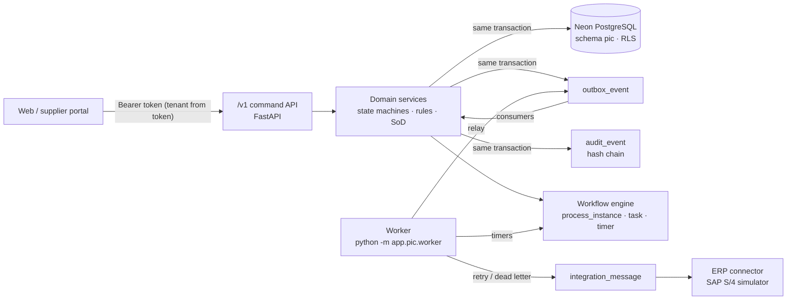

| Element | Implementation |
|---|---|
| Tenant isolation | Every request runs `SET LOCAL ROLE pic_app` and `app.tenant_id`; 85 tables have forced row-level security. |
| Workflow engine | Postgres-native engine standing in for Camunda 8: process instances, step history, human tasks (sequential or parallel), timers. |
| Rules | Effective-dated `rule_set` rows (DMN-01, DMN-02, DMN-03, PO-RISK, …). Every document stores the versions it used. |
| SoD | `sod_rule` + `action_log`, checked at command time for people and agents. Blocked attempts are written to `sod_violation`. |
| Events | Transactional outbox; consumers are idempotent (`processed_event`); failures retry up to 8 times. |
| ERP | `integration_message` with a unique idempotency key. The ERP is queried before any retry; failures dead-letter, and can be replayed from `/v1/integration/messages/{id}/replay`. |
| Audit | Append-only (the `pic_app` role cannot UPDATE or DELETE it). SHA-256 hash chain per tenant, verified at `GET /v1/audit/verify`. |
| Errors | RFC 9457 `application/problem+json` with `code`, `ruleRef` and `traceId`. Illegal transitions return 409; stale writes return 412. |

**Legend used in the diagrams:** rounded box = user task, square box = system task, diamond = gateway, circle = start/end event.

---

## F1 — MRP run → planned order → purchase requisition

Process key `pic.mrp-to-pr` · Module M02 · Service `services/planning.py`

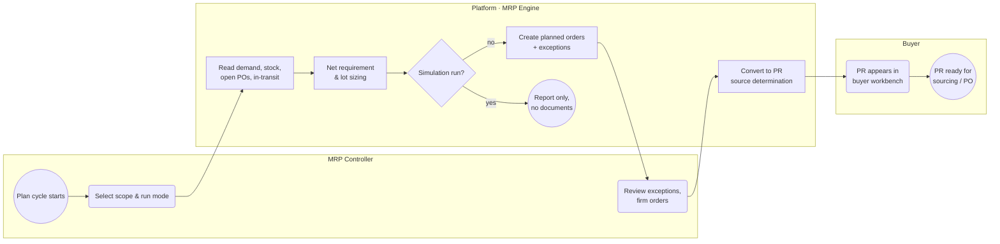

| Step | API | What the code enforces |
|---|---|---|
| F1-02 | `POST /v1/mrp/runs {plant, mode}` | Modes `NET_CHANGE` (materials whose demand changed since the last run), `REGENERATIVE`, `SIMULATION`. Only materials with MRP type `PD`. |
| F1-03/04 | (inside the run) | Daily buckets. Projected stock = on-hand + open PO + in-transit + firm planned receipts − gross demand. A planned order is created when projected stock drops below safety stock. Lot sizing: exact, fixed, EOQ, period, min/max, pack rounding. |
| F1-04 | | Release date = need date − (planned delivery + GR processing days) on the plant's factory calendar. |
| F1-05 | | Simulation stores the netting trace in `mrp_run.results` and ends without documents (tested). |
| F1-06 | | Unfirmed planned orders from earlier runs are deleted; firmed ones are never changed (RESCHEDULE_IN/OUT exceptions instead). Exceptions: PAST_DUE, BELOW_SAFETY, RESCHEDULE_IN. |
| F1-07 | `POST /v1/planned-orders/{id}/firm` | Event `planned_order.firmed`. |
| F1-08 | `POST /v1/planned-orders/{id}/convert` | Creates a PR with origin `MRP` (P02, immutable by database trigger), inheriting material, quantity, date, plant and storage location. Source determination order: contract → quota → source list → info record. The PR then goes through the same F2 approval controls. |
| F1-09/10 | (on PR approval) | The run instance ends when every planned order is converted. |

**Recorded path, MR-1043:**

| Step | Outcome |
|---|---|
| F1-02 | plant P100, net-change |
| F1-03 | 2 materials in scope |
| F1-04 | DC-330: 12,000 − (1,400 + 1,200 + 600 + 0) + 200 = **9,000** |
| F1-06 | 1 planned order (PLO-55821, need 12 Nov, release 30 Oct), 1 exception (DC-331 BELOW_SAFETY) |
| F1-07 | PLO-55821 firmed (mrp.controller) |
| F1-08 | REQ-2311 created; source: info record |
| F1-09/10 | REQ-2311 in buyer workbench after the 4-step approval |

---

## F2 — Guided buying → requisition

Process key `pic.requisition` · Module M04 · Service `services/requisition.py`

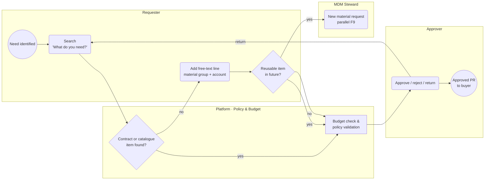

| Step | API | What the code enforces |
|---|---|---|
| F2-02 | `GET /v1/guided-buying/search?q=` | **P03** search order: contract item → catalogue item → material master → free text. The response says which channel to use and whether free text is allowed. |
| F2-02/04 | `POST /v1/requisitions` | **P04** free-text lines need a material group and can never reference a material (DB `CHECK free_text_no_material`). Purchase type (P08) per line. |
| F2-05/06 | (on create) | Lines flagged `reusable` start an F9 material request in parallel; the PR does not wait. |
| F2-07 | `POST /v1/requisitions/{id}/submit` | **P01** purpose code mandatory. Non-stock/service/expense/asset lines need an account assignment. **Quote policy:** free text below ₹25,000 needs none, below ₹2 L one, above that three quotes or a sourcing event. **Budget:** hard stop for asset/WBS, soft stop with justification for opex; commitment booked. **DMN-01** approver chain. |
| F2-08 | `GET /v1/tasks`, `POST /v1/tasks/{id}/complete` | Sequential approval. The requester and earlier approvers are excluded (four-eyes). Cost-object owner and department head are matched by ABAC (`cost_objects`, `plants`). SLA 2 business days, then escalation timer. Reject and return need a comment; reject/return release the budget commitment. |
| after | `PATCH /v1/requisitions/{id}/lines/{n}` | A change after approval restarts approval only if value, account or supplier changes. |

**DMN-01 approval route** (`rule_set` DMN-01@2026.1, values in ₹):

| PR value | Approvers |
|---|---|
| < 25,000, catalogue or contract | auto-approved |
| < 2,00,000 | cost-object owner |
| 2 L – 10 L | cost-object owner → department head |
| > 10 L | cost-object owner → department head → procurement head → finance controller |
| asset | + capex committee |

**Recorded paths:**
- **REQ-2311** (origin MRP, ₹36.9 L):
  - F2-07 budget not applicable (inventory purchase); route of 4 approvers.
  - F2-08 approved by COST_OBJECT_OWNER → DEPT_HEAD → PROCUREMENT_HEAD → FINANCE_CONTROLLER.
  - F2-09 to buyer workbench.
- **REQ-2312** (free-text fixture, ₹1.85 L, CC 4100):
  - F2-04 free text, F2-05 reusable → F2-06 MRQ-7731 started.
  - F2-07 budget OK, route COST_OBJECT_OWNER.
  - F2-08 approved by plant.controller.

---

## F3 — Strategic sourcing → award

Process key `pic.sourcing-award` · Module M05 · Service `services/sourcing.py`

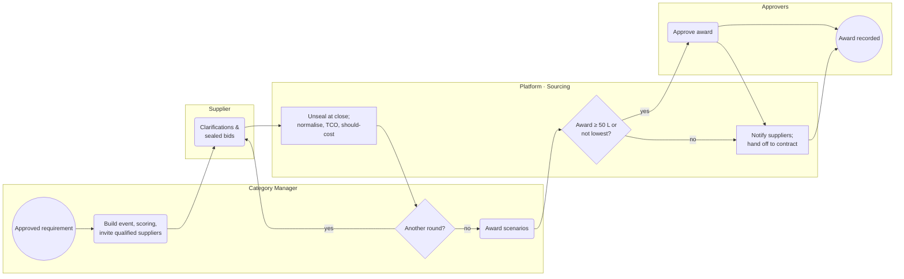

| Step | API | What the code enforces |
|---|---|---|
| F3-02 | `POST /v1/sourcing/events` | **P06**: lines only from approved requisitions; invitees only if Qualified for the category (Conditional needs a written waiver). Should-cost model; baseline by method (last price paid from the info record). |
| F3-02 | `POST /v1/sourcing/events/{id}/publish` | Weights must sum to 100 and lock at publish. Close timer created. `sourcing.event.published` → savings initiative *Identified*. |
| F3-03 | `POST /v1/sourcing/events/{id}/bids` (supplier) | Bids encrypted with a per-tenant key, SHA-256 hash recorded. Reading bids before close → **423 BIDS_SEALED** and an audited `BID_ACCESS_DENIED`. |
| F3-03/04 | close timer or `POST …/close` | At close: unseal, verify hash, compute TCO = price + freight + duty + packaging + carrying(lead time) + quality(PPM × CoPQ) − payment-term value. Bid Analysis agent run (L2). |
| F3-04 | `POST …/scores` | Manual criteria per evaluator; PRICE_TCO is computed. Each scoring action is logged for **SOD-05**. |
| F3-05 | `POST …/rounds` | Negotiation round; previous-round bids are superseded per supplier. |
| F3-06 | `POST …/scenarios` | LOWEST_COST, BEST_VALUE and CAPACITY_CONSTRAINED. The optimiser minimises Σ x·TCO subject to Σx = 1, x·Q ≤ verified twin capacity, min ≤ x ≤ max share, and the maximum number of suppliers (exact enumeration). |
| F3-06/07 | `POST …/award` | Non-lowest award needs a rationale; conflict-of-interest declaration mandatory; **SOD-05** (the sole evaluator cannot award). |
| F3-08 | tasks | AWARD-APPROVAL: below ₹50 L category manager; ₹50 L and above category manager → CPO → finance controller. The proposer is excluded. |
| F3-09 | | `sourcing.event.awarded` → contract drafts (F4) and savings *Negotiated*. |

**Recorded path, RFQ-2231:**

| Step | Outcome |
|---|---|
| F3-02 | published; weights locked |
| F3-03 | round 1 closed by timer (agent:SCHEDULER); 3 bids unsealed |
| F3-04 | TCO: TF001 398.00→402.50 · KD002 412.00→414.94 · SLA003 405.00→421.80 |
| F3-05 | yes: negotiation round 2 |
| F3-03/04 | round 2: KD002 405.00→408.01 |
| F3-06 | CAPACITY_CONSTRAINED proposed (LOWEST_COST and BEST_VALUE infeasible: capacity 60k/45k/70k < 90k/month) |
| F3-07 | yes: annual value ₹43,28,64,000.00, not the lowest bid |
| F3-08 | approved by CATEGORY_MANAGER → CPO → FINANCE_CONTROLLER |
| F3-10 | TF001 60% @ 398.00 / KD002 40% @ 405.00; **weighted 400.80** |

---

## F4 — Contract lifecycle

Process key `pic.contract` · Module M07 · Service `services/contract.py`

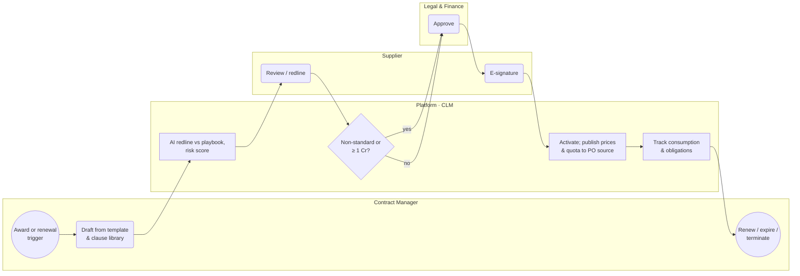

| Step | API | What the code enforces |
|---|---|---|
| F4-01/02 | consumer of `sourcing.event.awarded` | One scheduling agreement per awarded supplier: target quantity = share × annual quantity; price validity from the award; tolerances +2/−5; LME index ±3% band; clauses and obligations from the CLM playbook. |
| F4-03 | `POST /v1/contracts/{id}/review` | Contract Review agent (L2): clause positions STANDARD 0 / FALLBACK 30 / NON_STANDARD 70, with fallback suggestions. |
| F4-04 | `POST /v1/contracts/{id}/redlines` | Supplier redlines are audited with before and after text. |
| F4-05/06 | `POST /v1/contracts/{id}/submit` | ₹1 Cr and above, or any non-standard clause → LEGAL → FINANCE_CONTROLLER → CPO; otherwise contract manager. |
| F4-07 | `POST /v1/contracts/{id}/signatures` | Buyer (`contract:sign`) and supplier (portal user) both sign the same document hash. |
| F4-08 | `POST /v1/contracts/{id}/activate` | Requires all signatures with matching hashes. Publishes price validity to source determination and creates the 60/40 quota arrangement. `contract.activated` → savings *Contracted*. Renewal timer at −120 days; expiry timer. |
| F4-09 | `POST /v1/contracts/{id}/index-resets`, `GET …/consumption` | Index resets always add a new validity period and never overwrite. Within the band the price is unchanged and the absorbed increase is booked as **cost avoidance**. Consumption alerts at 80/90/100% (`contract.consumption.threshold`). Off-contract leakage is listed. |

**Recorded path, SA-5520:**

| Step | Outcome |
|---|---|
| F4-02 | drafted by the event relay with 6 clauses |
| F4-03 | contract risk 0, no deviations |
| F4-05 | yes: value ₹25,79,04,000.00 |
| F4-06 | approved by LEGAL → FINANCE_CONTROLLER → CPO |
| F4-07 | signed by buyer and supplier |
| F4-08 | active; price published |
| F4-09 | tracking; reset on 1 Jan 2027 at +0.74% absorbed |

---

## F5 — Purchase order → confirmation → delivery

Process key `pic.po` · Module M08 · Service `services/order.py`

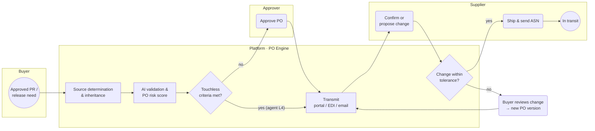

| Step | API | What the code enforces |
|---|---|---|
| F5-02 | `POST /v1/purchase-orders {source:{type:REQUISITION,id,lines}, supplierId?, contractRef?, release?}` | **P07** inheritance of PR, contract price valid on the need date, payment terms, Incoterms and tolerances. A quota splits the requirement (REQ-2311 9,000 → 5,400 + 3,600). A manual price outside contract tolerance needs a `deviationReason` (DB CHECK). **P08** purchase-type matrix sets GR/IR/SES/ERS flags. **SOD-01**: the supplier-master creator cannot create the PO. |
| F5-03 | `POST /v1/purchase-orders/{id}/validate` | PO Validation agent (L3). Additive risk: 18 if late-delivery probability ≥ 0.15, +35 if ≥ 0.30, 18 for price deviation, 40 if the supplier is not qualified, 15 if the value is above the band, 25 for a split pattern, 12 if the account assignment changed. |
| F5-04 | | **DMN-02** touchless: contract/catalogue price, supplier Qualified/Preferred, value ≤ ₹25 L, no split, late < 0.30, risk < 30. The Touchless PO agent (L4) releases only after its autonomy guard passes (kill switch, autonomy level, scope, value limit, acceptance rate). |
| F5-05 | tasks | Otherwise PO-APPROVAL: below ₹5 L a second buyer, above that also the procurement head. The creator is excluded. A blocked supplier → **422 PO_SUPPLIER_BLOCKED**. |
| F5-06 | | Status RELEASED → TRANSMITTED; confirmation SLA 24 h (timer → Expediting agent draft and buyer task). `purchase_order.released` → ERP PO posting and contract consumption. |
| F5-07/08 | `POST /v1/purchase-orders/{id}/confirmations` (supplier) | Hours to confirm recorded. Changes within tolerance are accepted; changes outside go to a buyer task. |
| change | `POST /v1/purchase-orders/{id}/versions` (If-Match) | Version n+1 snapshot in `po_version`; re-confirmation required; 412 on a stale ETag. |
| F5-09/10 | `POST /v1/asns` | Batches, e-way bill and CoC documents; ship quantity ≤ ordered + over-tolerance. Service POs hand over to F6 service entry instead. |

**Recorded paths:**
- **PO-77410:**
  - F5-02 TF001, inherited from REQ-2311 and SA-5520.
  - F5-03 risk 18/100 (LATE_RISK_MED +18).
  - F5-04 yes. F5-05 skipped, released by agent:TOUCHLESS_PO (L4).
  - F5-06 via portal. F5-07 confirmed in 6.00 h. F5-09 ASN-61208 with 2 batches. F5-10 in transit.
- **PO-77412** (service, manual price):
  - F5-04 no: price source MANUAL.
  - F5-05 approved by BUYER (buyer.lead).
  - F5-07 confirmed. F5-09 handed over to service entry.

---

## F6 — Goods receipt / service entry → quality

Process key `pic.receipt` · Module M09 · Service `services/receiving.py`

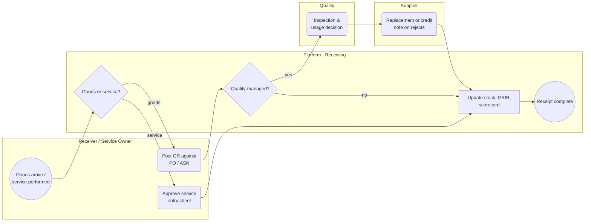

| Step | API | What the code enforces |
|---|---|---|
| F6-03 | `POST /v1/goods-receipts` | **SOD-03**: the PO creator cannot post the GR. Over-delivery beyond tolerance is blocked. Service lines are refused (they need an SES). Movement 101 to QUALITY or UNRESTRICTED stock. Batch, serial and expiry captured. ASN received quantities updated. |
| F6-05/06 | `POST /v1/inspection-lots/{id}/usage-decision` | Sample size per ISO 2859-1 (5,400 → 200). Accepted + rejected must equal the lot; rejections need a defect code and reason. Movement 321 to unrestricted, 350 to blocked. |
| F6-07 | (on rejection) | A return delivery is created (movement 122) and a credit note is expected from the supplier. |
| F6-08 | | `quality.usage_decision` → scorecard (OTIF, PPM) and digital-twin feedback. The GR is posted to ERP (exactly-once). |
| F6-04 | `POST /v1/service-entries`, `POST …/approve` | Service owner approval; the supplier user and the PO creator are both excluded. Value ≤ PO line. `service_entry.approved` accrues GRIR. |
| reversal | `POST /v1/goods-receipts/{id}/reverse` | Not allowed once invoiced and posted (use a return delivery instead). |

**Recorded paths:**
- **GR-90231:**
  - F6-03 5,400 against PO-77410/ASN-61208. F6-05 yes, quality stock.
  - F6-06 QL-2210: 5,380 accepted, 20 rejected (POROSITY).
  - F6-07 RD-4410: 20 returned, credit note requested.
  - F6-08 ERP material document 5000071230. F6-09 partially rejected.
- **SES-3301:** F6-02 service → F6-04 approved by SERVICE_OWNER → F6-08 → F6-09.

---

## F7 — Invoice → match → ERP posting → payment

Process key `pic.invoice` · Module M10 · Service `services/payables.py`

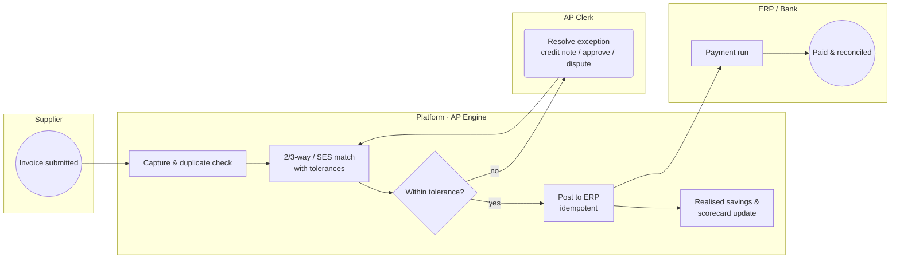

| Step | API | What the code enforces |
|---|---|---|
| F7-02 | `POST /v1/invoices` | Unique key (tenant, company code, supplier, invoice number, fiscal year) → 409 DUPLICATE_INVOICE. Fuzzy duplicate (amount ±₹1, date ±3 days) → hold. GST e-invoice IRN verified as SHA-256 of GSTIN + FY + type + number. |
| F7-03 | (on capture) / `POST …/match` | **DMN-03** per line: 3-way against accepted GR − already invoiced (0% qty); 2-way against PO; services against approved SES value; price ±1% or ₹500, whichever is lower; tax rate, HSN, tax amount and IRN. Credit notes reduce the matched quantity. |
| F7-04/05 | `POST …/credit-notes`, `POST …/exceptions/{id}/resolve` | Payment block until every exception is resolved. The Invoice Exception agent (L2) explains the cause from GR, inspection and return-delivery evidence. **SOD-04**: the PO creator cannot resolve exceptions on that PO. |
| approve | `POST …/approve` | **SOD-02a**: whoever changed the supplier's bank details cannot post its invoices. |
| F7-06 | `POST …/post` with `Idempotency-Key: tenant\|company code\|supplier\|invoice no` | Key format enforced (P13). `integration_message` is unique per key. A retry returns `replayed: true` and the same ERP document. A lost ERP response is resolved by query-before-retry (tested). |
| F7-08 | consumers of `invoice.posted` | Realised savings (only from posted invoices, P12); spend line with maverick flags; scorecard invoice accuracy; budget commitment → consumption. |
| F7-07/09 | `POST /v1/payments/runs` | Pays POSTED, unblocked, due invoices, net of credit notes. Skips suppliers still in the bank-change cooling-off period; alerts when bank details changed within 30 days; **SOD-02**. A partial unique index allows one live payment per invoice, so double payment is impossible (tested). |

**Recorded path, INV-TF-8812:**

| Step | Outcome |
|---|---|
| F7-02 | captured; no duplicate; IRN valid |
| F7-03 | 3-way: QUANTITY +20 |
| F7-04 | no → payment block |
| F7-05 | credit note CN-TF-221 received (ap.clerk) |
| F7-03 | 3-way: all lines within tolerance |
| F7-06 | posted as ERP **5100004421** (key AXN\|1000\|TF001\|INV-TF-8812) |
| F7-08 | realised savings ₹64,560.00 |
| F7-07 | PRUN-2611: PAY-880002 ₹25,26,663.20 (gross − CN) |
| F7-09 | paid; ERP clearing 1500002211; reconciled |

---

## F8 — Supplier onboarding & qualification

Process key `pic.supplier-onboarding` · Module M06 · Service `services/supplier.py`

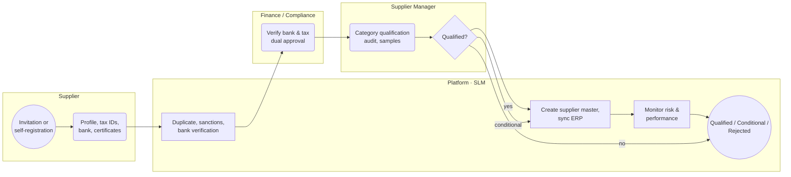

| Step | API | What the code enforces |
|---|---|---|
| F8-01 | `POST /v1/suppliers` | GSTIN encrypted (per-tenant key) with a blind index; PAN hashed. **SOD-01** action logged for the creator. Category status REGISTERED. |
| F8-02 | `POST /v1/suppliers/{code}/profile` | Supplier user or supplier manager. Certificates and the bank account (encrypted, masked) are stored and a bank change request is opened. |
| F8-03 | (on profile) | Duplicate screen (GSTIN blind index, legal-name similarity) and sanctions list; a sanctions hit blocks the supplier. |
| F8-04 | `POST /v1/bank-changes/{no}/callback`, then tasks | The call-back must be done by someone other than the requester. Two **different** finance controllers approve. 72-hour cooling-off before the first payment. **SOD-02** is logged for the requester. |
| F8-05/06 | `POST /v1/suppliers/{code}/qualifications`, `POST /v1/qualifications/{id}/assessment`, `…/decision` | Per category. Mandatory certificates (ALU-DIECAST: IATF 16949, ISO 14001) must be valid and verified; questionnaire ≥ 70, audit ≥ 75; PPAP sample. CONDITIONAL needs a waiver. |
| F8-07 | | Status ACTIVE; supplier master posted to ERP (vendor number). |
| F8-08 | timers | Certificate expiry → CONDITIONAL automatically. `POST /v1/suppliers/{code}/block` blocks new POs and opens a buyer task for each open PO. |

**Recorded paths:**
- **TF001:**
  - F8-02 profile with 2 certificates. F8-03 screening CLEAR, then bank call-back verified.
  - F8-04 FINANCE_CONTROLLER → FINANCE_CONTROLLER.
  - F8-05/06 ALU-DIECAST qualified. F8-07 ERP vendor 300001. F8-09 QUALIFIED.
- **MPC005:** waiting at the bank call-back (F8-03), as an example of an in-flight onboarding.

---

## F9 — Material master governance

Process key `pic.material-request` · Module M03 · Service `services/mdm.py`

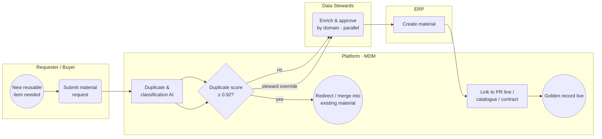

| Step | API | What the code enforces |
|---|---|---|
| F9-02 | `POST /v1/materials/requests` or `POST /v1/requisitions/{id}/lines/{n}/promote-material` | Only free-text lines can be promoted; the PR line stays free text (P04). |
| F9-03/04 | (on submit) | Score = 0.5 description + 0.3 MPN + 0.1 attributes + 0.1 classification. 0.92 or more blocks; 0.75–0.92 warns. Material Dedup agent run (L2). |
| blocked | `POST …/merge` or `POST …/override` | Merge redirects the requester to the existing material. An override needs a steward and a reason (**SOD-06**). |
| F9-05 | `POST /v1/materials/requests/{id}/decision` or tasks | Four parallel steward tasks (purchasing, quality, finance, plant), each matched by the steward's domain. The requester is excluded (**SOD-06**). |
| F9-06/07/08 | | Material created, posted to ERP exactly once, linked to the PR line; `material_request.approved`. |

**Recorded paths:**
- **MRQ-7731:** score 0 → 4 stewards approved → ERP material 100000331 → linked to REQ-2312 line 10 → golden record M-400001.
- **MRQ-7732:** score 1.0 → blocked → buyer redirected and merged into DC-330.

---

## 10. How the flows connect (events)

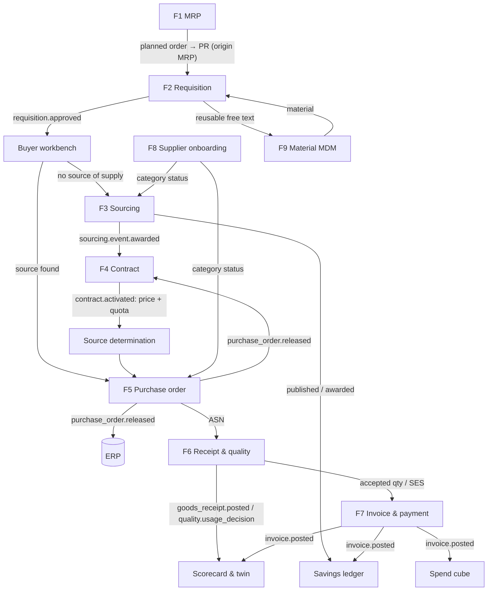

**Lineage:** every hop writes a `document_link` row. `GET /v1/lineage/{type}/{ref}` returns the graph. PO-77410's chain is PLO-55821 → REQ-2311 → RFQ-2231 → SA-5520, and it continues downstream to ASN-61208, GR-90231, INV-TF-8812, CN-TF-221, ERP 5100004421 and PAY-880002.

---

## 11. Document state machines

Every command goes through these transitions. Any other transition returns **409 ILLEGAL_TRANSITION**.

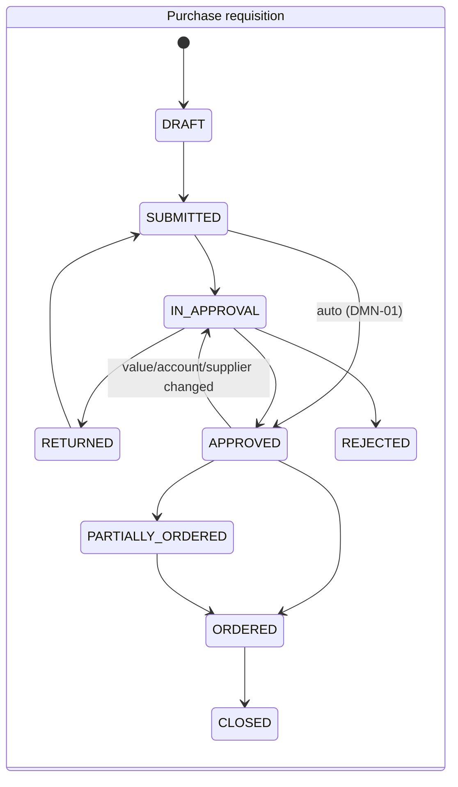

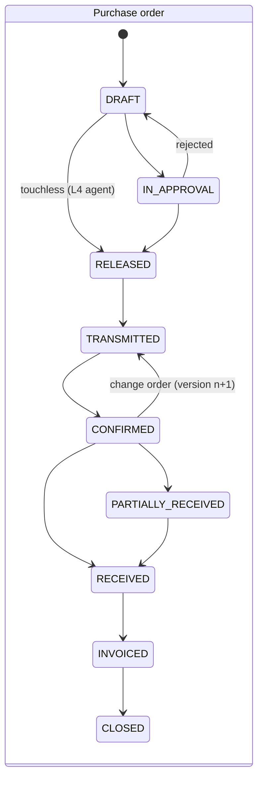

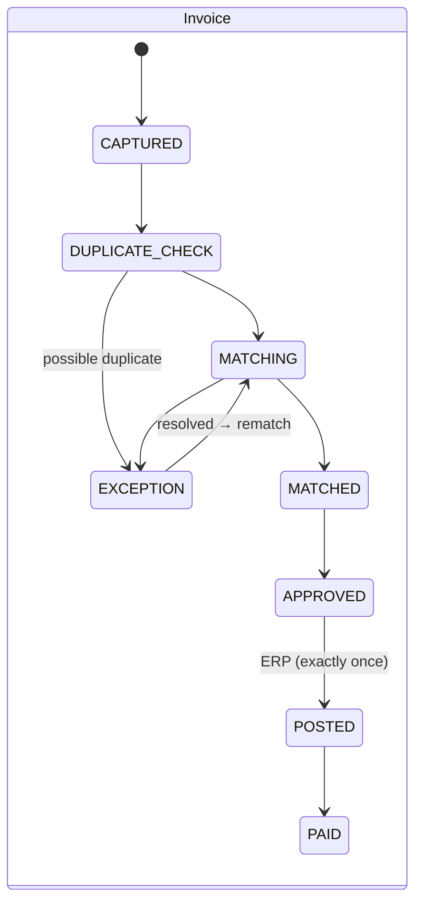

| Object | States (implemented) |
|---|---|
| Sourcing event | DRAFT → PUBLISHED → OPEN → CLOSED → UNDER_EVALUATION → (OPEN for another round) → AWARD_PENDING → AWARDED · CANCELLED |
| Contract | DRAFT → IN_NEGOTIATION → IN_APPROVAL → OUT_FOR_SIGNATURE → ACTIVE → EXPIRING → EXPIRED · TERMINATED · RENEWED |
| Goods receipt | POSTED → QUALITY_HOLD → ACCEPTED · PARTIALLY_REJECTED · REJECTED → REVERSED |
| Service entry | DRAFT → SUBMITTED → APPROVED · REJECTED → REVOKED |
| Planned order | CREATED → FIRMED → CONVERTED · DELETED |
| Material request | DRAFT → DUPLICATE_CHECK → IN_STEWARDSHIP · DUPLICATE_BLOCKED → APPROVED → SYNCED_TO_ERP · REJECTED · MERGED |
| Supplier (per category) | REGISTERED → UNDER_QUALIFICATION → QUALIFIED · CONDITIONAL → PREFERRED · BLOCKED · EXITED |
| Savings initiative | IDENTIFIED → NEGOTIATED → CONTRACTED → REALISING → VALIDATED · LOST |

---

## 12. Controls reference

### Segregation of duties (checked at command time)

| Rule | Conflict | Checked when | Result |
|---|---|---|---|
| SOD-01 | supplier-master creator ↔ PO for that supplier | PO create | 409 SOD_CONFLICT + `sod_violation` row |
| SOD-02 / 02a | bank-detail changer ↔ payment approval / invoice posting | payment run, invoice approve/post | blocked / skipped |
| SOD-03 | PO creator ↔ goods receipt on that PO | GR post | 409 (tested) |
| SOD-04 | PO creator ↔ invoice exception approval on that PO | exception resolve | 409 |
| SOD-05 | sole evaluator ↔ award | award proposal and approval | 409 |
| SOD-06 | material requester ↔ steward approval | steward task, override | 409 / excluded |
| SOD-07 | savings owner ↔ validation | savings validate | 409 |

Four-eyes on every approval chain: the initiator and earlier approvers in the chain are excluded from later tasks. The bank change requires two different finance controllers.

### Principles P01–P14 → where enforced

| ID | Enforcement in code | Proof |
|---|---|---|
| P01 | submit guard: purpose code | 422 RULE_VIOLATION |
| P02 | DB trigger `requisition_origin_immutable` | test_requisition_origin_is_immutable_p02 |
| P03 | guided-buying search order | `GET /v1/guided-buying/search` |
| P04 | DB CHECK `free_text_no_material`; promotion keeps the line free text | test_free_text_line_cannot_reference_material_p04 |
| P05 | F9 duplicate gateway + parallel stewards | MRQ-7731 / MRQ-7732 |
| P06 | event guards: approved requirement, qualified invitees, weights = 100 | test_unqualified_supplier_cannot_be_invited, test_weights_must_sum_to_100 |
| P07 | PO inherits contract price/terms; deviation reason CHECK | test_po_77410_inherits_contract_and_is_touchless |
| P08 | PURCHASE-TYPE-MATRIX rule set → GR/IR/SES flags | SES flow; service lines refused at GR |
| P09 | workflow tasks + SoD engine | test_sod03…, test_four_eyes… |
| P10 | `document_link` on every hop | lineageChain |
| P11 | `agent_run` with inputs, evidence, model version, autonomy level | `GET /v1/agents/{code}/runs` |
| P12 | ledger: negotiated (award), avoidance (index), realised (posted invoices only) | test_savings_three_kinds |
| P13 | `integration_message` unique key + query-before-retry + replay | test_invoice_post_is_idempotent, test_exactly_once_when_erp_response_is_lost |
| P14 | effective-dated `rule_set`; new versions via `POST /v1/admin/rules` | `rule_set_version` on every document |

---

## 13. Signature case: end-to-end results

| Blueprint figure | Result in the database |
|---|---|
| MR-1043 net 9,000 | MR-1043 net **9,000** → PLO-55821 (need 12 Nov 2026, release 30 Oct) |
| REQ-2311 from PLO-55821 | REQ-2311, origin MRP, 4-step approval, ORDERED |
| RFQ-2231 412 / 398 / 405; should-cost 391; baseline 410 | Same; should-cost **391.00**; baseline 410 from the info record |
| Dual source 60/40, weighted 400.8 | CAPACITY_CONSTRAINED: TF001 0.60 @ 398, KD002 0.40 @ 405, **400.80** |
| SA-5520 scheduling agreement, LME quarterly, 60-day terms | SA-5520 (TF001, N60, FCA Trichy, +2/−5) and SA-5521 (KD002) ACTIVE |
| PO-77410 risk 18, touchless | PO-77410 5,400 @ 398, risk **18**, released by agent:TOUCHLESS_PO; PO-77411 3,600 @ 405 |
| Confirmed in 6 h; ASN with batches and CoC | Confirmed in 6.00 h; ASN-61208, 2 batches, CoC, e-way bill |
| GR-90231: 5,400 / 5,380 / 20 (porosity) | GR-90231, QL-2210 sample 200; RD-4410 for 20 |
| INV-TF-8812 → +20 → CN-TF-221 → posted 5100004421 | Same; paid PAY-880002 ₹25,26,663.20 on 13 Jan 2027 |
| Negotiated 0.99 Cr/yr; avoidance 0.32 Cr | **0.99 Cr**; **0.32 Cr** (0.19 + 0.13 from the two contracts' Q1-27 reset) |
| Realised YTD 0.38 Cr (portfolio) | 0.01 Cr: realised savings come only from posted invoices, and this case has one (₹64,560) |

The seed also adds:
- an F2 free-text requisition with an F9 new material (REQ-2312 → MRQ-7731 → M-400001), and a blocked duplicate (MRQ-7732);
- an F6/F7 service path (REQ-2313 → PO-77412 → SES-3301 → HTS/1107, first-pass SES match);
- four suppliers fully onboarded through F8, and one (MPC005) still in progress.

---

## 14. Running it on Neon

1. Create `backend/.env` from `backend/.env.example`:
   - `DATABASE_URL` is the Neon connection string with `sslmode=require`; use the direct host for setup.
   - Generate `PIC_JWT_SECRET` and `PIC_FIELD_KEY`.
   - Optionally set `PIC_SEED_PASSWORD`.
2. From `backend/`, run:
   ```bash
   venv/Scripts/python -m app.pic.tools.neon_setup
   ```
   This does four things:
   - applies the PIC migrations (schema, role, RLS);
   - seeds the Axion case, skipped if tenant AXN exists;
   - loads the legacy data from `backend/data/legacy/supplier_twin.json` (see §17): it creates the legacy tables, copies all 15 legacy tables verbatim, migrates them into PIC tenants GMC and DBY, and writes `docs/PIC_Legacy_Migration_Report.md`;
   - prints a verification report covering row counts, RLS coverage, audit chains and pending events.
3. Run the API with `uvicorn app.main:app --port 8080`. Interactive docs are at `/docs`; the PIC routes are under `/v1`.
4. Run the worker with `python -m app.pic.worker`. It relays the outbox, fires timers and retries ERP postings.
5. Log in with `POST /v1/auth/token {"tenant":"AXN","email":"buyer@axion.example","password":"…"}`.
6. Run the tests with `python -m pytest tests/pic`. They need `TEST_DATABASE_URL`, a disposable database; they refuse to run against `neon.tech`.

**Demo users (tenant AXN)** — all `…@axion.example`:

| Area | Users |
|---|---|
| Admin and planning | `admin`, `mrp.controller`, `requester` |
| Approvers | `plant.controller`, `ops.head`, `procurement.head`, `cpo`, `finance.controller`, `finance.controller2`, `legal` |
| Buying, sourcing, contracts | `buyer`, `buyer.lead`, `category.manager`, `category.head`, `contract.manager`, `supplier.manager` |
| Data stewards | `mdm.purchasing`, `mdm.quality`, `mdm.finance`, `mdm.plant` |
| Receiving, quality, service, AP | `receiver`, `quality.engineer`, `quality.inspector`, `service.owner`, `ap.clerk` |
| Supplier users | `tf.sales`, `kd.sales`, `sla.sales`, `hts.service`, `mpc.sales` |

---

## 15. Operating cases (seeded after the signature case)

These cases run through the same services as the signature case (`backend/app/pic/seed/operations.py`, Jan–Mar 2027). Each one exercises a branch that the main path does not.

| # | Case | Flow branch exercised | Result in the data |
|---|---|---|---|
| 1 | February DC-330 release, 9,000 pcs | F2 manual stock PR → F5 quota split → F6 short shipment → F7 price exception | REQ-2315 → PO-77414 (TF 5,400) and PO-77415 (KD 3,600), both touchless. KD ships 3,420 (−5%, inside tolerance), so the receipt completes. INV-TF-9031 matches first time. KD/2702-118 bills 410 against the 405 contract → price exception → variance accepted with a note → **savings leakage** of ₹17,100 on SV-0412. |
| 2 | MRO catalogue buy, ₹18,500 | F2 auto-approval (catalogue < ₹25,000) → F5 touchless catalogue PO → F6 service entry | REQ-2314 approved by DMN-01 with no human → PO-77413 released by the L4 agent → unit-rate SES → HTS/1188 SES match → posted. |
| 3 | Duplicate invoice | F7 fuzzy duplicate hold → reject | KD/2702-118-R (same amount, date within 3 days) is held as an exception and rejected; nothing posted or paid. |
| 4 | Conditional supplier | F8 → CONDITIONAL with waiver | MPC005: bank call-back and dual approval, then qualified CONDITIONAL with the ISO 14001 waiver recorded. |
| 5 | Unqualified supplier + SoD | F5 risk +40 → approval; F6 SOD-03 block | PO-77416 (fasteners from KD002, not qualified for FASTENERS) is risk-scored 40 and approved by the buyer lead. The stores buyer who created it is blocked from posting its GR (SOD-03, logged in `sod_violation`); the receiver posts it. |
| 6 | Sanctions screening | F8-03 screening → automatic block | ZAT006 "Zenith Alloy Trading FZE" fuzzy-matches the screening-list entry "Zenith Alloys Trading FZE" and is **BLOCKED** at registration. Until the licensed feed is connected, the list (`sanction_entry`) holds fictitious `SAMPLE-LIST` names. |
| 7 | Source list → change order | F5 source determination (source list + info record) → approval → confirmation → change order → re-confirmation | REQ-2317 (DC-331, 2,000) → PO-77417 from the ERP source list: Trichy Forge is the fixed source, at the info-record price ₹212. The PO is not touchless (the price source is not a contract or catalogue), so it is approved and confirmed. The OEM then pulls the schedule in: the buyer raises the quantity to 2,400 and moves the date to 18 Mar. This creates **version 2** (`po_version`), the PO goes back to TRANSMITTED, and Trichy Forge re-confirms. |
| 8 | Supplier change request after confirmation | PO-03: supplier proposes → buyer task `PO_CHANGE_REQUEST` → change order → re-confirmation | Trichy Forge raises **PCR-501** on PO-77417 (furnace relining on cell 2, ship 20 Mar instead of 18 Mar). The buyer lead accepts it, which creates **version 3**; Trichy Forge re-confirms the same afternoon. |
| – | Month-end payment run, 31 Mar 2027 | F7-07 | PRUN-2612 pays HTS/1188 and KD/2702-118. INV-TF-9031 (N60, due 14 Apr) stays open, as expected. |

---

## 16. Workspace screens (web)

The web workspace is at `/pic`. Sign-in is at `/pic/login`; supplier users are sent to `/pic/portal`. Every screen reads live data through the web server's `/api/pic` route, which attaches the httpOnly session token.

| Area | Route | Blueprint screens |
|---|---|---|
| Command centre | `/pic` | AIX-01 (live KPIs, live event stream, recent audit) |
| Task inbox | `/pic/tasks` | REQ-03 (approve / return / reject with comment, four-eyes) |
| MRP | `/pic/mrp`, `/pic/mrp/[run]` | MRP-01/02/03 (run console, netting trace, firm / convert) |
| Requisitions | `/pic/requisitions`, `/new`, `/[ref]` | REQ-01/02 (guided search in enforced order, policy and budget feedback) |
| Buyer workbench | `/pic/buyer` | REQ-04 (source determination, create PO, risk and lineage result) |
| Materials | `/pic/materials`, `/[ref]` | MDM-01/02/03 (duplicate score, stewards, merge / override) |
| Sourcing | `/pic/sourcing`, `/new`, `/[ref]` | SRC-01..05 (builder, sealed bids, TCO matrix, scenarios, award) |
| Contracts | `/pic/contracts`, `/[ref]` | CLM-01..04 (review, approval, signatures, activation, index reset, consumption) |
| Suppliers | `/pic/suppliers`, `/new`, `/[code]` | SLM-01/02 (360 view, onboarding, bank call-back, qualification, block) |
| Purchase orders | `/pic/purchase-orders`, `/[ref]` | PO-01..04 (validation explained, change order, ASN) |
| Receiving | `/pic/receiving`, `/[ref]` | RCV-01..04 (inbound, GR, usage decision, SES, reversal) |
| Invoices | `/pic/invoices`, `/[id]` | INV-01..04 (capture, match detail, exceptions, credit notes, post, payment run, GR/IR) |
| Savings, spend | `/pic/savings`, `/pic/spend` | SAV-01/02 (+ new initiative), SPD-01..09 (overview, categories, suppliers, cube, compliance, maverick, classification review, category strategy, forecast) |
| Demand forecast | `/pic/mrp/forecast` | MRP-04 (bias, MAPE, override with reason, release to MRP) |
| Supplier performance, risk | `/pic/suppliers/performance`, `/pic/suppliers/risk` | SLM-03 (scorecards, CAPA, preferred / exit), SLM-04 (risk heat map, signals, mitigation) |
| Obligations, new contract | `/pic/contracts/obligations`, `/pic/contracts/new` | CLM-04, CLM-03 renewals calendar, CLM-01 manual contract |
| PO changes, expediting | `/pic/purchase-orders/changes`, `/expediting` | PO-03, PO-04 |
| Reconciliation, insights | `/pic/invoices/reconciliation`, `/insights` | INV-03, INV-04 |
| Copilot | `/pic/copilot` | AIX-02 (answer contract rendered in full) |
| Process monitor | `/pic/processes` | F1–F9 swimlanes and live instances |
| AI agents | `/pic/agents` | AIX-03 (autonomy editor, run now, recommendations inbox, runs, kill switch) |
| Administration | `/pic/admin` | ADM-01/02/04/05/06 (organisation, currencies and FX, users and roles, industry templates, rule versions, SoD, integration replay, audit + hash-chain check) |
| Supplier portal | `/pic/portal` | SLM-05 (confirm, ASN, service sheet, sealed bid, invoice, credit note, sign / redline) |

---

## 17. Legacy data migration (Docker supplier_twin)

The legacy app's live data was in the Docker Desktop container `supplier_twin_db` (PostgreSQL 15, database `supplier_twin`, 15 tables, 156 rows). The other containers on the machine belong to other projects and were not touched. The full reconciliation and the findings are in **`docs/PIC_Legacy_Migration_Report.md`**.

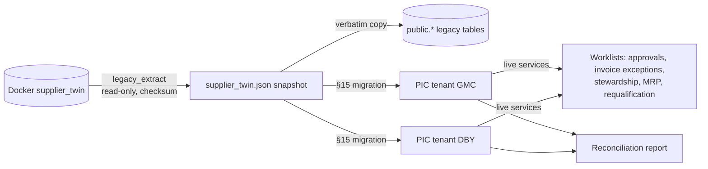

| Step | Command / module | What it does |
|---|---|---|
| Extract | `python -m app.pic.tools.legacy_extract` | Runs `psql` inside the container (no password handled) and writes `backend/data/legacy/supplier_twin.json` with row counts and a SHA-256. `--url` or `--sqlite` read other sources. |
| Schema drift | legacy Alembic `e3c1f2a4b5d6` | Adds 9 columns that the models and the Docker DB have but the legacy chain lacked (inventory category/unit/thresholds/location/status; stock-transaction notes/performed-by/balance). Uses `ADD COLUMN IF NOT EXISTS`, so it is safe on both. |
| Verbatim copy | `neon_setup` step 3a | All 15 tables go into `public` with their ids, `ON CONFLICT DO NOTHING`. |
| PIC migration | `app/pic/seed/legacy.py` | One PIC tenant per legacy buyer. Masters, open documents and paid history are loaded with legacy ids, audited `MIGRATED` and linked for lineage. The open items then run through the live services. |
| Report | `app/pic/tools/migration_report.py` | Counts and values legacy vs PIC, the live results and the control findings. |

**Results (rehearsed on a local PostgreSQL 16 copy of the Neon setup):**

| Tenant | Loaded | Live continuation | Key findings on the legacy data |
|---|---|---|---|
| **GMC**: Global Manufacturing Corp | 5 suppliers, 5 requisitions, 5 POs, 5 invoices, 2 payments; all counts and values match | PO-2026-6488 validated (risk 58: price deviation, supplier not qualified) → **IN_APPROVAL** task; 3 pending invoices → **MISSING_GR** exceptions; 3 flagged suppliers → requalification | Invoice paid **before the PO was approved**; 2 invoices paid without a goods receipt; PO value ≠ approved quotation |
| **DBY**: Dummy Buyer | 1 supplier, 9 materials + stock + 13 movements, 6 requisitions, sourcing event RFQ-2026-092 (2 rounds, 280 → 265), 6 POs, 3 ASNs, 3 GRs, 24 invoices, 13 payments; all counts and values match | 11 pending invoices → **DUPLICATE** hold; nozzles bought twice as free text → **MRQ-7731** with 4 steward tasks; MRP **MR-1043** on consumption forecast → PLO → **REQ-2312 in approval**; 2 below-safety alerts | **3 overpaid POs** (e.g. PO-2025-00089: 7 invoices paid, 192,000 against 29,500); a disputed invoice paid; 2 POs closed without a receipt; test postings flagged |

Users of the migrated tenants share the seed password. Internal users are `<role>@gmc.example` or `<role>@dby.example`. Where the legacy logs name a person, that person fills the matching role: for example, Elena Rostova is the DBY finance controller and Marcus Vance the DBY receiver. Legacy users keep their e-mail addresses; for example, `carriedavis@example.net` signs in to GMC's supplier portal as James-Hampton.

After the migration, **every PIC table holds data**. The one exception is `idempotency_record`, which fills at runtime from API calls that carry an Idempotency-Key.

---

## 18. Intelligence and governance modules

These modules sit on top of F1–F9. They read the documents the flows produce, raise work for people and agents, and feed decisions back into the flows. The gap analysis against the blueprint is in **`docs/PIC_Module_Gap_Analysis.md`**.

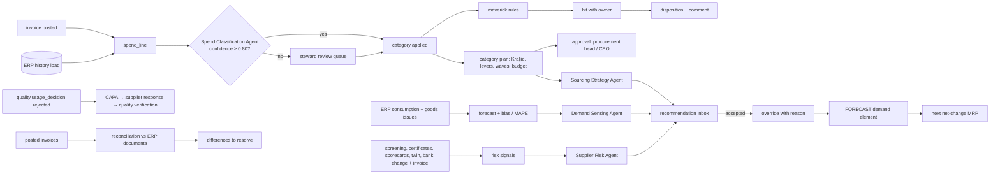

| Module | Trigger | Human decision | Rule set |
|---|---|---|---|
| Spend classification | Every spend line (on invoice posting or bulk load) | Steward accepts or reclassifies below 0.80 | `SPEND-GOVERNANCE` |
| Maverick rules | Every spend line | Owner disposes: accepted exception / recovery / policy breach / false positive, with comment | `maverick_rule` per tenant |
| Category strategy | `POST /v1/category-plans` | Procurement head or CPO approves; the owner cannot | — |
| Forecast review | `POST /v1/forecasts/generate` + Demand Sensing | MRP controller overrides (reason required) and releases to MRP | `DEMAND-SENSING` |
| Supplier risk | `POST /v1/supplier-risk/scan` or agent run | Supplier manager mitigates / closes | `SUPPLIER-RISK` |
| CAPA | Quality rejection on a usage decision | Supplier responds; quality verifies effectiveness | — |
| Preferred / exit | Supplier or category manager | Preferred needs 3-period OTIF ≥ 95% and PPM ≤ 1,000 | `SUPPLIER-RISK` |
| PO change request | Supplier (portal) or buyer | Buyer accepts → version n+1 → re-confirmation | `PO-APPROVAL` |
| Reconciliation | AP or finance runs it (nightly in production) | Resolve each difference | — |
| Agents | Events or `POST /v1/agents/{code}/runs` | Accept / reject (reject needs a comment); feedback drives acceptance rate and automatic suspension | autonomy policy per agent |

**Results on the rehearsal database:**
- **AXN, spend:** trailing 12 months (Oct 2025 – Sep 2026) is 415 Cr, 99% of it addressable; 70.5% is contracted and 6.2% maverick. The blueprint's AIX-01 figures are 412 Cr, 71% and 6.2%.
- **AXN, spend governance:** 433 maverick hits, 48 classification reviews and 15 category plans. ALU-DIECAST is approved as strategic.
- **AXN, forecasting:** DC-331 was over-forecast by 22%. The Demand Sensing recommendation was accepted, which set March 2027 to 17,227 and released it to MRP.
- **AXN, suppliers and finance:** CAPA-301 holds Trichy Forge's response, and reconciliation REC-101 found 0 differences.
