# PIC – Workflow Screens and Process Flows

AlphaHelion Purchasing Intelligence Cloud. The visual companion to the PIC Workflow Guide: for every module, the process flow as a swimlane diagram and the real screens a user works with at each step.

Date: 10 November 2026. Code baseline: `main` at commit `d111aca` (database migration head 0028). Written for: the client's process owners, key users and the implementation team.

## Contents

- [M01 Spend & Category Intelligence](#m01-spend--category-intelligence)
- [M02 MRP & Planning](#m02-mrp--planning)
- [M03 Material & Master Data (MDM)](#m03-material--master-data-mdm)
- [M04 Requisition & Guided Buying](#m04-requisition--guided-buying)
- [M05 Strategic Sourcing](#m05-strategic-sourcing)
- [M06 Supplier Lifecycle & Performance](#m06-supplier-lifecycle--performance)
- [M07 Contract Lifecycle Management](#m07-contract-lifecycle-management)
- [M08 Purchase Orders & Supplier Collaboration](#m08-purchase-orders--supplier-collaboration)
- [M09 Receiving, Quality & Inventory](#m09-receiving-quality--inventory)
- [M10 Invoice Matching, Payables & Finance](#m10-invoice-matching-payables--finance)
- [M11 Savings & Value Realisation](#m11-savings--value-realisation)
- [M12 Predictive Intelligence, Agents & Copilot](#m12-predictive-intelligence-agents--copilot)
- [Platform & Enterprise Administration](#platform--enterprise-administration)

## How to read this document

Each module section has three parts:

1. **Process flow.** A swimlane diagram of the main end-to-end path. Each lane is a role (or "System" for automatic steps). Boxes are steps, numbered in the order they happen. Diamonds are decisions, with the yes and no paths labelled. Rounded boxes at the edge are hand-offs to another module. A table under the diagram says which users hold each lane's role.
2. **Screen walkthrough.** One entry per step: the step number, the role, the screen ID and name, and the route under `/pic`. The screenshot shows the screen as built. Red numbered boxes on the screenshot are callouts; the numbered list under it explains each one. A last line says what happens next.
3. **Exceptions and alternative paths.** What happens when a check fails or a user rejects, and how it is resolved.

Steps with no screen (a system check, a background job, a message to the ERP) appear in the diagram and are described in the walkthrough without a screenshot.

The full rules, states, events, KPIs and open items of each module are in the PIC Workflow Guide (`docs/PIC_Workflow_Guide.md`), section by section.

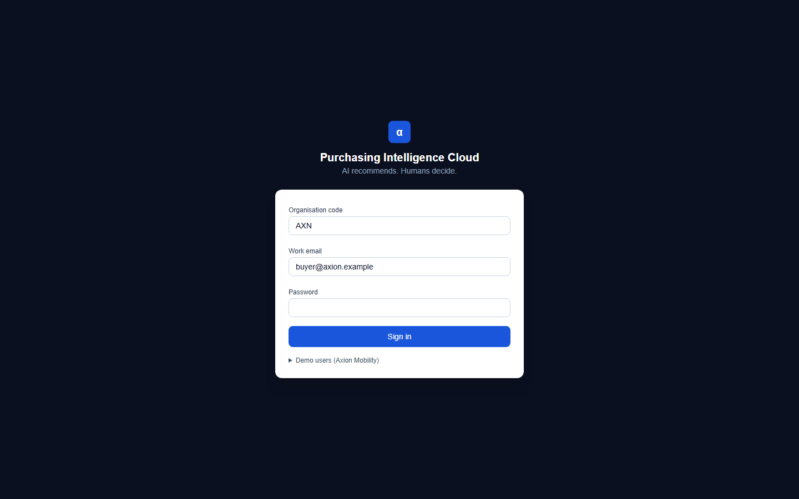

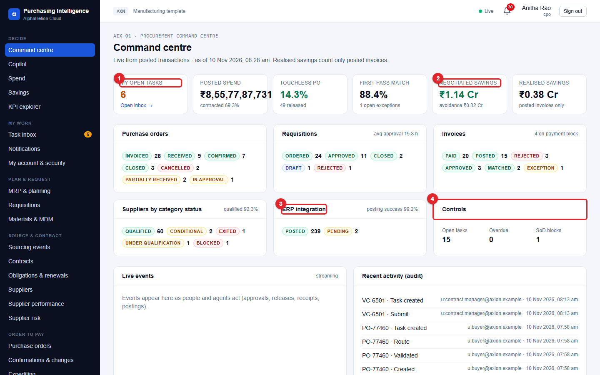

## About the screenshots

- They were taken from the current build running locally against a scratch copy of the demo data, never against production. The screens and data are the same as in the demo environment.
- The data is MOCK demonstration data: tenant AXN (Axion Mobility Systems, the signature-case manufacturer) and, for ERP-related screens, tenant KAC (Kaveri Auto Components, loaded from a mock SAP extract). Names, numbers and amounts are illustrative.
- Dates in the demo data run into 2027 and 2028 because the scenarios are set in the future business calendar of the demo.
- The sidebar shows only the menus the signed-in user's roles allow, so it differs between screenshots.

## The modules and how they connect

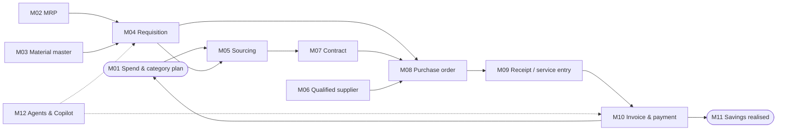

Every module runs on the platform services described in the last section: users and roles, segregation of duties, rule versions, workflows and the task inbox, the audit trail, and the integration with the ERP.

---

## M01 Spend & Category Intelligence

M01 turns posted supplier invoices, credit notes and debit notes into a classified spend cube and runs the governance work around it: the classification steward queue, maverick-spend hits, duplicate-supplier clusters and the category plans. Spend arrives on its own when accounts payable posts an invoice (M10); category managers, data stewards and the procurement head then work the queues and approve the category strategy. An approved category plan sets the category budget that every requisition is checked against (M04), and opportunities lead into sourcing (M05) and savings (M11). Text reference: PIC Workflow Guide, section M01.

### Process flow

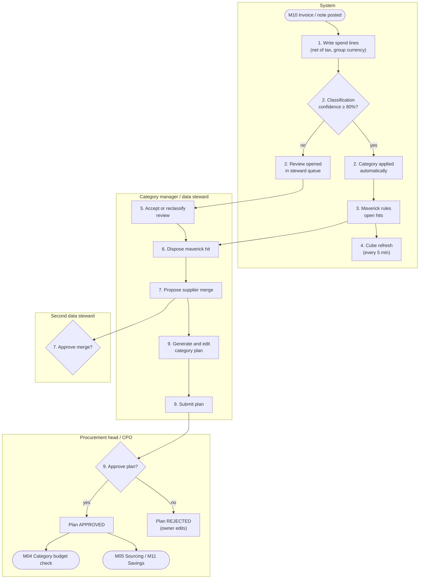

| Lane | Role(s) |
|---|---|
| System | Spend feed, Spend Classification Agent, maverick rules, cube refresh job |
| Category manager / data steward | Category Manager (`category.manager` on AXN, `category.head` on KAC), Master Data Steward |
| Second data steward | Master Data Steward who did not propose the merge (`mdm.purchasing` and the other `mdm.*` users) |
| Procurement head / CPO | Procurement Head (`procurement.head`), CPO (`cpo`); finance controller for payment-control hits |

### Screen walkthrough

#### Steps 1–4 · System · Spend lines, classification, maverick rules, cube refresh

No screen: when accounts payable posts an invoice (M10), the system writes one spend line per invoice line, net of GST, in the group currency (credit notes become negative lines, debit notes positive ones). The Spend Classification Agent applies the category when it is at least 80% confident and otherwise opens a review in the steward queue. The maverick rules in force on the document date open hits (MAV-…) with an owner role and a due date. The cube is refreshed every 5 minutes for the periods that changed.

#### Step 4a · Category manager · SPD-01 Spend overview
`/pic/spend?tab=overview`

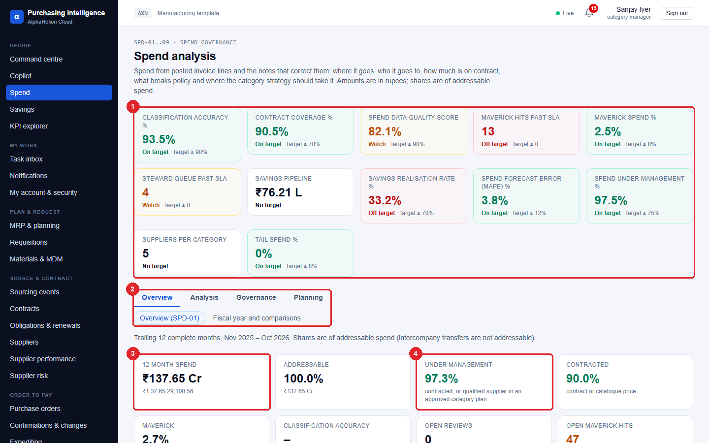

1. **KPI strip (M01)**: classification accuracy, contract coverage, data-quality score, maverick hits and steward reviews past SLA, savings pipeline, forecast error, spend under management, each against its target (green on target, amber watch, red off target).
2. **Areas and views**: Overview, Analysis (categories, suppliers, Pareto, cube, lines), Governance (compliance, maverick, classification, duplicates, data quality) and Planning (category strategy, savings pipeline, forecast). The URL keeps the view (`?tab=`).
3. **12-month spend**: trailing 12 complete months (here Nov 2025 – Oct 2026, ₹137.65 Cr), followed by addressable, contracted and maverick shares.
4. **Under management**: share of addressable spend that is contracted, or bought from a qualified supplier in a category with an approved category plan.

The figures are scoped to the user: this category manager sees only the categories in their attributes.

#### Step 4b · Category manager · SPD-04 Spend cube
`/pic/spend?tab=cube`

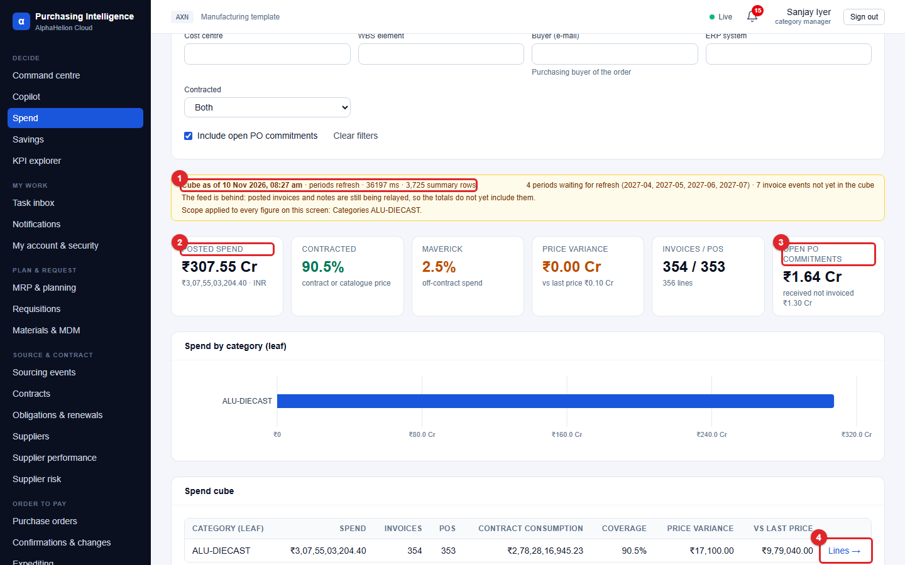

Above this part of the screen (scrolled out) the user picks the **dimensions** (category levels, supplier, parent, plant, company code, cost centre / WBS, material group, buyer, period, fiscal year and quarter, currency, ERP system, contracted; the chart groups by the first one) and the **filters** (period range, category, plant, supplier, company code, currency, cost centre, WBS, buyer, ERP system, contracted), which can be saved as views.

1. **Cube status**: when the cube was last built, periods still waiting for refresh and invoice events not yet in the cube ("the feed is behind"), and the scope applied to this user (here category ALU-DIECAST).
2. **Posted spend** for the filters (₹307.55 Cr), with contracted and maverick shares, price variance and invoice / PO counts.
3. **Open PO commitments** (₹1.64 Cr) and received-not-invoiced value: open orders are shown next to spend but are never counted as spend.
4. **Lines →**: drills from a cube row to its invoice lines, which can be exported as CSV.

The chart and the table group the spend by the first dimension chosen (here category, leaf level).

#### Step 5 · Category manager / data steward · Classification steward queue
`/pic/spend?tab=classification`

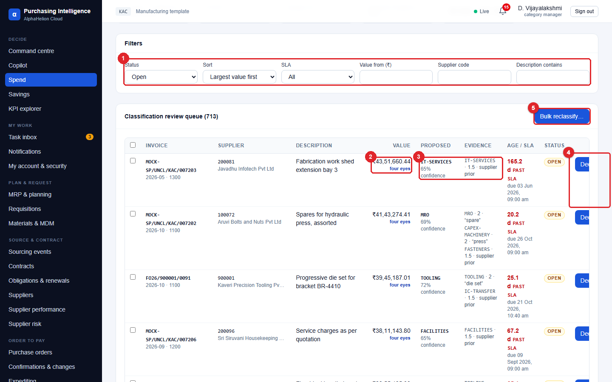

1. **Filters**: status (open, pending second steward, decided), sort (largest value first, due date, confidence, age), SLA, value from, supplier and description. Above them (scrolled out) the queue KPIs: open reviews, past SLA, oldest, accept rate and age buckets.
2. **Value with "four eyes"**: lines worth ₹25 lakh or more; reclassifying them needs two different stewards.
3. **Proposed category and evidence**: the agent's proposal with its confidence (here IT-SERVICES at 65%) and the alternatives with the matched keywords or the supplier prior.
4. **Decide** (row action, at the right edge of the table): opens the decision dialog below. The Age / SLA column shows overdue reviews in red ("past SLA").
5. **Bulk reclassify…**: decides up to 500 selected reviews in one go; each row is checked on its own and refused rows are reported.

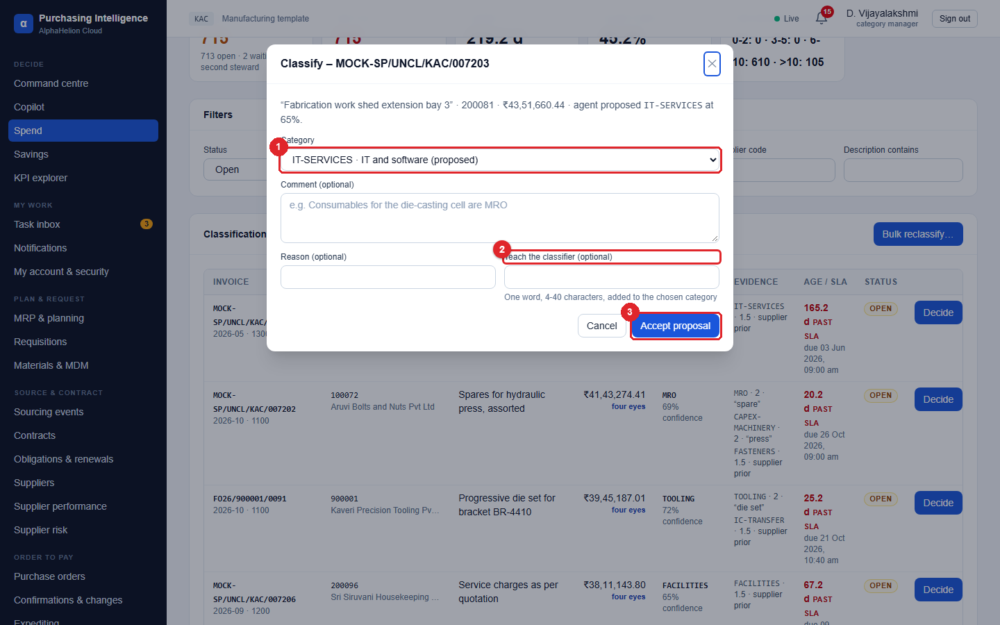

1. **Category**: the agent's proposal is preselected. "Fabrication work shed extension bay 3" was proposed as IT-SERVICES at 65%, a typical case for the steward to correct.
2. **Teach the classifier**: an optional keyword (one word, 4–40 characters) added to the chosen category, so similar lines are classified automatically next time; comment and reason are optional.
3. **Accept proposal**; with another category the button reads **Reclassify**, or **Record first decision** at or above ₹25 lakh: the review is then parked as "Pending" until a second steward confirms the same category (**Confirm category**); a different choice reopens the review.

The decision moves the line (and its credit and debit notes) to the chosen category, and the cube re-materialises those periods.

#### Step 6 · Category manager (owner role) · SPD-06 Maverick hits
`/pic/spend?tab=maverick`

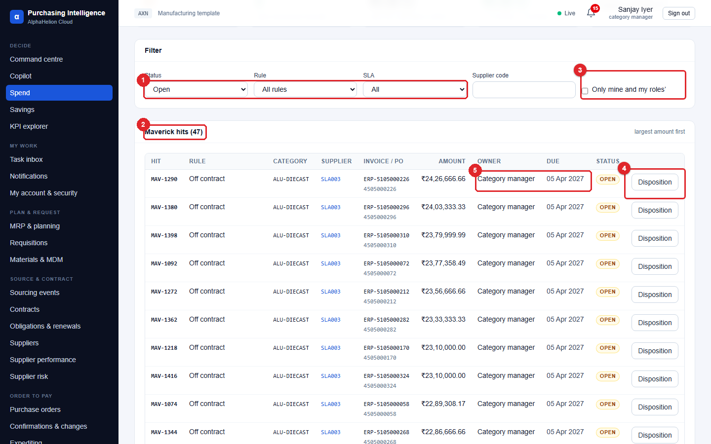

1. **Filter**: status (open, recovery open, disposed, resolved), rule, SLA (open and past SLA) and supplier code. Above the filter (scrolled out) the KPI row shows open hits, hits past SLA, savings at risk, recovered amounts and open hits by owner role.
2. **Maverick hits (47)**: the open hits this category manager may see, largest amount first.
3. **Only mine and my roles’**: limits the list to hits owned by the user or by one of their roles.
4. **Disposition**: offered on open hits the user may decide.
5. **Owner and due date**: the owner role from the rule (here category manager for "Off contract") and the SLA due date; escalated hits show "escalated ×1 to …".

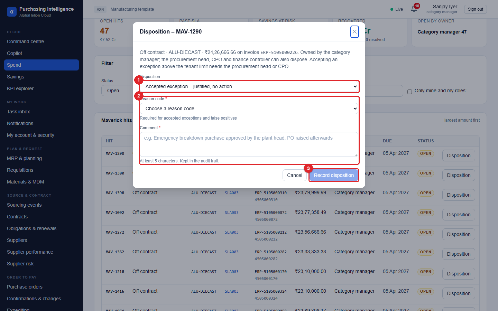

1. **Disposition**: accepted exception (justified, no action), false positive, policy breach, or recovery (the hit moves to "Recovery open").
2. **Reason code and comment**: a reason code is required for accepted exceptions and false positives; the comment (at least 5 characters) is kept in the audit trail. The header repeats the rule, category, amount and invoice and who else may dispose.
3. **Record disposition** closes the hit as Disposed, or opens the recovery.

A hit sent for recovery later shows **Resolve recovery**, where the recovered amount (at most the hit amount) is entered when the supplier credit or debit note is booked (M10).

#### Step 7 · Data steward · Duplicate suppliers
`/pic/spend?tab=duplicates`

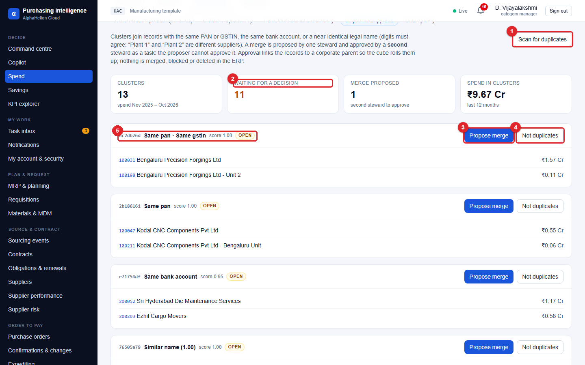

1. **Scan for duplicates**: finds clusters by same PAN or GSTIN (score 1.00), same bank account (0.95) or a near-identical legal name (0.92 or more; digits must agree, so "Plant 1" and "Plant 2" stay apart).
2. **Waiting for a decision**: 11 of the 13 clusters are open; one merge is proposed and waits for a second steward; ₹9.67 Cr of 12-month spend sits in clusters.
3. **Propose merge**: choose the survivor (by default the supplier with most spend) and add a note; a merge task opens for a data steward other than the proposer.
4. **Not duplicates**: dismisses the cluster with a reason.
5. **Why the records match**: here same PAN and same GSTIN, score 1.00; below it the suppliers with their 12-month spend (Bengaluru Precision Forgings Ltd and its Unit 2).

A proposed merge waits for a second steward (Step 7b).

#### Step 7b · Second data steward · REQ-03 Merge approval in the task inbox
`/pic/tasks`

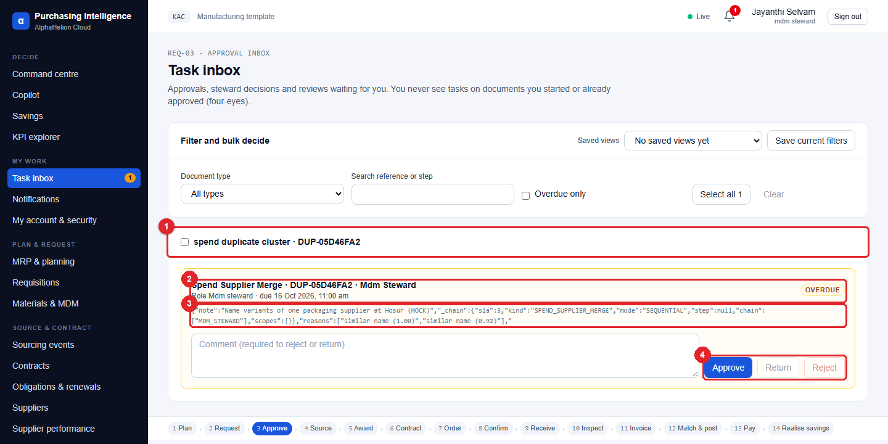

1. **The task**: "spend duplicate cluster · DUP-05D46FA2", in the inbox of an MDM steward other than the proposer.
2. **Task header**: Spend Supplier Merge for the MDM steward role, due 16 Oct 2026, flagged Overdue (SLA 3 business days).
3. **Evidence**: the proposer's note and the match reasons (here similar names, scores 1.00 and 0.92). The evidence is currently shown as raw data text, not as formatted fields.
4. **Approve / Return / Reject**: a comment is required to return or reject.

Approval links the other records to the survivor (MOCKD-201) as their corporate parent so the cube rolls them up; nothing is merged, blocked or deleted in the supplier master or the ERP.

#### Step 8 · System · Data quality

No screen in this walkthrough: the daily `spend-quality` job (or a user running the assessment on Governance › Data quality) scores the spend data 0–100 on 14 checks; the score feeds the KPI strip (Step 4a).

#### Step 9 · Category manager → procurement head · SPD-07 Category strategy
`/pic/spend?tab=strategy`

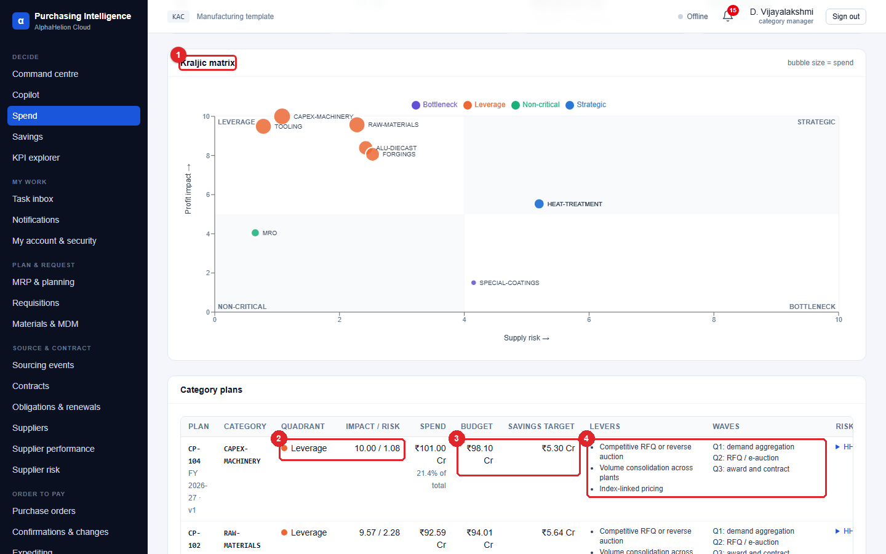

1. **Kraljic matrix**: every category placed by supply risk (x) and profit impact (y), bubble size = spend: leverage (TOOLING, CAPEX-MACHINERY, RAW-MATERIALS, ALU-DIECAST, FORGINGS), strategic (HEAT-TREATMENT), non-critical (MRO), bottleneck (SPECIAL-COATINGS).
2. **Quadrant and impact / risk** of each plan (here CP-104 CAPEX-MACHINERY, FY 2026-27, version 1).
3. **Spend, budget and savings target**: trailing spend, the plan budget (from the spend forecast) and the savings target, capped by the plan rules.
4. **Levers and waves**: the levers from the lever catalogue and the dated waves (demand aggregation, RFQ / e-auction, award and contract).

**Regenerate plans** (above the matrix) creates draft plans for every category with addressable spend; approved and in-approval plans are left alone. **Open** on a row shows the plan; the owner can **Edit plan** and **Submit for approval**.

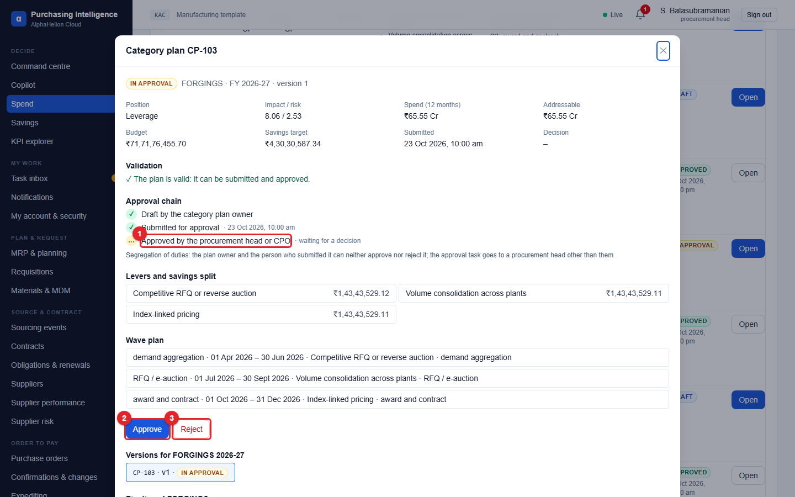

1. **Approval chain**: drafted by the owner, submitted on 23 Oct 2026, now waiting for the procurement head or CPO. The plan owner and the submitter can neither approve nor reject (segregation of duties).
2. **Approve**: the plan becomes Approved (a previously approved version becomes Superseded); its budget is now used by the category-budget check of requisitions.
3. **Reject**: needs a comment; the owner edits the plan and submits it again.

Above the chain the plan shows its position (Leverage), impact / risk, spend, budget (₹71.72 Cr), savings target (₹4.30 Cr) and the validation result; below it the savings split by lever and the wave plan. On an approved plan, **Revise (new version)** starts a new draft.

#### Step 10 · Hand-off

No screen: an approved plan with a budget is the category budget checked when requisitions are submitted (M04 Step 4); opportunities open a new sourcing event (M05); savings initiatives belong to M11; recovered maverick hits lead to supplier credit or debit notes (M10).

### Exceptions and alternative paths

| Exception | What the user sees | How it is resolved |
|---|---|---|
| Line classified below the 80% threshold | A review in the steward queue with the proposed category, alternatives and the due date (Step 5) | A steward accepts the proposal or picks another category; overdue reviews are flagged "past SLA" |
| Reclassification of a line worth ₹25 lakh or more | The review shows status "Pending" with "first steward chose …" (Step 5) | A second, different steward must choose the same category; a different category reopens the review |
| Keyword already belongs to another category | The decision is refused with a keyword conflict | Choose another keyword or leave the field empty |
| Maverick hit past its SLA | Hit shown "past SLA"; Owner column shows "escalated ×1 to …" (Step 6) | The `spend-sla` job escalates to the rule's escalation role, then to the CPO |
| Accepting an exception above ₹1 crore | The disposition is refused for a category manager | The procurement head or CPO records the disposition |
| Hit sent for recovery | Status "Recovery open" with a "Resolve recovery" button | Enter the recovered amount (at most the hit amount) when the supplier credit or debit note is booked (M10) |
| Proposer tries to approve their own supplier merge | No decision form is shown to the proposer | Another data steward approves or rejects in the inbox (Step 7b) |
| Category plan rejected | Plan status "Rejected" | The owner edits the plan (it returns to Draft) and submits it again |
| Plan owner or submitter tries to approve | Approve and Reject are not offered | The procurement head or CPO decides (Step 9) |
| Foreign-currency line without an FX rate | Excluded from totals; counted in the data-quality checks | Load the FX rates; the line is then included at the next refresh |
| Cube behind the invoice feed | Yellow note "The feed is behind … periods waiting for refresh" on the cube (Step 4b) | The `spend-cube-refresh` job (every 5 minutes) or an admin full refresh rebuilds the dirty periods |

---

## M02 MRP & Planning

M02 turns demand (forecasts, customer orders, reservations, project demand) into planned orders and then into purchase requisitions. The MRP controller starts a run, reviews the netting and the exceptions, firms the orders that must not change and converts them into requisitions; Kanban materials skip MRP and raise a requisition when a bin is signalled empty. The requisitions are approved in M04 and then reach the buyer workbench, where the buyer creates the purchase order (M08) or a sourcing event (M05). Text reference: PIC Workflow Guide, section M02.

### Process flow

**MRP run to requisition**

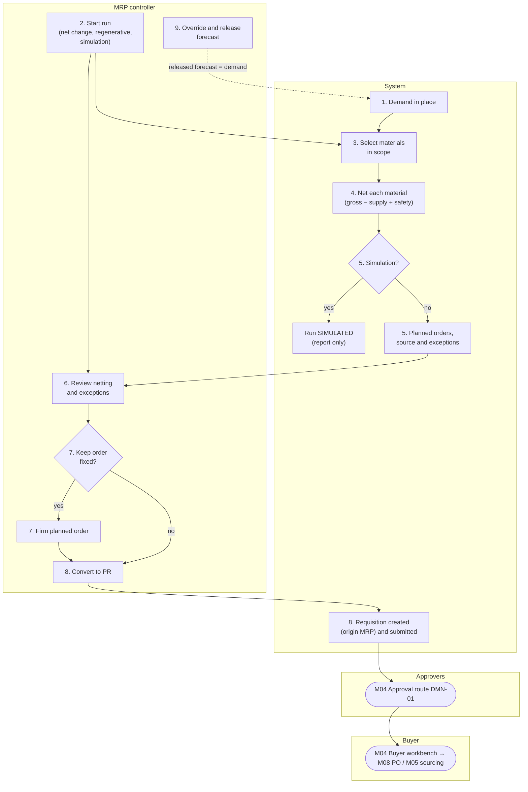

**Kanban replenishment**

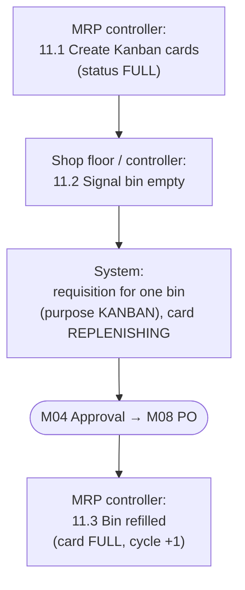

| Lane | Role(s) |
|---|---|
| MRP controller | MRP Controller / Planner (`mrp.controller`) |
| System | MRP engine, source determination, MRP Exception Agent, Demand Sensing Agent |
| Approvers | Cost-object owner (`plant.controller`), department head (`ops.head`), procurement head, finance controller, by value (M04) |
| Buyer | Buyer (`buyer`) |

### Screen walkthrough

#### Step 1 · System · Demand in place

No screen: demand elements (customer orders and project demand from the ERP, reservations from M09, released forecasts from Step 9, ERP delta syncs) are stored with a change time. A change in demand is what brings a material into the next net-change run.

#### Step 2 · MRP controller · MRP-01 Run console
`/pic/mrp`

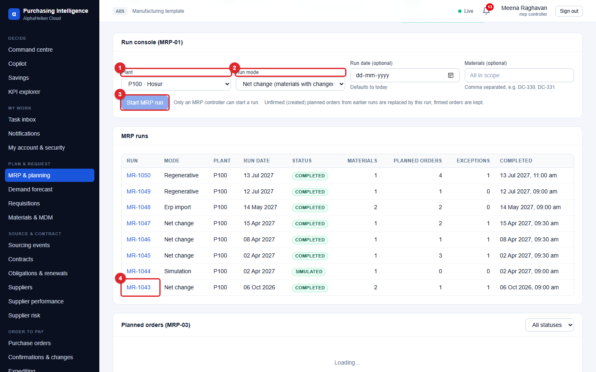

1. **Plant**: the plant to plan (here P100 Hosur).
2. **Run mode**: net change (only materials whose demand changed since the last run), regenerative (all planned materials, or the listed ones) or simulation (netting report only, nothing saved). Run date and a material list are optional.
3. **Start MRP run** starts the run. The note next to it reminds the controller that unfirmed planned orders from earlier runs are replaced, while firmed orders are kept.
4. **MRP runs** lists every run with its mode, status (Completed, Simulated), the number of materials planned, planned orders and exceptions. Run MR-1043 is the signature case; click a run to open it.

The system numbers the run (MR-…), plans the materials in scope and ends the run Completed (or Simulated); the MRP controllers of the plant are notified.

#### Step 3–5 · System · Scope, netting, planned orders and exceptions

No screen: only active materials with MRP type PD (daily), PW (weekly), PM (monthly) or VB (reorder point) are planned; Kanban (KB) and no-planning (ND) materials are skipped. For each material the system nets gross demand against on-hand stock, open POs, goods in transit and firmed receipts, adds safety stock, sizes the lot and dates the proposal back from the need date by the planned delivery and goods-receipt days. It then finds the source (contract, quota, source list, info record, else "none" for the buyer queue), writes planned orders PLO-… and records exceptions with their value at risk.

#### Step 6 · MRP controller · MRP-02 Run result and netting trace
`/pic/mrp/MR-1043`

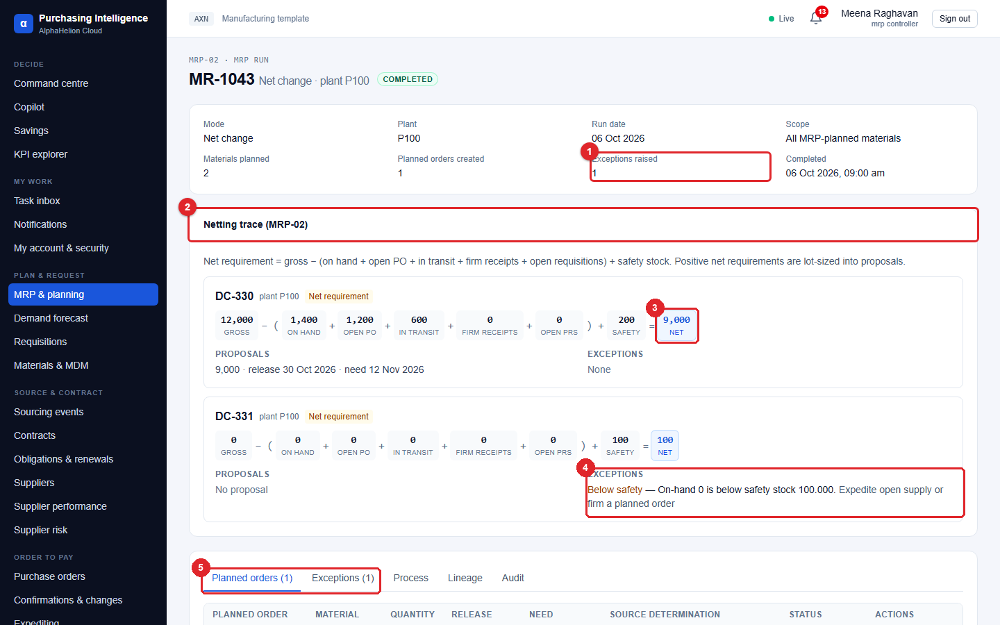

1. **Run header**: mode, plant, run date, scope and the counts. MR-1043 planned 2 materials, created 1 planned order and raised 1 exception.
2. **Netting trace**: one card per material with the calculation written out: gross − (on hand + open PO + in transit + firm receipts + open requisitions) + safety stock = net.
3. **DC-330**: 12,000 − (1,400 + 1,200 + 600 + 0 + 0) + 200 = **9,000**. The proposal below it is 9,000 pieces, release 30 Oct 2026, need 12 Nov 2026.
4. **DC-331**: the exception "Below safety": on-hand 0 is below the safety stock of 100, with the recommended action (expedite open supply or firm a planned order).
5. **Planned orders / Exceptions tabs**: the planned orders of this run (with Firm and Convert actions) and the exception list with value at risk.

The controller now decides, per planned order, whether to firm it, convert it or leave it to the next run (Steps 7 and 8).

#### Step 6b · MRP controller · MRP-02 Exception messages on a firmed order
`/pic/mrp/MR-1047`

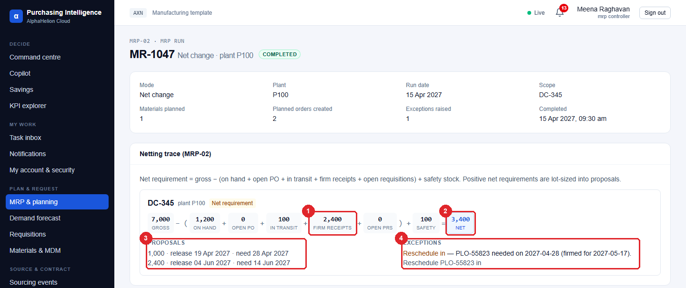

1. **Firm receipts 2,400**: planned order PLO-55823 was firmed earlier, so this run counts it as supply and does not change it.
2. **Net 3,400**: 7,000 − (1,200 + 0 + 100 + 2,400 + 0) + 100.
3. **Proposals**: the run proposes two new orders, 1,000 (need 28 Apr 2027) and 2,400 (need 14 Jun 2027).
4. **Exception "Reschedule in"**: PLO-55823 is needed on 28 Apr 2027 but is firmed for 17 May 2027. Because a firmed order is never moved by MRP, the run raises a message for the controller instead.

The controller acts on the message (convert the firmed order now, or cancel it with a reason) from the Planned orders tab or MRP-03.

#### Steps 7–8 · MRP controller · MRP-03 Planned orders: firm and convert to requisition
`/pic/mrp` (card "Planned orders (MRP-03)") or the Planned orders tab of a run

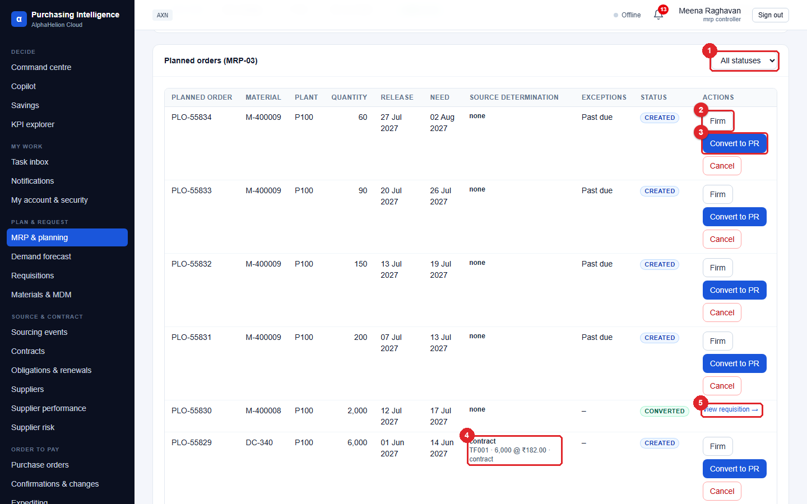

1. **Status filter**: all statuses, or only one status (created, firmed, converted, deleted).
2. **Firm**: Created → Firmed. Later runs no longer change or delete a firmed order; they raise reschedule or cancel messages instead (Step 6b).
3. **Convert to PR**: allowed from Created or Firmed; creates and submits the requisition.
4. **Source determination**: the source found for the order, here a contract with supplier TF001 at ₹182.00 for DC-340 (from the ERP-import run MR-1048); "none" means the buyer must find a source.
5. **View requisition →**: on a converted order, the link to its requisition.

The planned-order list shows order number, material, plant, quantity, release and need dates, the source determination, exception codes and status, and can be filtered by status. Actions per order: **Firm** (Created → Firmed; later runs no longer change it), **Convert to PR** (from Created or Firmed), **Unfirm** and **Cancel** (both with a reason). Converting creates a requisition REQ-… with origin MRP and one stock line (material, quantity, need date, plant, source and price), submits it at once and links it on the order ("View requisition →"). Demo: run MR-1047 has PLO-55826 and PLO-55827 (Created); PLO-55823 and PLO-55828 are Firmed.

#### Step 8a · Approvers · Approval of the MRP requisition (M04)
`/pic/requisitions/REQ-2311`

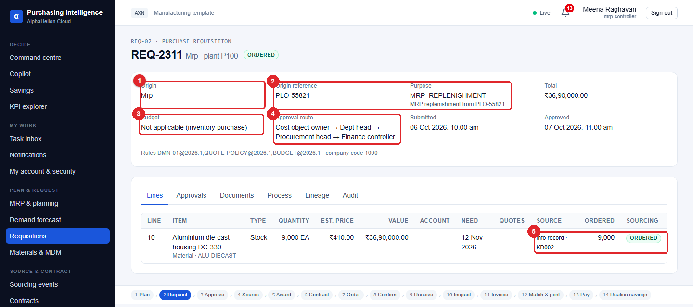

1. **Origin MRP**: set by the conversion and never changed afterwards; only the MRP controller (or an agent) can create MRP-origin requisitions.
2. **Origin reference and purpose**: planned order PLO-55821, purpose MRP_REPLENISHMENT; total ₹36,90,000.
3. **Budget "Not applicable (inventory purchase)"**: stock lines without an account assignment skip the cost-object budget check.
4. **Approval route**: cost-object owner → department head → procurement head → finance controller (value above ₹10 lakh), submitted 6 Oct and approved 7 Oct 2026.
5. **Line 10**: 9,000 EA of DC-330 at ₹410.00, need date 12 Nov 2026, source "Info record · KD002" carried over from the planned order; now fully ordered.

The MRP requisition follows the normal M04 controls and the DMN-01 route by value; the MRP controller who converted is the requester and is excluded from approving. Demo: REQ-2311 (origin MRP, ₹36.9 lakh, from PLO-55821) was approved through the four-step chain and is now ordered.

#### Step 9 · MRP controller · MRP-04 Demand forecast review
`/pic/mrp/forecast`

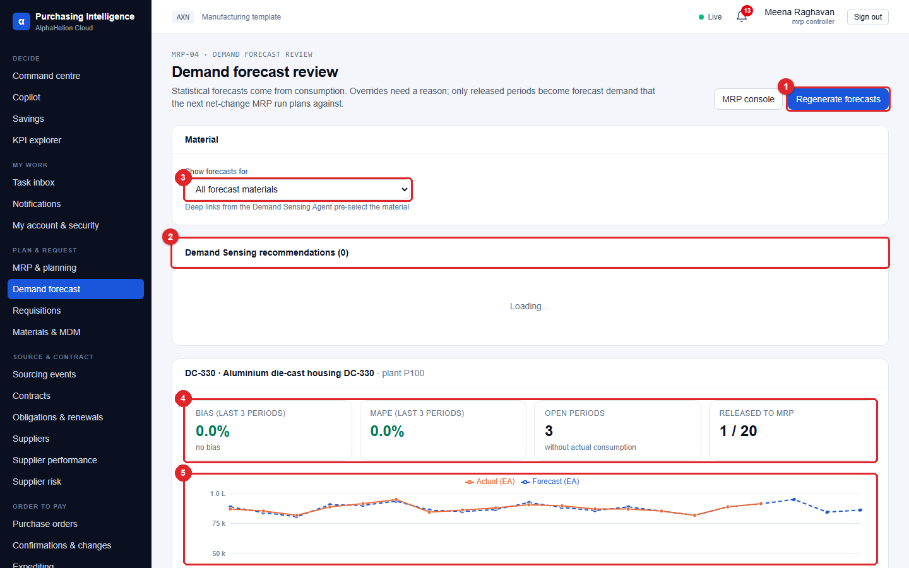

1. **Regenerate forecasts**: refreshes the actuals from goods issues (or the loaded ERP consumption history) and recomputes the statistical forecast.
2. **Demand Sensing recommendations**: overrides the agent proposes when the forecast bias over the last three periods exceeds the tenant threshold (none open at the time of the screenshot).
3. **Show forecasts for**: all forecast materials, or one material (deep links from the agent pre-select it).
4. **Per material and plant**: bias and error (MAPE) over the last three periods, open periods without actual consumption, and how many periods are released to MRP (DC-330: 1 of 20).
5. **Actual versus forecast** by month; below the chart (not shown) each period has its statistical, override and actual quantity with **Override** (new quantity and a reason of at least 5 characters) and release.

Only released periods become forecast demand (FC-YYYY-MM) that the next net-change run plans; a statistical forecast never reaches MRP without a release.

#### Step 10 · Integration · ERP-run MRP (alternative)

No screen in this walkthrough: tenants that run MRP in their ERP post the planned orders through the integration (or upload a batch on `/pic/admin`, connectors). Accepted rows become planned orders on a run with mode "ERP import" (MR-1048 in the run list of Step 2) and are firmed and converted exactly as in Steps 7–8.

#### Step 11 · MRP controller · Kanban cards
`/pic/industry` (tab "Kanban & reorder point")

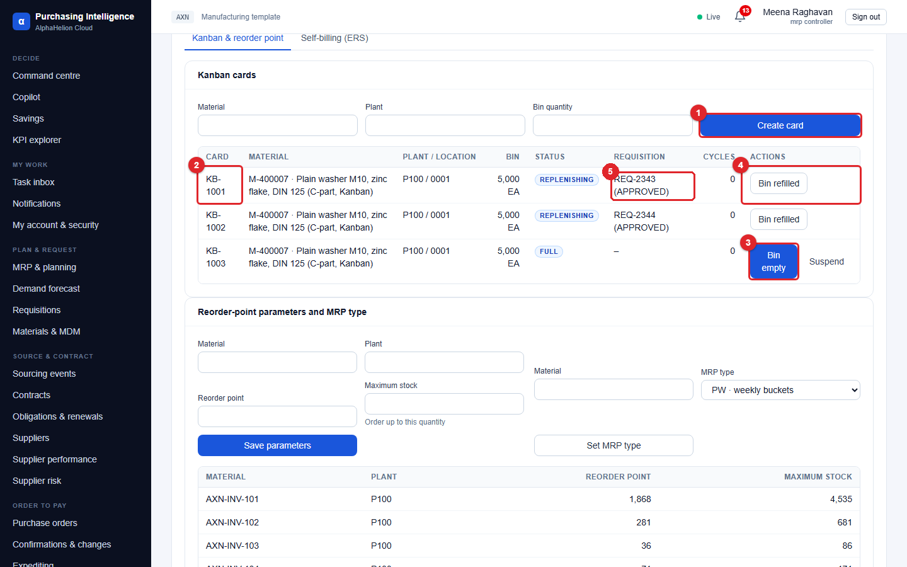

1. **Create card** (11.1): material, plant and bin quantity; the new card starts Full.
2. **KB-1001**: plain washer M-400007, bin of 5,000 EA at P100 / 0001, status Replenishing.
3. **Bin empty** (11.2) on a Full card (KB-1003): raises a requisition for one bin (purpose Kanban replenishment, need date today + lead time) and submits it for approval at once; the card goes to Replenishing. **Suspend** / **Resume** need a reason.
4. **Bin refilled** (11.3): sets the card back to Full and counts a cycle. Refill is manual; a goods receipt does not refill the card.
5. **Requisition**: the replenishment requisition of each card and its status (REQ-2343 and REQ-2344, both approved).

The same tab holds the reorder-point parameters (reorder point, maximum stock) and the MRP type per material (visible below the cards).

#### Step 12 · Hand-off · Buyer workbench

Approved MRP requisitions appear in the buyer workbench (`/pic/buyer`, origin MRP), where the buyer creates the purchase order (M08) or bundles the lines into a sourcing event (M05). See M04 Step 10.

### Exceptions and alternative paths

| Exception | What the user sees | How it is resolved |
|---|---|---|
| Simulation run | Run status "Simulated" and the note "the netting below is a report only" on MRP-02; no planned orders | Start a net-change or regenerative run when the result is acceptable |
| Material not in a net-change run | It does not appear in the netting trace ("Net-change runs only plan materials whose demand or supply changed") | Run in regenerative mode, or list the material in the run console |
| Below safety stock, past due, reschedule in / out, cancel | Exceptions tab of the run with value at risk and recommended action (Step 6) | Firm, convert or leave the order; the controller can close an exception with a reason |
| Unfirmed order replaced by a later run | Earlier CREATED order shows Deleted | Firm orders that must not change (Step 7); firmed orders only get reschedule or cancel messages |
| Planned order no longer needed | Cancel (with reason) on a CREATED or FIRMED order; Unfirm sends a firmed order back to CREATED | The next net-change run replans the material |
| No source of supply found | Source determination "none" on the planned order | The requisition goes to the buyer queue; the buyer sources it (M05) |
| MRP requisition rejected or returned by an approver | Requisition Rejected / Returned (M04) | The MRP controller edits and resubmits, or the next run replans |
| Kanban card suspended | Status Suspended; Resume needs a reason | Resume the card when the bin is back in use |
| Kanban control not enabled for the tenant | Kanban tab not shown in industry controls | Switch on the manufacturing template's KANBAN rule (administrator) |

---

## M03 Material & Master Data (MDM)

M03 governs how material masters are created and changed, so that everything bought again is bought against one clean record. A requester, buyer or MRP controller raises a material request; the system checks it for duplicates; four data stewards (purchasing, quality, finance, plant) approve it in parallel; and the new material is created and sent to the ERP. Changes to an existing material follow the same governance: an impact preview, approval by the steward domains that own the changed fields, a new material version and an ERP update. Text reference: PIC Workflow Guide, section M03.

### Process flow

**New material request**

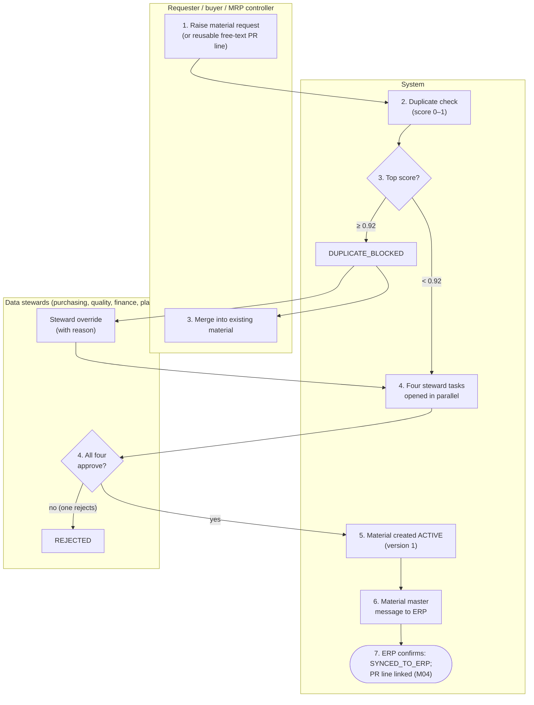

**Change to an existing material**

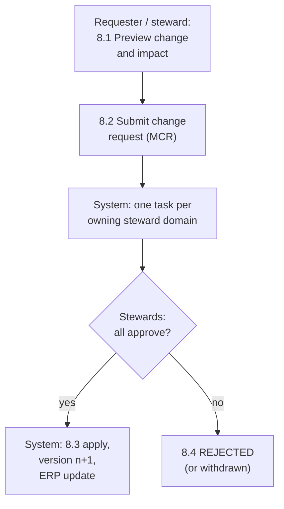

| Lane | Role(s) |
|---|---|
| Requester / buyer / MRP controller | `requester`, `buyer`, `mrp.controller` |
| System | Duplicate scoring (Material Dedup Agent), workflow, ERP connector |
| Data stewards | Master Data Steward per domain: `mdm.purchasing`, `mdm.quality`, `mdm.finance`, `mdm.plant` |

### Screen walkthrough

#### Step 1 · Requester / buyer / MRP controller · MDM-01 Materials and new material request
`/pic/materials`

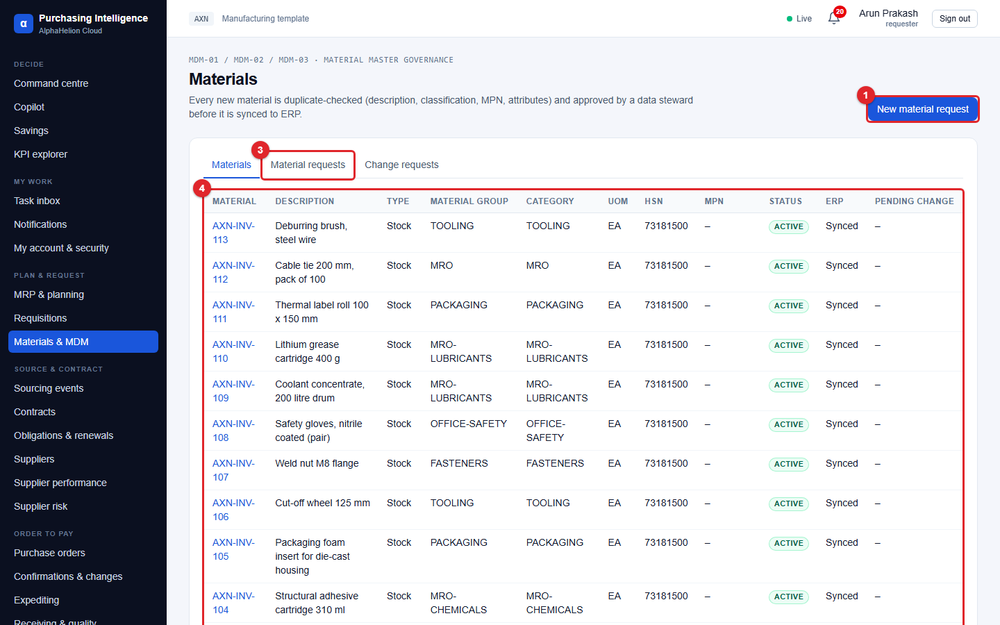

1. **New material request** opens the guided request form (next screenshot). (When the M03 KPIs have loaded, a strip above the tabs shows blocked bank-change fraud attempts, duplicate rate, first-time-right rate and request cycle time.)
3. Tabs: Materials, Material requests (by status) and Change requests in approval.
4. The material masters: type, material group, category, unit, HSN, manufacturer part number, status, whether the ERP has confirmed the record (Synced) and any change request still open on it.

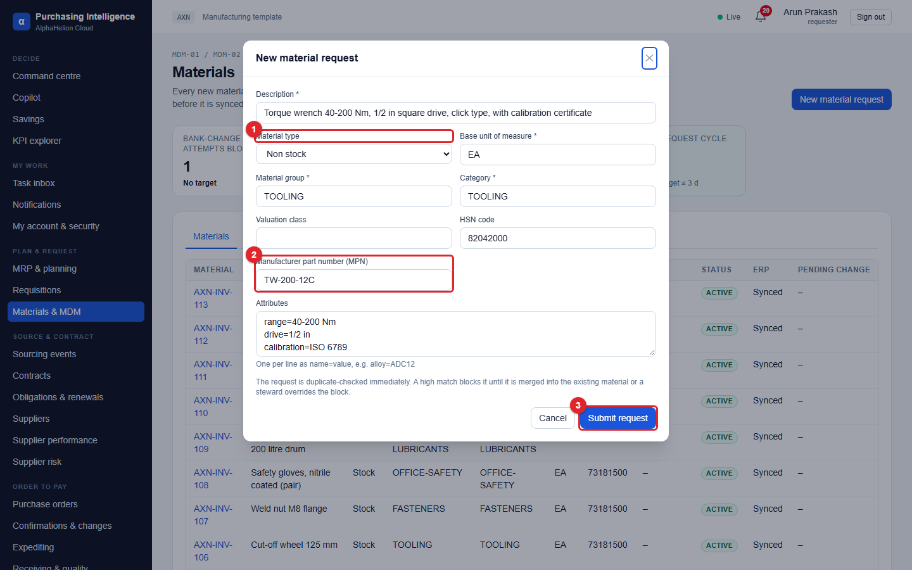

1. Material type: stock, non-stock or service (MRP type only for stock).
2. Manufacturer part number (MPN): one of the strongest signals for the duplicate check. The form also asks for description, base unit, material group, category, valuation class, HSN code and attributes (one per line, name=value).
3. **Submit request** creates the request MRQ-… and opens it.

A request is also started automatically from a free-text requisition line marked reusable (M04), or from **Promote to material** on a free-text line of the requisition.

#### Steps 2–3 · System · MDM-02 Duplicate check and gateway
`/pic/materials/MRQ-…`

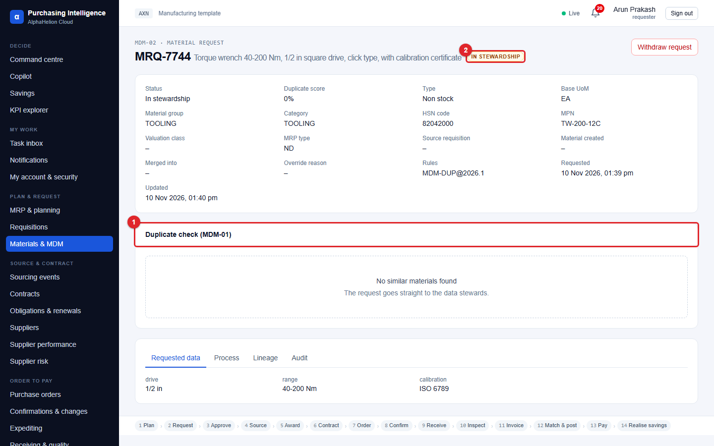

1. Duplicate check (MDM-01): no similar material found for the torque wrench (score 0 %), so the request goes straight to the data stewards.
2. Status IN STEWARDSHIP. The requester can still **Withdraw request**.

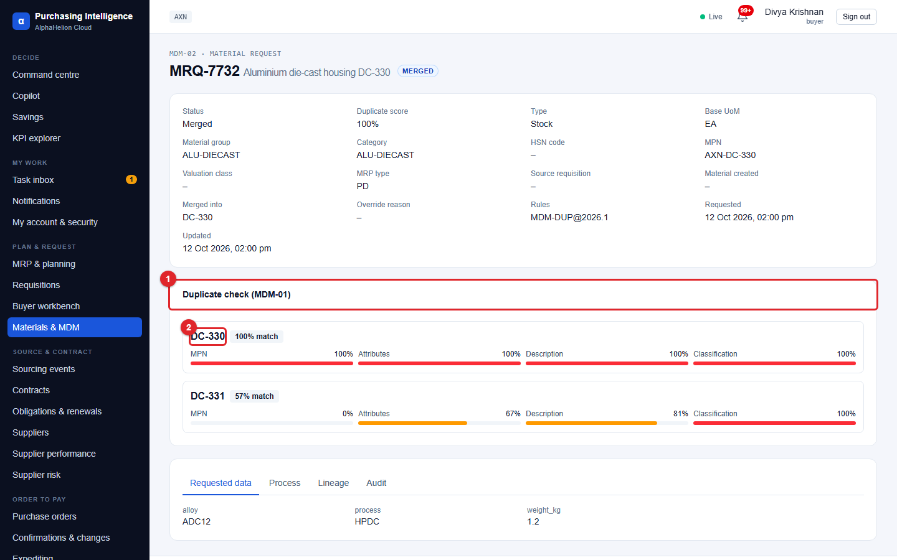

1. Duplicate check for MRQ-7732 "Aluminium die-cast housing DC-330" (MPN AXN-DC-330): up to five candidates with their score and its parts (MPN, attributes, description, classification).
2. DC-330 matched 100 %, so the request was blocked (0.92 or more) and merged into DC-330: status MERGED, "Merged into DC-330". DC-331 at 57 % is only listed. Between 0.75 and 0.92 the stewards get a warning; below that the request passes.

#### Step 4 · Data stewards · REQ-03 Steward tasks
`/pic/tasks`

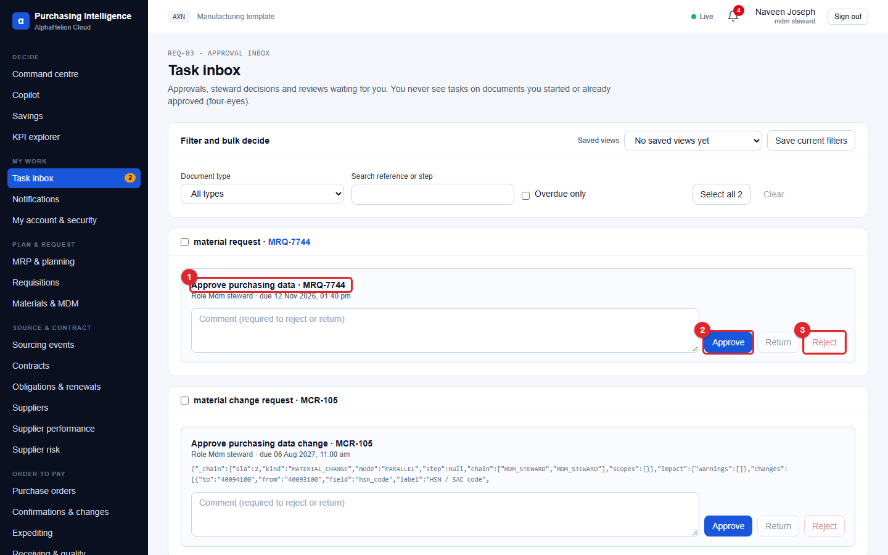

1. The purchasing steward's task "Approve purchasing data · MRQ-7744" with its due date. Four tasks open in parallel, one per domain (purchasing, quality, finance, plant); each steward sees only the task of their own domain.
2. **Approve**.
3. **Reject** (a comment is required). One rejection cancels the other tasks and rejects the request.

The same inbox also holds material change tasks, here MCR-105. The requester never gets a task on their own request (four-eyes, SOD-06).

#### Steps 5–7 · System · Material created, sent to the ERP, linked
`/pic/materials/MRQ-7742`

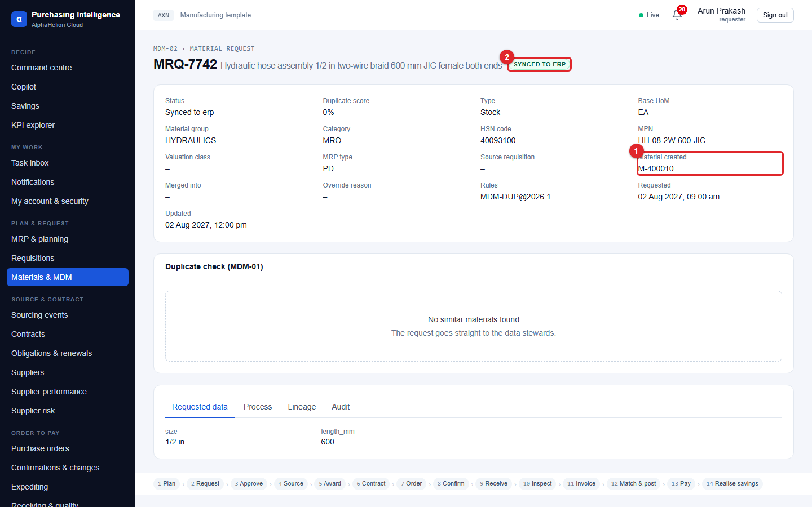

1. Material created: MRQ-7742 (hydraulic hose assembly) became M-400010 when all four domains approved.
2. Status SYNCED TO ERP: the material master message (SAP product API or MATMAS IDoc) was confirmed by the ERP.

If the request came from a requisition line, the line is linked to the new material but stays free text. MRQ-7731 (custom fixture from REQ-2312, see M04) is the signature case.

#### Step 8 · Requester or steward · Material master and change request
`/pic/materials/M-400010`, `/pic/materials/DC-330`

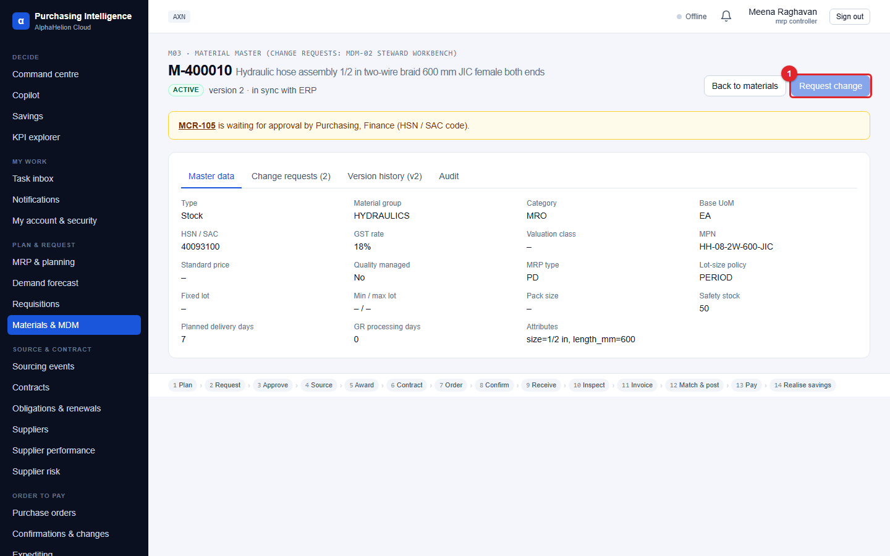

1. **Request change** is disabled here because MCR-105 is still waiting for approval by purchasing and finance (HSN / SAC code), as the yellow banner says. The page shows status ACTIVE, version 2, "in sync with ERP", the master data and the tabs Change requests, Version history and Audit.

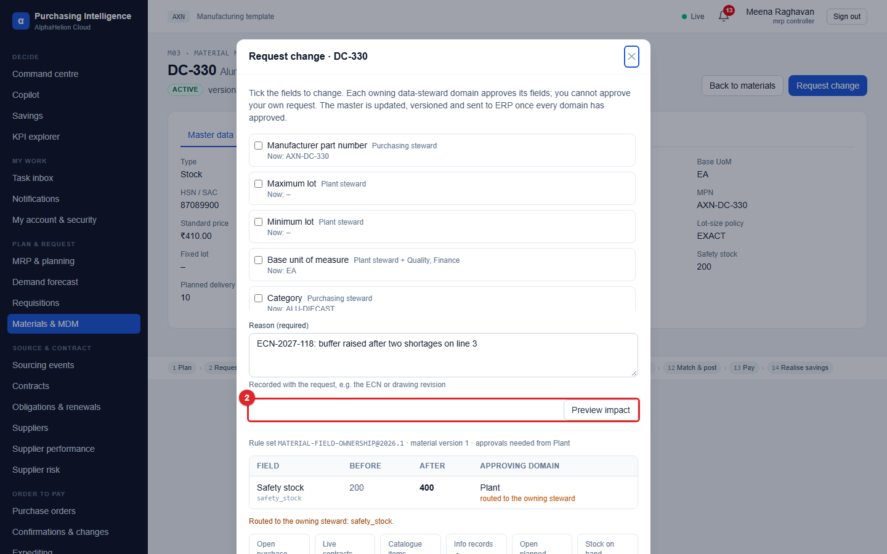

2. **Preview impact** for a change to DC-330 (safety stock 200 → 400, reason ECN-2027-118): the dialog lists the fields with their owning steward domain, then the change with its approving domain (Plant) and the impact on open purchase orders, live contracts, catalogue items, info records, planned orders and stock. **Submit for approval** (below the impact) creates the change request MCR-….

#### Step 8 (cont.) · Data stewards · MDM-02 Steward workbench: material change request
`/pic/materials/MCR-105`, `/pic/materials/MCR-104`

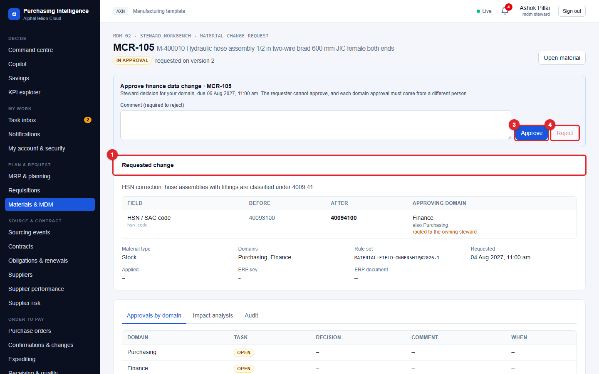

1. Requested change: HSN / SAC code 40093100 → 40094100, owned by Finance and also Purchasing, with material type, domains and rule set.
3. **Approve** (here for the finance steward's own domain task).
4. **Reject** (comment required). The approvals must come from different people; the requester can **Withdraw**.

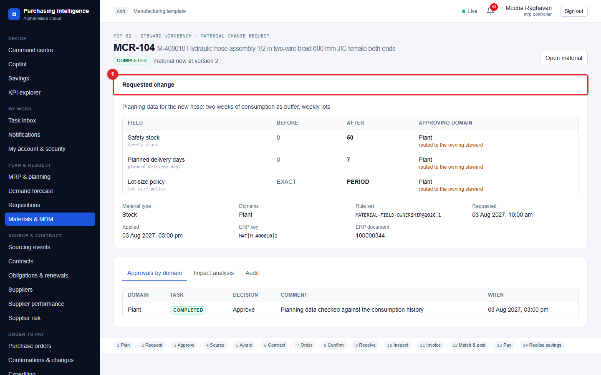

1. MCR-104 is COMPLETED: safety stock 0 → 50, planned delivery days 0 → 7, lot-size policy EXACT → PERIOD, approved by the plant steward; applied on 3 Aug 2027, material now at version 2, sent to the ERP (ERP document 100000344).

### Exceptions and alternative paths

| Exception | What the user sees | How it is resolved |
|---|---|---|
| Duplicate score 0.92 or more | Request status "Duplicate blocked" with the candidates and their scores (Steps 2–3) | The requester or a steward merges it into the existing material (status Merged), a steward overrides the block with a reason, or the requester withdraws the request |
| Duplicate score between 0.75 and 0.92 | Warning: the candidates are listed for the stewards; the request still goes to stewardship | The stewards decide with the candidates in view |
| A steward rejects | Request Rejected; the other steward tasks are cancelled | The requester raises a corrected request |
| Requester tries to approve as steward | No task is offered (four-eyes, SOD-06) | Another steward of that domain approves |
| ERP confirmation pending | Material shows "ERP update pending" | Cleared when the ERP posts the material master message (SYNCED_TO_ERP) |
| Change request while another is in approval | "Request change" is disabled with "MCR-… is still in approval" | Wait for the open change request, or withdraw it |
| Unit-of-measure change with stock or open documents | Preview shows the change as blocked by the impact analysis; Submit is disabled | Clear the stock and open documents first, or keep the unit |
| Material changed since the request was raised | On the last approval the request is rejected as stale | Raise the change again on the current version |
| Change request rejected or withdrawn | Status Rejected / Cancelled | Raise a new change request |

---

## M04 Requisition & Guided Buying

M04 lets any employee ask for what they need through the right channel: the search looks at contract items first, then the hosted catalogue, then the material master, and only then allows free text; services, IT, marketing and facilities requests can use a category SOW form. On submit the system checks policy, quotes and budget (cost object and category plan) and routes the requisition for approval by value. Approved lines, manual and MRP alike, land in the buyer workbench, where the buyer creates the purchase order (M08) or bundles them into a sourcing event (M05). Text reference: PIC Workflow Guide, section M04.

### Process flow

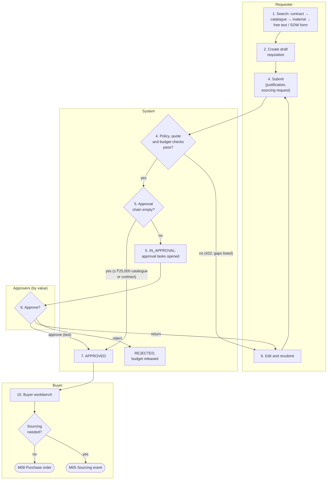

| Lane | Role(s) |
|---|---|
| Requester | Requester (`requester`); MRP controller for MRP-origin requisitions (M02) |
| System | Policy and budget checks, DMN-01 approval routing, Guided Buying Agent |
| Approvers (by value) | Cost-object owner (`plant.controller`) → department head from ₹2 lakh (`ops.head`) → procurement head and finance controller above ₹10 lakh; capex committee for assets |
| Buyer | Buyer (`buyer`) |

### Screen walkthrough

#### Step 1 · Requester · REQ-01 Find what you need
`/pic/requisitions/new`

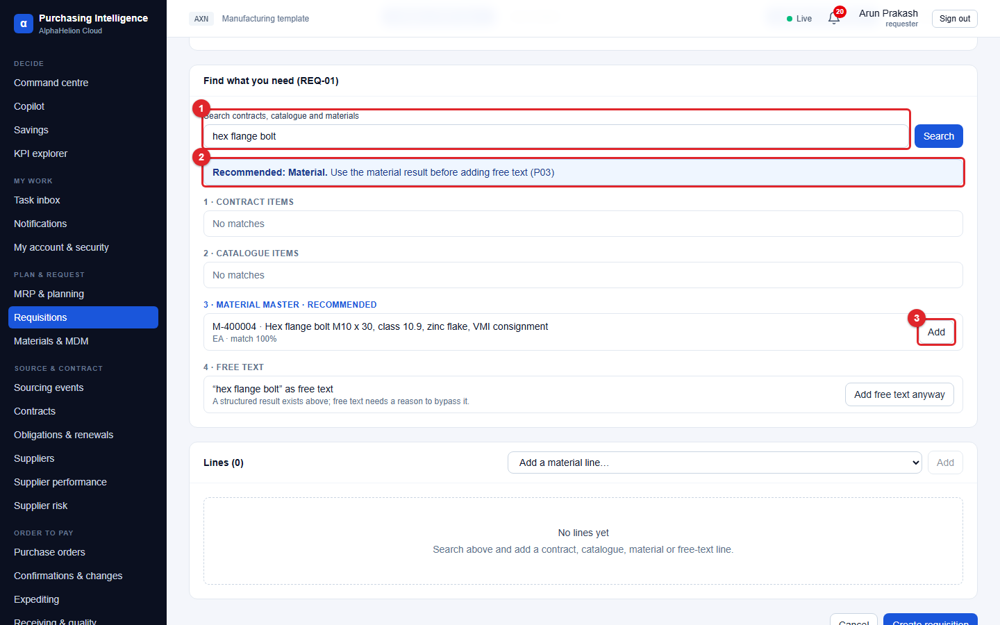

1. Search contracts, catalogue and materials: here "hex flange bolt".
2. The recommended channel and the rule: "Recommended: Material. Use the material result before adding free text (P03)". Results come in the fixed order contract items → catalogue items → material master → free text.
3. **Add** puts the material M-400004 (hex flange bolt M10 × 30, 100 % match) on the requisition. Free text is still offered, but "a structured result exists above; free text needs a reason to bypass it".

The same page offers punch-out to supplier web shops and the request templates.

#### Step 1a · Requester · Category SOW form (services, IT, marketing, facilities)
`/pic/requisitions/new` → **Professional Services SOW**

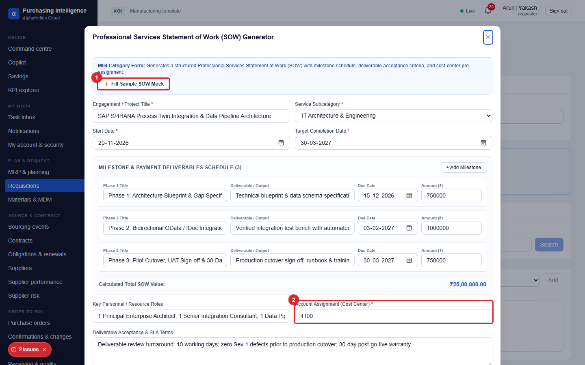

1. **Fill Sample SOW Mock** fills the demo values: engagement title, subcategory, start and completion dates, and a milestone schedule (three phases with deliverable, due date and amount; total ₹25,00,000).
2. Account assignment (cost center), mandatory; here 4100. Key personnel and the acceptance and SLA terms follow.

**Apply SOW to Requisition** (at the bottom of the form) adds one service line with the template, material group, cost-centre assignment and the composed statement of work. The other generators are Marketing & Agency SOW, IT Hardware & SaaS and Facilities & AMC SOW.

#### Step 2 · Requester · REQ-02 Draft requisition
`/pic/requisitions/REQ-2334` (a draft raised by the buyer for 30,000 seal kits, ₹38,40,000)

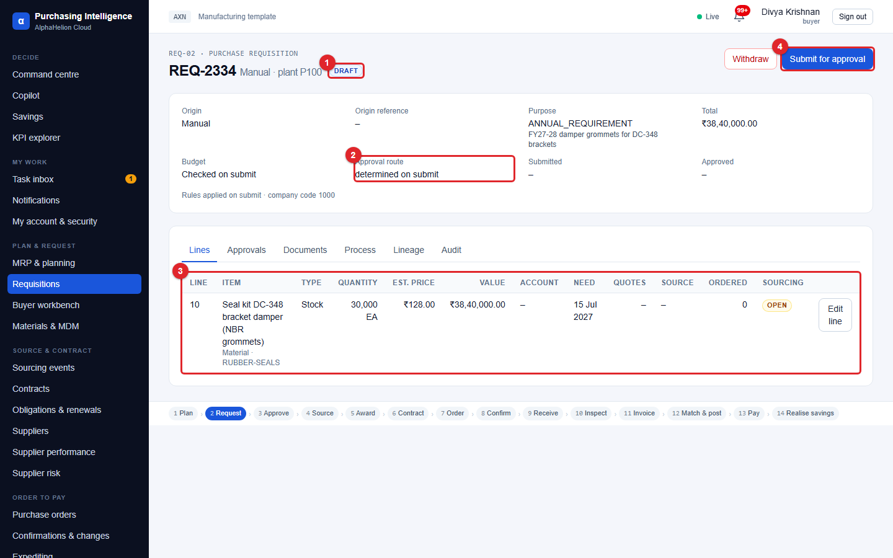

1. Status DRAFT.
2. Approval route: "determined on submit".
3. The lines with item, type, quantity, price, account assignment, need date, quotes and source.
4. **Submit for approval** opens the submit panel (Step 4).

The header holds plant, purpose code (mandatory, P01), origin and purpose text. **Create requisition** on the new-requisition page saves the draft REQ-…; missing fields are listed before anything is saved:

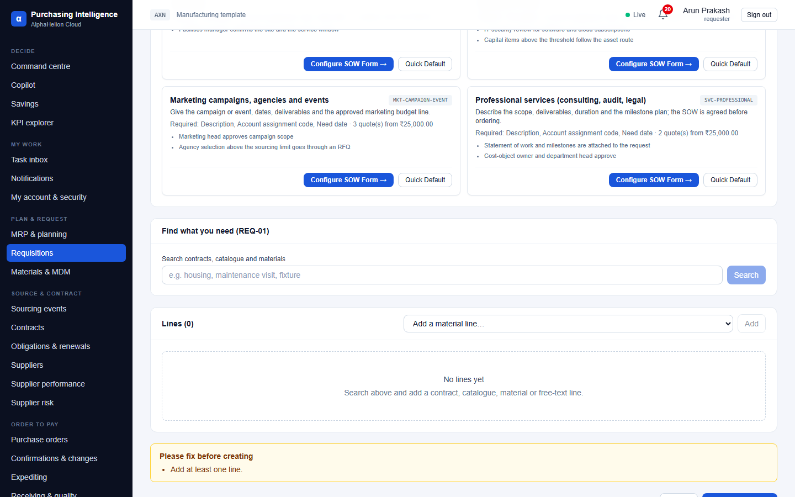

"Please fix before creating – Add at least one line." All gaps are listed together under the form.

#### Steps 4–5 · Requester / system · Submit: policy, budget and approval route
`/pic/requisitions/REQ-2334` → **Submit for approval**

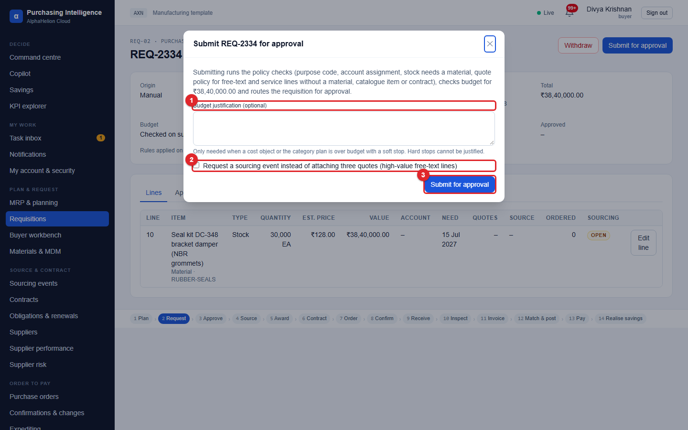

1. Budget justification: optional, mandatory when a soft budget stop applies.
2. "Request a sourcing event instead of attaching three quotes": marks the lines Sourcing required instead of attaching quotes.
3. **Submit for approval** runs the checks (purpose code, account assignment, stock needs a material, quote policy for free-text and service lines) and the budget check for the total.

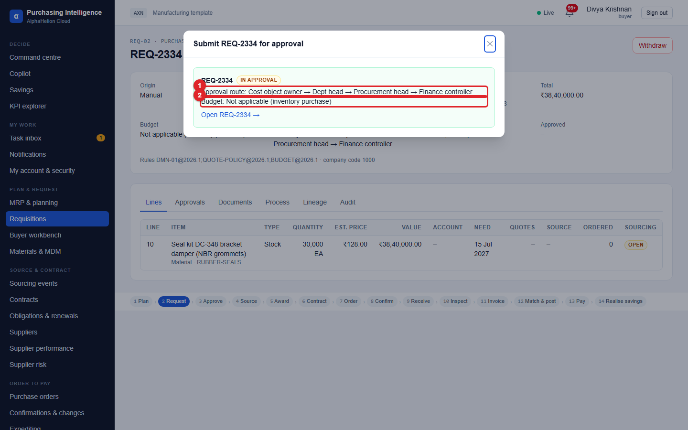

1. Approval route by value (DMN-01): above ₹10 lakh it is cost-object owner → department head → procurement head → finance controller. A small catalogue or contract requisition shows "none — auto-approved by policy".
2. Budget result: here "Not applicable (inventory purchase)", because a stock line is not charged to a cost object; for a cost-object line it shows the budget check, then the category-plan budget result and any policy hints.

The requisition is now IN APPROVAL.

Approval tasks open for the first approver.

#### Step 6 · Approvers · REQ-03 Task inbox
`/pic/tasks` (signed in as the cost-object owner)

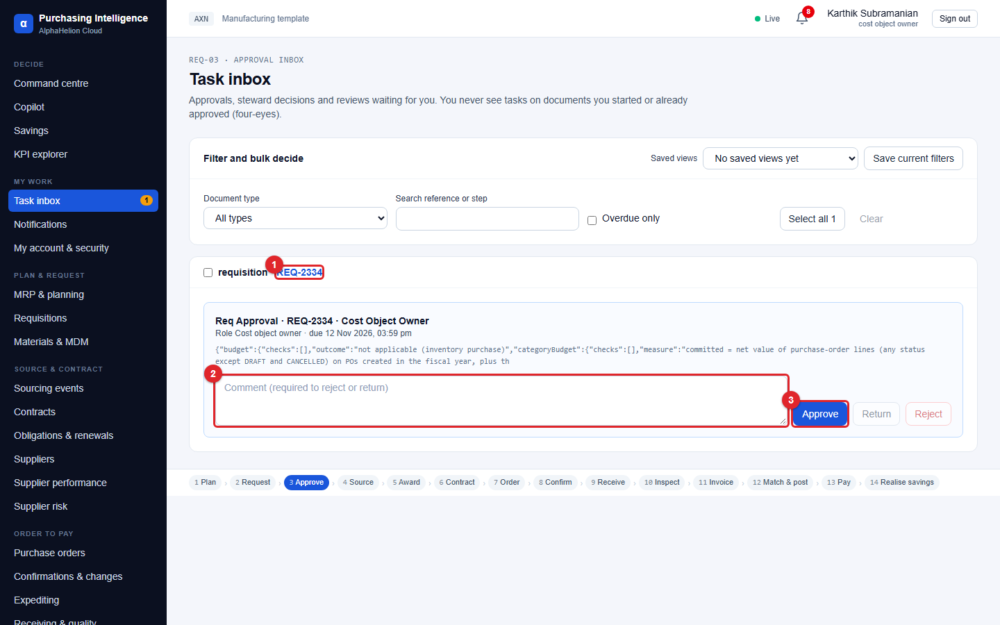

1. REQ-2334 waiting for the cost-object owner (first step of the route), with its due date and evidence (budget result).
2. Comment: required to return or reject.
3. **Approve** (or Return, Reject).

Users never see tasks on documents they started or already approved (four-eyes). Approvers follow DMN-01: cost-object owner up to ₹2 lakh, plus department head up to ₹10 lakh, plus procurement head and finance controller above ₹10 lakh; asset purchases add the capex committee.

#### Step 7 · System · Approved requisition
`/pic/requisitions/REQ-2312`

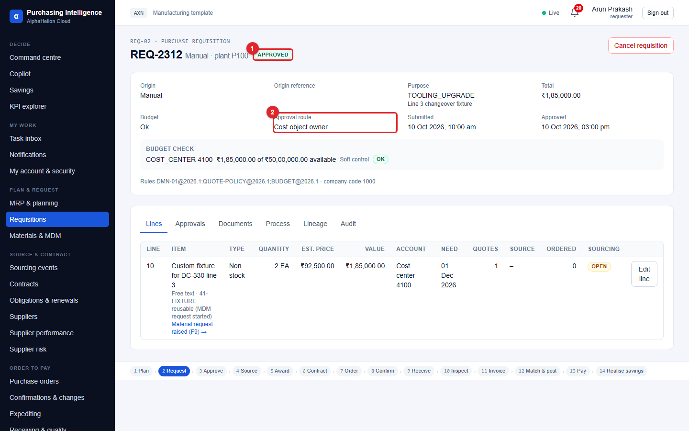

1. Status APPROVED (submitted 10 Oct 2026 10:00, approved 15:00).
2. Approval route: cost-object owner only (₹1,85,000 is below ₹2 lakh). The budget check shows cost centre 4100 with ₹1,85,000 of ₹50,00,000 available (soft control, OK), and the rule versions used.

The line, a free-text custom fixture for the DC-330 line 3 (2 × ₹92,500, one quote), was marked reusable and started material request MRQ-7731 ("Material request raised (F9) →", see M03). On the last approval an approved snapshot is kept, the source of supply is determined again for material lines and the requester is notified.

#### Step 10 · Buyer · REQ-04 Buyer workbench
`/pic/buyer`

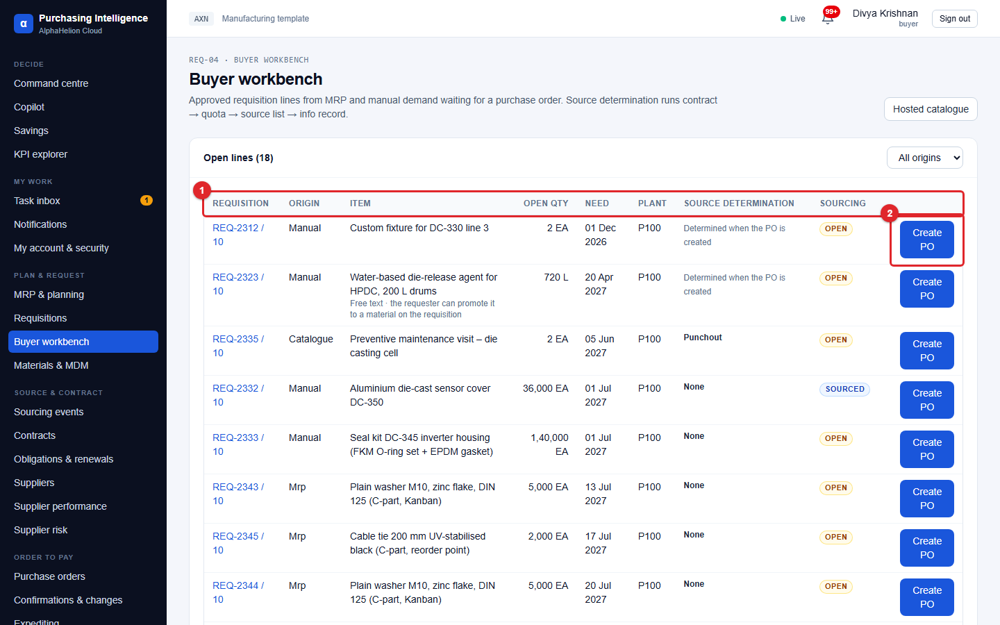

1. Open lines from approved requisitions (18 here), oldest need date first: requisition and line, origin (manual, catalogue, MRP), item, open quantity, need date, plant, source determination and sourcing status (OPEN, SOURCED).
2. **Create PO** opens the purchase-order dialog for the line (M08).

Lines marked "sourcing required" are bundled into a sourcing event from `/pic/sourcing/new` (M05). **Hosted catalogue** opens the catalogue screen.

#### Step 10a · Buyer · Hosted catalogue maintenance
`/pic/buyer/catalogue`

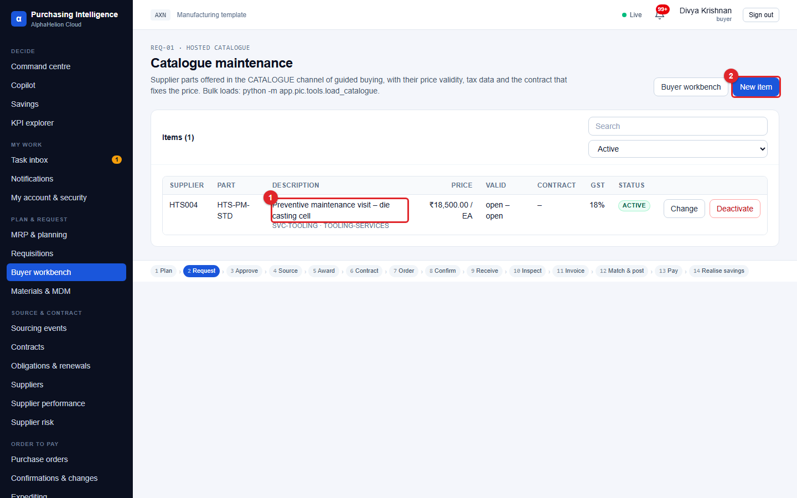

1. The catalogue item offered in guided buying: "Preventive maintenance visit – die casting cell" from HTS004 (part HTS-PM-STD, ₹18,500 per EA, GST 18 %, active, category TOOLING-SERVICES).
2. **New item** adds a catalogue item; each row has **Change** and **Deactivate**.

### Exceptions and alternative paths

| Exception | What the user sees | How it is resolved |
|---|---|---|
| Mandatory field, account assignment, quote or line missing | Create or submit refused; every gap is listed together (Step 2) | The requester completes the lines and submits again |
| Free-text or service line above ₹2 lakh without three quotes | Submit refused by the quote policy | Attach quotes, or tick "Request a sourcing event instead of attaching three quotes" (line marked Sourcing required, Step 4) |
| Cost-object budget exceeded (soft stop) | "Budget justification *" becomes mandatory | Enter a justification and submit again |
| Asset or WBS budget exceeded (hard stop) | Submit refused | Reduce the value or ask the budget owner to raise the budget |
| Category plan budget above 90% / above 100% | Warning in the submit result / "Category budget exceeded – justification required" | Justify (soft mode) or reduce the value; in hard mode the category owner must raise the plan budget |
| Approver returns the requisition | Status Returned; budget released | Requester edits and resubmits (back to Step 4) |
| Approver rejects | Status Rejected; budget released (see REQ-2324) | Process ends; raise a new requisition if still needed |
| Approval task not decided in time | Task escalates: reminder, manager added, then reassigned | Escalation rule; delegation of authority applies |
| Value, account or supplier changed after approval | Requisition goes back to In approval; budget re-booked | New approval round (at least the cost-object owner) |
| Cancel after ordering or after bundling into sourcing | Cancel refused ("requisition ordered" / "in sourcing") | Cancel the PO or the sourcing event first |
| Punch-out cart price more than 2% above catalogue | Line refused at conversion | Use the catalogue price or ask the supplier to correct the cart |

---

## M05 Strategic Sourcing

M05 turns approved requirements into a competitive event (RFI, RFQ, RFP or reverse auction) and ends with an approved, explainable award. A category manager (or the buyer who owns the event) builds and publishes the event, invited suppliers bid sealed in the supplier portal, the bids are opened at the close, evaluated on total cost of ownership (TCO) and awarded through an approval chain that depends on the annual value. The award hands over to contracts (M07, one contract draft per awarded supplier), to source determination for purchase orders (M08) and to savings tracking (M11). Text reference: PIC Workflow Guide, section M05.

### Process flow

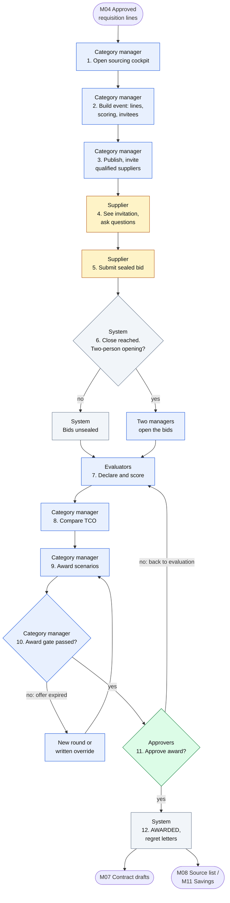

Colours: blue = category manager and evaluators, amber = supplier, grey = system, green = approvers; rounded grey boxes are hand-offs to other modules.

| Lane | Role(s) |
|---|---|
| Category manager (event owner) | Category Manager (`category.manager` on AXN, `category.head` on KAC); a buyer can own the events they create; evaluators (quality inspector) score their criteria |
| Supplier (portal) | Supplier portal user of each invited supplier (e.g. `bids.<supplier code>@suppliers.kaveri-auto.example` on KAC) |
| System | Close timer, sealed-bid store, opening, TCO and scenario engine, award consumers |
| Award approvers | Category Manager, then CPO and Finance Controller when the annual value is 50 lakh or more (rule `AWARD-APPROVAL`) |

### Screen walkthrough

#### Step 1 · Category manager · SRC-01 Sourcing Project Cockpit
`/pic/sourcing`

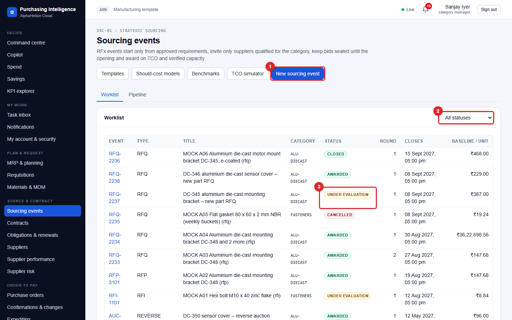

1. **New sourcing event** opens the event builder. Templates, should-cost models, benchmarks and the TCO simulator are on the same row.
2. The status filter narrows the worklist (draft, open, closed, under evaluation, award pending, awarded, cancelled). The Pipeline tab shows the same events by stage with value, age and next step.
3. Each event shows its number, type, category, status, round, close time and baseline price. RFQ-2237 is under evaluation; it is the expired-offer case in Steps 13 and 14.

Approved requisition lines with no source of supply arrive from the buyer queue (M04). The category manager starts a new event from them.

#### Step 2 · Category manager · SRC-02 Event Builder
`/pic/sourcing/new`

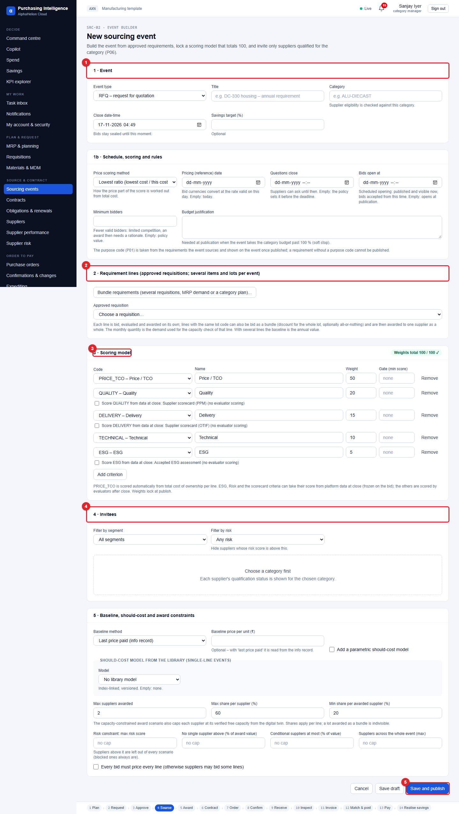

1. **Event**: type (RFI, RFQ, RFP or reverse auction), title, category and the close time until which bids stay sealed. Section 1b sets the price scoring method, pricing date, question deadline, scheduled opening and minimum number of bidders.
2. **Requirement lines** come only from approved requisitions; several requisitions, MRP demand or a category plan can be bundled into one event.
3. **Scoring model**: criteria with whole-number weights that must total 100. Price/TCO is scored automatically, the other criteria by evaluators or from scorecard data.
4. **Invitees**: only suppliers that are Qualified or Preferred for the category are offered, with segment and risk filters. Section 5 sets the baseline, an optional should-cost model and the award constraints (maximum suppliers, share per supplier, risk caps).
5. **Save and publish** runs the publication checks (weights total 100, at least one invitee, close in the future, purpose code, close before the need date, category budget). **Save draft** keeps the event in DRAFT.

On publication the event gets a number from the RFQ series (all event types use it), the weights are locked, the event opens for bids and the close timer is set.

#### Step 3 · Category manager · SRC-03 Event page, Invitations
`/pic/sourcing/RFQ-2231`

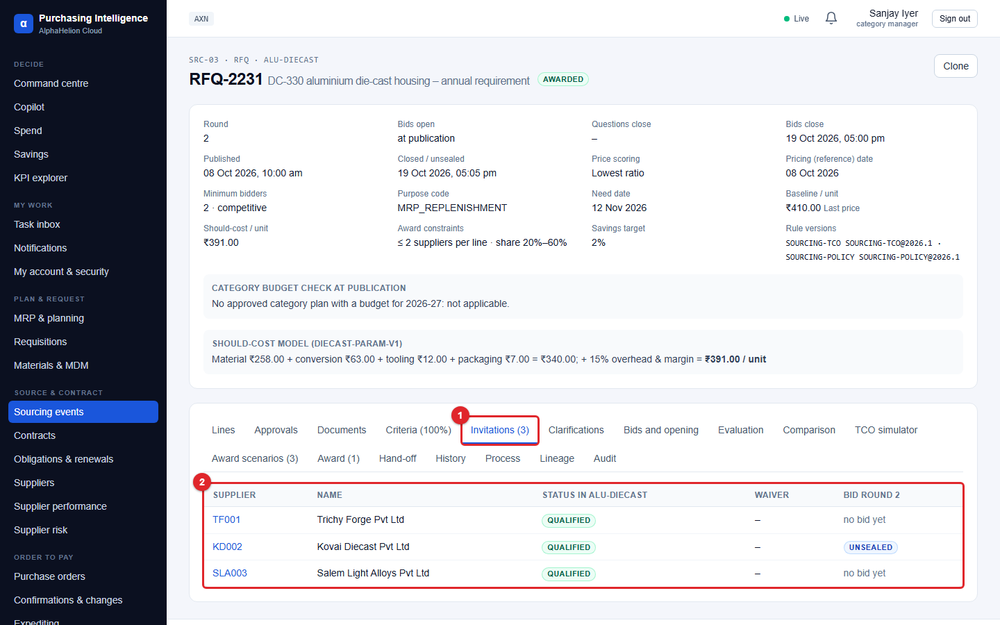

1. The **Invitations** tab of RFQ-2231 (DC-330 aluminium die-cast housing) lists every invited supplier.
2. For each supplier the screen shows its status in the event's category (all three are Qualified), any waiver and the state of its bid in the current round. Prices are never shown here.

The invited suppliers receive a notification and see the event in their portal.

#### Step 4 · Supplier · SLM-05 Supplier portal, RFQs tab
`/pic/portal` (tab RFQs)


1. The supplier's portal user opens the **RFQs** tab. A supplier only sees events it was invited to.
2. RFQ-2255 (compression spring, tenant KAC) is open until 10 Nov 2026, 5:00 pm.
3. **Submit sealed bid** opens the bid form. **Q&A** lets the supplier ask a question until the question deadline; answers go to every invitee without the asker's name.

#### Step 5 · Supplier · Sealed bid
`/pic/portal` (bid dialog)


1. The notice explains that the bid is encrypted on submission and stays sealed until the close. The green box confirms the bid already on file for round 1 with its SHA-256 fingerprint; submitting again replaces it.
2. Per line the supplier enters unit price, currency, incoterm, payment terms, lead time and capacity; freight, duty and packaging only if quoted (otherwise the TCO rule estimates them).
3. **Offer valid until** must be after the close. The award is blocked later if the offer has expired by then (Step 13).

The system checks the bid (invited, before close, price plausibility, one currency) and stores only the encrypted content and its fingerprint.

#### Step 6 · System and category managers · Bids and opening
`/pic/sourcing/RFQ-2253` (tab Bids and opening)


1. The **Bids and opening** tab lists the bid receipts: supplier, round, SEALED, submission time and the fingerprint of the sealed content, never the prices. At the close time the event moves to CLOSED; without a two-person rule the bids are unsealed at once and the event goes to evaluation.
2. With the two-person opening rule the bids stay sealed until two different managers open them; this event (tenant KAC) has one of two openings recorded.
3. A second manager clicks **Open bids as the second opener**. **Try to read the bids now** demonstrates that an early read is refused.
4. The evidence trail records the waiting state and each opener, and every refused early read.

#### Step 7 · Evaluators · Evaluation
`/pic/sourcing/RFQ-2231` (tab Evaluation)


1. Each evaluator first declares any conflict of interest, then scores the manual criteria from 0 to 100. Criteria fed from platform data (scorecard, ESG, risk) are scored automatically at the close. A bid can be disqualified here with a written reason.

#### Step 8 · Category manager · Comparison and TCO
`/pic/sourcing/RFQ-2231` (tab Comparison)


1. The summary shows the valid bidders against the minimum, the baseline, the price scoring method and the should-cost.
2. The comparison ranks the bids by TCO per unit (price plus freight, duty, packaging, carrying and quality cost, minus the value of the payment terms), then by weighted score, with the technical gate, lead time and outlier and collusion checks.
3. **Export comparison CSV** downloads the matrix; the file's fingerprint is audited.

If the result is not good enough the owner starts **another round** with a new close time; earlier bids are then superseded.

#### Step 9 · Category manager · SRC-04 Award scenarios
`/pic/sourcing/RFQ-2231` (tab Award scenarios)


1. The **Award scenarios** tab compares the scenarios built for the event.
2. Lowest cost and best value would give all volume to one supplier; both are INFEASIBLE because the digital twin shows that neither supplier has the monthly capacity.
3. **Capacity constrained** splits the volume 60/40 between TF001 and KD002 within each supplier's verified free capacity, with weighted price, TCO, risk and annual savings against the baseline.
4. The award decision on this scenario is APPROVED.

#### Step 10 · Category manager · SRC-05 Award proposal
`/pic/sourcing/RFQ-2231` (tab Award)


1. The owner proposes the award on one scenario with a rationale and a conflict declaration; the decision shows scenario, annual value and status.
2. **Authority band**: the annual value is above the 50 lakh threshold, so the chain is Category manager, then CPO, then Finance controller.
3. **Exceptions** recorded on the decision, here NOT_LOWEST (the award includes a bid that is not the lowest).
4. The **rationale** explains the exception; a rationale is required for every rationale-type exception.

Before the proposal is accepted the award gate checks that every bid is evaluated, every criterion scored, no awarded offer has expired and the technical gate is passed. The event moves to AWARD_PENDING and approval tasks are created.

#### Step 11 · Approver · Award approval task
`/pic/tasks`


1. The approver opens the award approval task in the task inbox; the link (here RFQ-2249, tenant KAC) opens the event.
2. The task shows the step (Award approval, role Category manager) and the evidence: scenario, rationale, exceptions and allocations. The evidence is shown as raw data in this version of the screen.
3. Tasks past their due date are flagged OVERDUE and escalate by their service-level timer.
4. **Approve**, **Return** or **Reject**; a comment is required to return or reject. The proposer can never approve their own award.

A rejection returns the event to evaluation; the last approval sets it to AWARDED.

#### Step 12 · System · Award and hand-off
`/pic/sourcing/RFQ-2231` (tab Hand-off)


1. The **Hand-off** tab appears once the award is pending or approved.
2. One contract per awarded supplier was drafted automatically (SA-5520 for TF001 and SA-5521 for KD002), here already active, with validity and target value.
3. **PO release** shows READY once the contract is active and its prices are published. Quota arrangements and source-list entries below feed source determination for purchase orders (M08).

No screen: each non-awarded bidder receives a regret notification with its own rank only, and a savings initiative is recorded as negotiated (M11).

### Exceptions and alternative paths

| Exception | What the user sees | How it is resolved |
|---|---|---|
| Lowest offer expired before the award (AXN RFQ-2237, pack D22) | The award is refused; the event stays UNDER EVALUATION without an award decision (Step 13) and the History tab records AWARD_BLOCKED_OFFER_EXPIRED (Step 14) | Start a new round, or propose the award with a written override (next row) |
| Expired offer with a written override (AXN RFQ-2238, pack D22) | The award decision carries the exception BID_OFFER_EXPIRED with the override reason and who overrode it (Step 15) | The normal approval chain applies: category manager, CPO, finance controller; event AWARDED |
| Two-person opening required | Event waits in CLOSED with "1 of 2" openers (Step 6) | A second, different manager opens the bids |
| Fewer valid bidders than the minimum | Comparison shows limited competition | The award needs a rationale (LIMITED_COMPETITION exception) |
| Award approval rejected | Task decision Reject (Step 11) | Event returns to UNDER_EVALUATION; scenario kept as evidence |
| Event no longer needed | **Cancel event** on the event page (any state before AWARDED), with a reason | Requirement lines go back to the buyer queue; invitees are told |

#### Step 13 · Category manager · Award blocked: offer expired
`/pic/sourcing/RFQ-2237` (tab Award)


1. RFQ-2237 (DC-345 mounting bracket, new part) is still UNDER EVALUATION.
2. **Award** was tried on 27 Sept 2027 and refused, because Trichy Forge's lowest offer was valid only until 20 Sept 2027.
3. **New round** asks the bidders for fresh, valid offers.
4. No award decision exists: the refused attempt does not create one.

#### Step 14 · Category manager · History of the blocked award
`/pic/sourcing/RFQ-2237` (tab History)


1. The history shows the close, the unsealing of the three bids and the move to evaluation, each with the rule version and a hash chained to the previous entry.
2. **AWARD_BLOCKED_OFFER_EXPIRED** records the refused award: supplier TF001, valid until 2027-09-20, seven days expired, and the user who tried.

#### Step 15 · Category manager · Award with an expired-offer override
`/pic/sourcing/RFQ-2238` (tab Award)


1. RFQ-2238 (DC-346 sensor cover) is AWARDED.
2. The award (lowest cost, annual value above 50 lakh) went through Category manager, CPO and Finance controller.
3. The exception **BID_OFFER_EXPIRED** shows the override: Trichy Forge's offer ended on 18 Sept 2027; the category manager recorded that the supplier confirmed the price in writing and that a new round would delay PPAP by three weeks.

---

## M06 Supplier Lifecycle & Performance

M06 brings a new supplier on board and keeps watching it afterwards. A supplier manager invites the company (or registers it directly), the supplier registers itself through a one-time link and adds its bank details and certificates in the portal, the system screens it for duplicates and sanctions, a second person verifies the bank account by phone and two finance controllers approve it, and the supplier manager qualifies the supplier per category. The first positive qualification makes the supplier ACTIVE and sends the vendor to the ERP; from then on scorecards, risk signals and master-data changes keep the record current. Category status gates sourcing invitations (M05), contracts (M07), purchase orders (M08) and the payment run (M10). Text reference: PIC Workflow Guide, section M06.

### Process flow


Colours: blue = supplier manager, amber = supplier, grey = system, green = finance approvers; dotted lines = the master-change path that runs any time after onboarding.

| Lane | Role(s) |
|---|---|
| Supplier manager | Supplier Manager (`supplier.manager`); a quality inspector may verify certificates; category manager sets PREFERRED / EXITED |
| Supplier (public page / portal) | The invited company's contact, who becomes its first supplier portal user |
| System | Screening (duplicate GSTIN/PAN, sanctions list), onboarding process, scorecard and risk jobs, ERP integration queue |
| Finance controllers (two people) | Two different Finance Controllers (`finance.controller`, `finance.controller2`), never the requester or the caller |

### Screen walkthrough

The walkthrough follows a new supplier, Hosur Coil Springs Pvt Ltd (SUP-1003, category PACKAGING), from invitation to approval on the AXN demo tenant.

#### Step 1 · Supplier manager · SLM-02 Supplier base and invitations
`/pic/suppliers`


1. The **Invitations (F8-01)** list below the supplier base shows every invitation with company, e-mail, categories, status and expiry.
2. The new invitation for onboarding@hosur-coilsprings.example is SENT and valid for 14 days; **Revoke** withdraws it. Earlier invitations show REGISTERED with the supplier code they created.


1. **Invite supplier** opens the dialog: company legal name and contact e-mail (the portal login is bound to this address).
2. **Categories** for which qualification will start.
3. **Create invitation** sends the e-mail with a one-time registration link; only a fingerprint of the link is stored. **Register supplier** (next to it) registers a supplier directly instead.

#### Step 2 · Supplier · Self-registration
`/pic/register?token=…` (public page from the invitation e-mail)


1. The supplier enters its GSTIN; the page checks format, state code and check character and fills the PAN and state from it.
2. Registered address and the contact person; the e-mail is fixed to the invited address. Further down the supplier sets its portal password (12+ characters) and clicks **Register**.

The system registers the supplier (status REGISTERED), starts qualification for the invited categories, creates the portal login and notifies the supplier managers.

#### Step 3 · Supplier and system · Profile, bank details and screening
`/pic/suppliers/SUP-1003` (as supplier manager)


1. The supplier is REGISTERED and its PACKAGING category is under qualification.
2. In the portal the supplier added its bank account and ISO 9001 certificate. The bank details became bank change BCR-117, waiting for a call-back.
3. **Verify call-back** is for a person other than the requester (Step 4).
4. **Screening**: Clear, with 0 duplicates and 0 sanctions hits. A duplicate or provider outage gives REVIEW; a sanctions hit blocks the supplier.


1. The **Onboarding process** tab shows where the supplier is in the F8 process.
2. Completed steps (invitation, profile, screening) with who and when.
3. The active step: category qualification for PACKAGING, with the supplier manager.

#### Step 4 · Supplier manager · Bank call-back
`/pic/suppliers/SUP-1003`

No separate screen: the supplier manager phones the supplier on an independently known number and clicks **Verify call-back** in the banner (Step 3, callout 3) with a note. BCR-117 moves to PENDING_APPROVAL and two approval tasks are created for finance controllers; the requester and the caller are excluded from them.

#### Step 5 · Finance controllers · Bank account approval (MDM-04)
`/pic/tasks`


1. The bank change BCR-117 appears in each finance controller's task inbox.
2. The task names the step (Bank change, role Finance controller) and its due date.
3. **Approve**, **Return** or **Reject**. Two different finance controllers must approve; one rejection rejects the change.

On the second approval the new account becomes active and every other account of the supplier inactive. Payments can use it only after the 72-hour cooling-off, and invoices within 30 days of a bank change raise a fraud signal (Step 9).

#### Step 6 · Supplier manager · Qualification per category
`/pic/suppliers/SUP-1003` (tab Qualifications)


1. The assessment recorded with **Record assessment**: questionnaire 82, audit 79, no sample required for packaging.
2. **Decision**: Qualified (may be invited to sourcing), Conditional (with a written waiver) or Rejected (category exited).
3. A reason is required. Qualified is refused while gaps remain (missing, expired or unverified certificates, questionnaire below 70, audit below 75, missing PPAP), and it also needs a verified, dual-approved bank account and a passed screening.
4. The **Qualifications** tab lists one qualification per category with its scores; **Decide** opened this dialog.

#### Step 7 · System · Supplier active and sent to the ERP
`/pic/suppliers/SUP-1003`


1. The first positive decision makes the supplier ACTIVE.
2. **Status by category**: PACKAGING is QUALIFIED (qualified 10 Nov 2026), so the supplier can now be invited to sourcing events (M05) and receive contracts and purchase orders for that category.
3. **Master data changes (MDM-04)**: from now on tax IDs, address and contact change only through an approved change request (Step 10).

No screen: the vendor is created in the ERP through the integration queue (SAP business partner with masked tax and bank data); its ERP vendor number is stored on the supplier when the posting succeeds.

#### Step 8 · Supplier manager · SLM-03 Performance scorecard
`/pic/suppliers/performance`


1. Key figures: suppliers scored, average OTIF, open CAPAs and CAPAs waiting for verification.
2. The latest monthly scorecard per supplier: OTIF (from goods receipts), PPM (from quality decisions) and first-pass invoice accuracy.
3. Status per category with **Make preferred** (needs OTIF 95 %+ and PPM within limit over the last three scorecards) and **Exit**.
4. **Open CAPA** raises a corrective action; a rejected lot opens one automatically.

#### Step 9 · Supplier manager · SLM-04 Supplier risk monitor
`/pic/suppliers/risk`


1. Key figures: high-risk supplier share, suppliers with signals, open and critical signals.
2. **Run Supplier Risk Agent** scans sanctions, certificates, OTIF, PPM, twin late-delivery probability, bank-change fraud, concentration, geography, single source and cyber; each open signal gets an owner and a mitigation task.
3. The heat map shows the worst open signal per supplier and risk category; Zenith Alloy Trading FZE is BLOCKED with a critical compliance (sanctions) signal.

#### Step 10 · Finance controller and supplier manager · Master-data change approval (MDM-04)
`/pic/tasks` (tenant KAC)


1. A tax-ID, address or contact change (here SMC-101 on KAC) creates parallel tasks for a finance controller and a supplier manager; the requester never approves it.
2. The evidence shows masked before and after values (PAN, GSTIN, state) and the reason. In this version the evidence is shown as raw data.
3. **Approve**: after both approvals the new values are written to the supplier, a tax change re-runs screening, and the change goes to the ERP.

### Exceptions and alternative paths

| Exception | What the user sees | How it is resolved |
|---|---|---|
| Duplicate GSTIN/PAN or similar name found at screening | Screening REVIEW on Supplier 360; onboarding waits | A supplier manager other than the registrant clears, merges into the existing supplier, or re-screens |
| Sanctions hit | Screening BLOCKED; the supplier is blocked at once (e.g. Zenith Alloy Trading FZE, ZAT006, BLOCKED with a critical compliance signal in Step 9) | Unblock is refused while the sanctions match stands |
| Bank call-back fails or a finance controller rejects | Bank change REJECTED; the old account stays active (demo: AAC202, bank change rejected by the finance controller) | Supplier manager raises a new bank change with correct details |
| Bank change after onboarding | Only the supplier manager can raise it (**Request bank change** on Supplier 360); the portal answers that the bank-change process is required | Same call-back and dual approval; payments wait 72 hours after activation (cooling-off) |
| Qualification criteria not met | **Decide** with QUALIFIED is refused and lists the gaps (certificates, questionnaire below 70, audit below 75, PPAP) | Record a better assessment, decide CONDITIONAL with a written waiver, or REJECTED (category EXITED) |
| Mandatory certificate expires | Category moves from QUALIFIED/PREFERRED to CONDITIONAL automatically | Supplier uploads the renewed certificate; it is verified by a second person |
| Invitation link expired, used or revoked | The registration page says the link is no longer valid | Supplier manager sends a new invitation |

---

## M07 Contract Lifecycle Management

M07 takes a contract from its first draft to signature, use and end of life. Most contracts are drafted automatically from a sourcing award (M05), one per awarded supplier; a contract manager can also create one by hand. The contract manager reviews the clauses against the playbook, settles supplier redlines, sends the contract through an approval chain that depends on value and clause risk, collects both signatures and activates it. Only an active contract publishes its prices for purchase orders (M08); release orders then consume it, and renewal, amendment, expiry or termination close the cycle. Text reference: PIC Workflow Guide, section M07.

### Process flow


Colours: blue = contract manager, amber = supplier, grey = system, green = approvers (contract manager below 1 crore with standard clauses; Legal, Finance controller and CPO above it or with a non-standard clause).

| Lane | Role(s) |
|---|---|
| Contract manager | Contract Manager (`contract.manager`, `contract.manager2`); contracts from an award are owned by the category manager who proposed it |
| Supplier (portal) | Supplier portal user of the contract's supplier |
| Approvers | Contract Manager below 1 crore with standard clauses; Legal, Finance Controller and CPO above it or with a non-standard clause (rule `CONTRACT-APPROVAL`) |
| System | Activation, price publication, consumption tracking, renewal and expiry timers |

### Screen walkthrough

#### Step 1 · Contract manager · CLM-01 Contract Workspace
`/pic/contracts`


1. **New contract** starts a manual contract (Step 2). **Obligations & renewals** opens the tracker (Step 11).
2. Key figures: contract cycle time, contract leakage, contracts expiring in 90 days and obligation on-time %.
3. Search and filters by type, status and "expiring in 90 days".
4. Contracts born from a sourcing award appear as drafts without any user action, e.g. VC-6504 from the RFQ-2238 award (DC-346 sensor cover) and SA-5526 / SA-5527 from the RFQ-2234 award.

#### Step 2 · Contract manager · New contract
`/pic/contracts/new`


1. **Contract type**: master agreement, NDA, quantity contract, rate card, scheduling agreement, SOW or value contract. Framework types (master agreement, NDA) carry no lines or prices.
2. **Header**: supplier, title, validity, payment terms, incoterms, company code and an optional category overlay and master agreement.
3. **Playbook preview**: the clauses and obligations of the chosen type that will be added automatically, with their fallback positions.

The draft gets a number (here from the SA, QC, VC series by type) and status DRAFT.

#### Step 3 · Contract manager · CLM-02 Clause review
`/pic/contracts/VC-6501` (tab Clauses)


1. **AI review** scores every clause against the playbook (standard 0, fallback 30, non-standard 70) and suggests fallbacks; the contract moves to IN_NEGOTIATION.
2. **Submit for approval** is available once no supplier redline is waiting for review.
3. The **Clauses** tab lists each clause with its position and risk; **Propose redline** lets the contract manager change the wording. Supplier redlines from the portal appear here as "to review".
4. The summary shows the contract risk (here 0/100, every clause on the playbook wording) and the approval route that will apply: Contract manager, because the value is below 1 crore and all clauses are standard.

#### Step 4 · Contract manager · Approval route above the threshold
`/pic/contracts/KAC-RC-0007` (tab Clauses)


1. The same Clauses tab on a KAC rate card worth 1.42 crore.
2. Because the value is at or above 1 crore, the route is Legal, then Finance controller, then CPO. Any non-standard clause would trigger the same route regardless of value.

#### Step 5 · Approver · Contract approval task
`/pic/tasks`


1. VC-6501 was submitted by `contract.manager`; the approval task goes to the second contract manager (`contract.manager2`), because the owner and the submitter never approve their own contract.
2. The task card shows the step (Contract approval, role Contract manager) and its due date.
3. **Approve**, **Return** or **Reject**; a comment is required to return or reject.

Approved: status OUT_FOR_SIGNATURE. Rejected: back to IN_NEGOTIATION.

#### Step 6 · Contract manager and supplier · Signatures
`/pic/contracts/KAC-SOW-0002` (tab Signatures)


1. After the approval in Step 5, VC-6501 is OUT FOR SIGNATURE.
2. **Sign as buyer** records the buyer's signature (name and title); the signature stores the fingerprint of the contract text.
3. The signature line shows who still has to sign; the supplier signs in the supplier portal (Contracts tab, **Sign**).
4. **Activate** stays disabled until both parties have signed the same text.
5. The prices are not yet published: they reach source determination only on activation.

The same step on a contract where the buyer has already signed (tenant KAC):


1. KAC-SOW-0002 is OUT FOR SIGNATURE.
2. The buyer has signed; the supplier signs in the supplier portal (Contracts tab, **Sign**).
3. **Send via e-sign provider** creates an envelope at the configured provider (DocuSign, Adobe Sign, Leegality or eMudhra); each signature then arrives through the provider's signed callback. **Activate** stays disabled until both parties have signed.
4. Each signature records signer, time, envelope and provider, with the fingerprint of the signed text.

#### Step 7 · Contract manager · Active contract and its SAP outline agreement
`/pic/contracts/SA-5520`


1. **ERP outline agreement** shows the SAP S/4HANA outline agreement number (here 4600000001) once the contract has been posted to the ERP. Master agreements and NDAs have no lines and show "not posted (no lines)".
2. SA-5520 is ACTIVE: the scheduling agreement for TF001 born from the RFQ-2231 award, signed by both parties and activated.
3. The price validity periods are published to source determination; the index reset of 1 Jan 2027 stayed within the ±3 % band, so the price stayed at ₹398 (index reset absorbed).

On activation the prices are published to source determination, the quota arrangement (60/40 with SA-5521) and the source-list entry are created, and the renewal and expiry timers are set.


1. The **Signatures** tab of SA-5520.
2. Buyer and supplier signatures with the same document fingerprint, which **Activate** checks before the contract goes live.

#### Step 8 · System · Consumption and obligations
`/pic/contracts/SA-5520` (tab Consumption & obligations)


1. The **Consumption & obligations** tab of SA-5520.
2. Every released, changed, cancelled or closed release order (M08) recalculates the released quantity per contract line against the target: here 2,59,800 of 6,48,000 pieces, 40.09 % consumed. Alerts go out once at 80, 90 and 100 %.
3. Compliance rate, released value, off-contract buying and price leakage for the contracted items; the contract's obligations follow further down.

#### Step 9 · Contract manager · Amendments
`/pic/contracts/QC-6103` (tab Amendments)


1. The **Amendments** tab; **Amend** (variation, extension, terms) and **Terminate** are in the header.
2. The version history: v1 signed and activated, v2 from extension CA-104 after the renewal decision.
3. Each amendment shows kind, status, effective date, value change and its approval chain (here Legal, then Finance controller, because the value change is above 1 crore).
4. The contract's SAP outline agreement (4600000007) stays the same across versions.

#### Step 10 · Contract manager · Renewal task
`/pic/tasks`


1. At the renewal notice date (120 days before the end) the contract becomes EXPIRING and the contract manager receives a renewal task. Approving it drafts an extension amendment; rejecting it lets the contract expire on its end date.

#### Step 11 · Contract manager · CLM-04 Obligation tracker and renewal calendar
`/pic/contracts/obligations`


1. Key figures: on-time %, overdue, due in 30 days, completed and tracked obligations.
2. Buyer and supplier obligations from the playbook with due dates; overdue ones are flagged in red.
3. **Mark complete** records the evidence; an obligation counts as on time if completed by its due date. The renewal calendar further down lists each contract's notice date.

### Exceptions and alternative paths

| Exception | What the user sees | How it is resolved |
|---|---|---|
| Supplier redline not yet reviewed | **Submit for approval** is refused while a supplier redline waits; the Clauses tab counts it "to review" (Step 3) | Contract manager accepts the redline with a position or restores the standard text |
| Approval rejected | Task decision Reject (Step 5) | Contract returns to IN_NEGOTIATION for changes and resubmission |
| Signature mismatch | **Activate** is refused when the two signatures do not carry the fingerprint of the current text | Both parties sign the current version again |
| Supplier blocked or exited | **Activate** is refused | Resolve the supplier status in M06 first |
| Contract terminated (QC-6104) | Status TERMINATED with date and reason (Step 12); open POs get a review task for the buyer (M08 Step 12) | Buyer keeps the PO on the old terms or cancels and re-sources it |
| Contract expired | Status EXPIRED; prices and quota stop, pending amendments lapse | **Renew as successor** drafts a new contract, or a new sourcing event (M05) |

#### Step 12 · Contract manager · Terminated contract
`/pic/contracts/QC-6104`


1. QC-6104 (DC-348 mounting brackets, Salem Light Alloys) is TERMINATED.
2. The header shows when and why: termination for convenience effective 31 Aug 2027, after the 90-day notice and approval by Legal and the CPO.
3. The SAP outline agreement 4600000008 remains as the ERP reference; the price validity has ended, so source determination no longer uses the contract.

---

## M08 Purchase Orders & Supplier Collaboration

M08 turns approved requisition lines into purchase orders that inherit price and terms decided upstream, and then works the order with the supplier. The buyer creates the PO from the buyer workbench, either against an active contract (a release order) or through automatic source determination; the system validates it, releases it straight away when it qualifies as touchless, or routes it for approval by value. On release the PO is posted to the ERP and transmitted to the supplier, who confirms it in the portal. Change orders create new versions, and the expediting cockpit chases late confirmations and deliveries until the goods arrive (M09). Text reference: PIC Workflow Guide, section M08.

### Process flow


Colours: blue = buyer, amber = supplier, grey = system, green = approvers (buyer up to 5 lakh; buyer and procurement head above it; buyer lead for price deviations).

| Lane | Role(s) |
|---|---|
| Buyer | Buyer (`buyer` on AXN, `buyer.direct` / `buyer.indirect` on KAC) |
| System | PO validation (price check, risk score, split detection), touchless agent, ERP posting, transmission, confirmation timer |
| Approvers | Buyer up to 5 lakh; Buyer and Procurement Head above 5 lakh (rule `PO-APPROVAL`); buyer lead for price deviations; procurement head for one-time vendors |
| Supplier (portal) | Supplier portal user of the ordered supplier |

### Screen walkthrough

The walkthrough follows PO-77460 on the AXN demo tenant: a release order against scheduling agreement SA-5522 (DC-345 motor mount bracket, Sriperumbudur Precision Diecast, born from the RFQ-2232 award) for requisition REQ-2327.

#### Step 1 · Buyer · PO-01 Buyer workbench and PO creation
`/pic/buyer`


1. The workbench lists approved requisition lines (manual, catalogue and MRP origin) waiting for a purchase order, with open quantity, need date and plant.
2. **Source determination** shows how the PO will be sourced (contract, quota, source list, info record, punch-out) or "None" when there is no source yet.
3. **Create PO** opens the create dialog for the line.


1. **Supplier**: leave on automatic source determination (contract, then quota, source list, info record), or pick a supplier.
2. **Contract**: choose an active contract to create a release order; price and terms then come from the contract's valid price.
3. **Unit price override** with a deviation reason, only when needed; a price above the contract +2 % or the last price +5 % adds a buyer-lead approval. The one-time vendor reason is for a supplier not qualified for the category.
4. **Create purchase order** creates one PO per supplier with price, payment terms, incoterms and tolerances inherited.


1. The PO worklist (`/pic/purchase-orders`) shows the module KPIs: confirmation rate within SLA, change rate, PO cycle time and touchless %.
2. Every PO with status, net value, risk, release path, version and its ERP document number once posted.
3. **New order** is also available here.

#### Step 2–3 · System · Validation and touchless decision
`/pic/purchase-orders/PO-77460`


1. PO-77460 is IN APPROVAL.
2. **AI validation (explainable)**: risk score 33/100 from a medium late-delivery probability (digital twin) and a value above the touchless band; the reason it is not touchless is spelled out.
3. **Lineage**: REQ-2327 → RFQ-2232 → SA-5522, with the rule versions applied.
4. The line price ₹182.00 comes from the contract (price source CONTRACT).

A PO that meets the touchless rule (contract or catalogue price, qualified supplier, value up to 25 lakh, no split, low risk) is released by the touchless agent without approval and goes straight to Step 5.

#### Step 4 · Approvers · PO approval
`/pic/tasks`


1. PO-77460 (32.76 lakh) needs a buyer and then the procurement head. The first task goes to another buyer (here Rahul Menon), never to the PO's creator.
2. The task shows the risk factors as evidence (raw data in this version of the screen).
3. **Approve**, **Return** or **Reject**; reject or return needs a comment and sends the PO back to DRAFT.

#### Step 5 · System · Release
`/pic/purchase-orders/PO-77460`


1. After the last approval the PO is RELEASED and immediately TRANSMITTED.
2. **ERP document**: the PO is queued for posting to the ERP; the SAP PO number appears here once the integration queue has posted it ("not posted yet" in this scratch environment, where the queue worker was not running).
3. **Released by** the procurement head, the last approver.
4. **Change order** and **Cancel order** are now available to the buyer.


1. The **Approvals** tab.
2. Each approval with role, person, time and comment: buyer, then procurement head.

#### Step 6 · System · Transmission to the supplier
`/pic/purchase-orders/PO-77460` (tab Transmissions)


1. The **Transmissions** tab.
2. Version 1 was sent over the supplier portal; suppliers set up for EDI (EDIFACT ORDERS, ORDCHG for changes) or e-mail get those channels as well.
3. The exact document is kept with its SHA-256 fingerprint (**View**). The 24-hour confirmation timer starts now.

#### Step 7 · Supplier · Order confirmation in the portal
`/pic/portal` (tab Orders)


1. The supplier's portal user (Sriperumbudur Precision Diecast) sees PO-77460, TRANSMITTED, in the **Orders** tab; the supplier only ever sees its own orders.
2. **Confirm dates** confirms with the supplier's own delivery date per schedule line.
3. **Confirm** accepts the order exactly as sent.
4. **Propose change** asks for another quantity, date or price.

A confirmation within tolerance sets the PO to CONFIRMED with confirmed dates; anything else becomes a change request for the buyer (Step 8). EDI suppliers confirm with an ORDRSP message instead.

#### Step 8 · Buyer · PO-03 Confirmations and change orders
`/pic/purchase-orders/changes`


1. Key figures: POs awaiting confirmation, confirmation rate within the 24-hour SLA, change rate and open change requests.
2. PO-77460 waits for the supplier's confirmation, with its due time and SLA state.
3. Tabs for change requests, confirmations and version history.
4. Change requests from either side with reason, status and outcome: PCR-501 (TF001, later date) accepted and turned into version 3; PCR-502 (SPD201) rejected with the buyer's reason.


1. The **Version history** tab.
2. Every change order creates a new version with the change and the reason; the old version is kept, confirmed dates are cleared, the new version is sent again (ORDCHG on EDI) and posted to the ERP, and the supplier re-confirms.

#### Step 9 · Buyer · PO-04 Expediting cockpit
`/pic/purchase-orders/expediting`


1. Key figures: late lines, lines at risk, value at risk and open lines without an ASN.
2. Open schedule lines ranked by delivery risk: PO-77395 is 13 days late.
3. **Twin P(late)**: the digital twin's late-delivery probability for the supplier and category; together with days late and the ASN status it drives the ranking. Each row has an **Expedite** action with a message drafted by the Expediting agent.

Goods then arrive with the supplier's ASN and are received in M09.

### Exceptions and alternative paths

| Exception | What the user sees | How it is resolved |
|---|---|---|
| No source of supply | PO creation refused with "needs sourcing" | Start a sourcing event (M05) for the requirement |
| Price above contract +2 % or last price +5 % | **Deviation reason** required in the create dialog (Step 1); a buyer-lead approval is added | Buyer lead approves or rejects the deviation |
| Supplier not Qualified/Preferred for the category | Refused unless a **one-time vendor reason** is given (up to 5 lakh, procurement head approves, never touchless) | Qualify the supplier in M06 or use the one-time-vendor path |
| Approval rejected | Task decision Reject (Step 4); PO back to DRAFT | Buyer corrects and resubmits with a reason |
| Supplier proposes another date, quantity or price | Confirmation CHANGE_REQUESTED and a review task for the buyer (Step 8) | Buyer accepts (becomes a change order, new version) or declines |
| No confirmation within 24 hours | Expedite task with an agent-drafted message (Step 9) | Buyer sends the follow-up |
| Supplier blocked | Open POs get a blocked-supplier review task | Buyer cancels or keeps the PO after review |
| Contract terminated | Open POs against it get a terminated-contract review task (Step 10) | Buyer keeps the PO on the old terms or cancels and re-sources |
| Cancel | **Cancel order** (Step 5) while nothing has been shipped, received or invoiced | Requisition quantity reopens; cancellation is sent to the supplier and the ERP |

#### Step 10 · Buyer · Terminated contract review
`/pic/tasks`


1. PO-77436 was released against QC-6104, which was terminated (M07 Step 12), so the buyer received a review task.
2. **Approve** keeps the PO open on the old terms; **Reject** with a comment leads to cancellation and re-sourcing.

---

## M09 Receiving, Quality & Inventory

M09 confirms that what was ordered really arrived or was performed. The supplier announces the delivery with an advance shipping notice (ASN), the receiver posts the goods receipt, the quality inspector decides on quality-managed goods, and rejected goods go back with a return delivery; services are confirmed with a service entry sheet that the service owner approves. Every completed receipt updates stock, GR/IR and the supplier scorecard, goes to the ERP, and hands the accepted quantity to invoice matching in M10. The inventory part keeps the stock ledger: stock postings, physical counts and reservations, each approved by value band. Text reference: PIC Workflow Guide, section M09.

### Process flow

Each box names its lane (role) in bold, and the colour repeats the lane: supplier blue, receiver and maker green, quality inspector orange, service owner purple, inventory approver yellow, system grey.

**A. Goods and services receipt**


**B. Inventory documents**


| Lane | Role(s) |
|---|---|
| Supplier (portal) | SUPPLIER_USER of the supplier, e.g. `kd.sales` (Kovai Diecast), `hts.service` (Hosur Tooling Services) |
| Receiver | RECEIVER (stores clerk), e.g. `receiver` (Murugan Pandian, plant P100) |
| Quality inspector | QUALITY_INSPECTOR, e.g. `quality.inspector` |
| Service owner | SERVICE_OWNER, e.g. `service.owner`; never the supplier user who entered the sheet or the PO creator |
| Maker / approver (inventory) | RECEIVER or INVENTORY_CONTROLLER create; INVENTORY_CONTROLLER approves, FINANCE_CONTROLLER and CPO in the higher value bands |
| System | PIC rules, stock ledger, ERP outbox, supplier scorecard |

### Screen walkthrough

The walkthrough follows the AXN demo tenant. Goods receipt GR-90274 was posted for this document against ASN-61207 (Kovai Diecast, PO-77395, 600 die-cast housings DC-330).

#### Step 1 · Supplier · SLM-05 Supplier portal, Send ASN
`/pic/portal` tab **Orders**


1. The ASN dialog for the confirmed order (here PO-77395 of Kovai Diecast; it opens from **Send ASN** on the order row, tab **Orders**).
2. **E-way bill**: number (12 digits), vehicle number, and either the validity or the distance (one day per 200 km). Required when the consignment value including GST reaches the e-way bill threshold (50,000 rupees).
3. **Quantity shipped** per line, with the batch. The quantity cannot exceed the open order quantity plus the over-delivery tolerance.
4. **Send ASN**.

On **Send ASN** the ASN is created (number ASN-…) with status IN TRANSIT and the receiving dock sees it in the inbound list (step 2).

#### Step 2 · Receiver · RCV-01 Inbound & ASN monitor
`/pic/receiving` tab **Inbound**


1. The ASN in transit with its purchase order and supplier.
2. The e-way bill number, vehicle and validity. An e-way bill that ran out before the goods arrived is flagged **EXPIRED** (ASN-61207 in the second row).
3. **Post goods receipt** opens the receipt dialog for this ASN. Only the RECEIVER role sees this button.
4. **Receive without ASN**: confirmed and partly received orders, for goods that arrive without a shipping notice.

The receiver opens the goods receipt dialog (step 2, continued).

#### Step 2 (continued) · Receiver · RCV-02 Post goods receipt
`/pic/receiving` → **Post goods receipt**


1. The dialog title names the order and the ASN (PO-77411 / ASN-61209, Kovai Diecast).
2. **Receive qty**: defaults to the quantity shipped on the ASN and not yet received (3,600). Over-delivery beyond the PO tolerance is blocked.
3. **Batch / lot**: the supplier batch (KD-2611-18). Expiry and serial numbers are required for materials managed that way.
4. The line facts: ordered, shipped and received quantities, and "goes to quality stock (inspection lot)" because DC-330 is quality-managed.

On **Post goods receipt** PIC checks the order, the receiver's plant, the open posting period, the over-delivery tolerance and the batch, expiry and serial rules, then posts the receipt (movement 101).

#### Step 3 · System · Quality-managed receipt goes on hold
`/pic/receiving/GR-90274`


1. The receipt status **QUALITY HOLD**: the line is quality-managed.
2. The yellow banner: the e-way bill of ASN-61207 had expired (7 Oct 2026) before the goods arrived. The receipt is allowed but flagged and audited.
3. **Reverse** (movement 102) takes the receipt back with a reason. It is refused once an invoice uses the receipt or a lot was rejected and returned.
4. Tab **Inspection lots (1)**: one lot per quality-managed line (QL-2229, 600 pieces, sample of 80 from ISO 2859-1 level II).
5. Stock type **QUALITY**: the 600 pieces sit in quality stock (movement 101) and cannot be used or invoiced on a 4-way match until the usage decision.

No screen for a line that is not quality-managed: the receipt is ACCEPTED at once, stock goes to unrestricted, and the goods receipt message goes to the ERP (step 6).

#### Step 4 · Quality inspector · RCV-04 Usage decision
`/pic/receiving` tab **Quality** → **Usage decision**


1. The lot (QL-2229 from GR-90274: 600 pieces, inspect a sample of 80).
2. **Accepted quantity** (588); the rejected quantity (12) is filled in so that the two add up to the lot quantity.
3. **Defect code** (POROSITY) and the reason: both are required when anything is rejected.
4. **Return for replacement**: tick it to reopen the rejected quantity on the order for a new ASN instead of asking for a credit note.
5. **Record decision**.

On **Record decision** the accepted quantity moves to unrestricted stock (321). The rejected quantity is blocked (350) and leaves with a return delivery (122). When the last lot of the receipt is decided, the receipt becomes ACCEPTED, PARTIALLY REJECTED or REJECTED, a CAPA is opened for a rejection and the supplier scorecard is updated.

#### Step 4 (result) · Receiver · Goods receipt after the usage decision
`/pic/receiving/GR-90274` tab **Inspection lots (1)**


1. The receipt is now **PARTIALLY REJECTED** (588 accepted, 12 rejected).
2. The lot decision **PARTIALLY ACCEPTED** with status DECIDED.
3. Accepted and rejected quantities and the defect code POROSITY.
4. Tab **Returns (1)**: the return delivery RD-4413 created for the 12 rejected housings (step 5).

#### Step 5 · Quality inspector / AP clerk · Returns and their settlement
`/pic/receiving` tab **Returns**


1. **Awaiting credit note**: 3 returns, open value 26,170 rupees at the PO price (filter **Open only**).
2. RD-4413: the 12 DC-330 housings rejected in step 4 (GR-90274, PO-77395/10, reason POROSITY), status CREATED.
3. **Settles by**: credit note (the default). Returns for replacement show "replacement" and count under **Replacement due**.
4. **Request replacement** (quality inspector): instead of a credit note, the quantity is reopened on the PO for a new ASN and receipt; status REPLACEMENT DUE.
5. **Close** (quality inspector or AP clerk) closes a return by hand when nothing more is due, with a reason.

A return is settled automatically when the supplier's credit note covers its quantity (example: RD-4410 of the signature case was credited by CN-TF-221 and is shown with the filter **Open only** cleared).

The credit note itself is recorded on the invoice in M10; it settles the return.

#### Step 6 · System · Stock, GR/IR and scorecard updated

No screen: when the receipt is complete PIC sends the goods receipt to the ERP (message GOODS_RECEIPT, key `GR|<number>`), the accepted quantity becomes available for invoice matching, and the received-not-invoiced value shows as GR/IR accrual in M10.

#### Steps 7 and 8 · Supplier and service owner · RCV-03 Service entry sheets
`/pic/receiving` tab **Service entries** (supplier side: `/pic/portal` → **Enter service sheet**)


1. SES-3303: Hosur Tooling Services' sheet for 16 April 2027 (unit rate, 42,000 rupees) was **REJECTED** by the service owner.
2. SES-3304: the supplier entered the corrected sheet for 16-19 April 2027; it was **APPROVED**.
3. The status filter. A SUBMITTED sheet shows **Approve** and **Reject** buttons here and an approval task with comment below the list (approve, return or reject); the approver must differ from the supplier user and from the PO creator.
4. **Revoke approval** takes an approved sheet back (with a reason) while no invoice uses it.

The demo data holds no sheet in SUBMITTED status (every AXN service order is fully confirmed), so the Approve and Reject buttons are not visible in this screenshot.

An approved sheet adds its value to the PO line's approved service value, which is what a service invoice is matched against in M10.

#### Step 9 · Inventory controller · STK-01 Inventory, stock overview
`/pic/inventory` tab **Stock**


1. The inventory tabs: **Stock**, **Alerts**, **Movements** (signed ledger, CSV export), **Postings**, **Counts**, **Reservations**. The page header reads STK-01 · Inventory.
2. Own stock value at standard price (unrestricted, quality and blocked).
3. Blocked stock, for example batches blocked by a stock posting or rejected at inspection.
4. **Awaiting approval**: stock postings and count differences waiting for an approver (here STP-1003).
5. **Open reservations**: units still reserved for cost objects, which MRP (M02) counts as demand.

Below the tiles the stock is listed by location, stock type and batch, with filters for expiry and safety stock.

#### Step 10 · Inventory controller · STK-03 Stock posting approval
`/pic/inventory/postings/STP-1003`


1. Type **Scrap** with reason code DAMAGED and the reason text (required for block and scrap).
2. Movement **551** (scrap) from unrestricted stock, 8 packaging inserts, value 336 rupees at standard price.
3. **Approve** (inventory controller). Every scrap needs approval; transfers, blocks and unblocks below 25,000 rupees post automatically. The approval band sets the approvers: up to 2 lakh an inventory controller, up to 10 lakh also the finance controller, above that also the CPO.
4. **Reject** with a reason. The maker (here the receiver Murugan Pandian, who raised and submitted it) sees Approve and Reject disabled (SoD SOD-10).

The approval task with its comment box is also shown at the top of the page and in the task inbox.

After approval a user with the posting right clicks **Post to stock**: the stock is checked again under lock and the posting goes to the ERP (STOCK_POSTING).

#### Steps 11 and 12 · Receiver and inventory controller · STK-04 Physical inventory
`/pic/inventory/counts/PHI-1002`


1. Book quantities are frozen when the count is created (15 Aug 2027, 09:00), so goods received during the count are not lost: the posted difference is counted minus book at the freeze.
2. Progress: 2 of 3 lines counted, 1 accepted, 1 awaiting recount.
3. Line 20: the first count (19 against a book quantity of 24) is outside the tolerance (2% or 5,000 rupees), so the line is **RECOUNT REQUIRED** and a different person must recount it.
4. **Request recount**: the controller can order a recount of any line.

When every line is counted the count is submitted; the differences go to the approval chain by value (the approver is never a counter, SOD-11) and are then posted as gains (701) and losses (702) and sent to the ERP.

#### Steps 13 and 14 · Receiver / inventory controller · Reservations
`/pic/inventory` tab **Reservations**


1. RSV-1001: 40 thermal label rolls reserved for cost centre 4100, still **OPEN**.
2. RSV-1002: 175 cable-tie packs, 70 already issued, 105 open (**PARTIALLY ISSUED**).
3. **New reservation**: material, plant and location, quantity, need date, cost object (required) and purpose. PIC checks availability (unrestricted stock less other open reservations) and warns, or refuses if the rule says so.
4. RSV-1003: **CANCELLED** by the requester with a reason ("Trial run postponed to next quarter").

Each reservation opens with **Issue** and **Cancel** on its own page (`/pic/inventory/reservations/RSV-…`). Open reservations expire automatically a grace period (7 days) after the need date.

The open reserved quantity is demand for MRP (M02); each issue posts movement 201 (first expiry first out) and reduces that demand.

### Exceptions and alternative paths

| Exception | What the user sees | How it is resolved |
|---|---|---|
| E-way bill missing on a consignment above 50,000 rupees | Send ASN is refused with "e-way bill required" (step 1) | Supplier enters the 12-digit number, vehicle and validity or distance |
| E-way bill expired before the goods arrived | Yellow "eway bill expired" banner on the receipt (step 3) and EXPIRED chip in the inbound list (step 2) | Receipt allowed and audited; check the consignment documents |
| Over-delivery beyond the PO tolerance | Goods receipt refused (step 2) | Receive the tolerated quantity; buyer can change the tolerance (tab **Tolerances**) |
| Receiver created the PO (SoD SOD-03) | Goods receipt refused | Another receiver posts it |
| Posting period closed | Receipt, decision or posting refused with PERIOD_CLOSED | Finance reopens the period (M10 step 17) or post in the open period |
| Quantity rejected at inspection | Return delivery created (steps 4 and 5) | Credit note in M10, or **Request replacement** reopens the quantity on the PO for a new ASN |
| Wrong receipt | **Reverse** on the receipt (step 3) | Refused once invoiced or once a lot was returned: use a return delivery instead |
| Service entry above the PO line value | Sheet refused (RCV-SES) | Supplier enters a smaller value or the buyer changes the PO |
| Service entry rejected | Status REJECTED (step 8, SES-3303) | Supplier corrects and resubmits; a new approval task starts |
| Stock posting by its own maker | Approve and Reject are disabled for the maker (SoD SOD-10) | Another inventory controller approves |
| Count difference outside tolerance | Line marked for recount (step 11) | A different person recounts; the controller can also request a recount |
| Lot recall | **Recall lot** on `/pic/receiving/lots/<material>/<batch>` | Every unit on hand is quarantined and returned with a return delivery |

---

## M10 Invoice Matching, Payables & Finance

M10 takes the supplier's invoice from capture to cash. The supplier or the AP clerk captures the invoice; PIC checks for duplicates and matches it against the order, the goods receipt (and the quality decision) or the approved service entry; AP resolves exceptions and approves; above 10 lakh the finance controller and above 1 crore also the CFO approve; AP posts it to the ERP exactly once. Finance then pays it in a payment run (in parts if needed, with TDS and, for non-resident suppliers, section 195 withholding and the Form 15CA / 15CB checkpoint), sends the bank file, records the bank's answer, reconciles with the ERP, closes the period and prepares the TDS returns. Posted invoices hand over to M11 (realised savings). Text reference: PIC Workflow Guide, section M10, with docs/PIC_Default_Decisions.md (approval bands) and docs/PIC_Tax_Partial_Payments.md (partial payments, section 195, Form 16A copy).

### Process flow

Each box names its lane (role) in bold, and the colour repeats the lane: supplier and AP clerk blue, finance controller green, CFO purple, bank orange, system grey.

**A. Invoice to approval and posting**


**B. Payment run to bank**


**C. Month end and tax**


| Lane | Role(s) |
|---|---|
| Supplier / AP clerk | SUPPLIER_USER in the portal (`/pic/portal` tab **Invoices**); AP_CLERK, e.g. `ap.clerk` (Fathima Begum, AXN) |
| AP clerk | AP_CLERK: resolves exceptions, approves first, posts to the ERP. Never approves an invoice they captured (SOD-08) |
| Finance controller | FINANCE_CONTROLLER, e.g. `finance.controller` (Suresh Babu), `finance.controller2` (Deepa Ramesh): second approver from 10 lakh, payment runs, bank files, tax, period close. Never pays an invoice they approved (SOD-09) |
| CFO | CFO, e.g. `cfo` (Ravi Shankar Iyer, pack D22): third approver from 1 crore; cannot capture, post or pay |
| Bank | The company's bank (file upload by hand or SFTP; statements back as camt.053 or MT940) |
| System | Duplicate check, match engine, approval bands (rule INVOICE-APPROVAL), payment proposal job, ERP outbox |

### Screen walkthrough

The walkthrough uses the AXN demo tenant: the D22 tooling invoices of Hosur Tooling Services (HTS/TI/27-28/0611 to 0616, September 2027) for the approval bands, and the D23 October 2027 cases for partial payments and section 195. The exception example comes from the KAC tenant (pack D15).

#### Step 1 · AP clerk · INV-01 Invoice worklist
`/pic/invoices`


1. **Capture invoice** opens the capture dialog (AP clerk only). Suppliers submit the same form from the portal (`/pic/portal` tab **Invoices**).
2. The worklist filters: status, supplier, company code, dates, payment status, match type, payment block, open exceptions (and their type), MSME supplier.
3. The M10 KPI tiles: first-pass match, touchless invoices, duplicates prevented, DPO, MSME payment compliance, exception ageing.
4. Links to the other finance screens: **Posting & reconciliation** (INV-03), **TDS, Form 16A & MSME** (INV-05) and **Payables insights** (INV-04).

Below the worklist the page also shows the GR/IR accruals (received, not yet invoiced) and, for finance, the payment runs and bank files (step 12).

#### Step 1 (continued) · AP clerk · Capture invoice
`/pic/invoices` → **Capture invoice**


1. Optional: read a PDF or image of the invoice. The document-capture engine pre-fills the form; nothing is stored.
2. The purchase order and its supplier: only the supplier's own orders in the company code can be invoiced.
3. Supplier invoice number (1-40 characters) and invoice date.
4. Channel (PDF / OCR, e-invoice, portal, EDI) and, for a GST e-invoice, the IRN, which is checked against the supplier GSTIN, fiscal year and invoice number.
5. **Capture invoice** runs the duplicate check and the match at once (steps 2 and 3).

#### Step 2 · System · Duplicate check

No screen: PIC refuses an exact repeat (same supplier, number and fiscal year, or the same IRN). It holds a likely duplicate (same supplier, amount within 1 rupee, invoice date within 3 days, or a look-alike number such as INV-0012 / inv 12) with a DUPLICATE exception and a payment block. Example in KAC: FO26/200003/0083 "Amount and date match ABH/26-27/0025 within tolerance".

#### Step 3 · System · Match against order, receipt and quality decision
`/pic/invoices/<invoice>` (INV-02), example KAC FO26/100100/0069


1. **Re-run match** (AP clerk) after a correction; **Reject invoice** ends it with a reason.
2. Match type **3WAY · after exception**: the first-pass match failed (first-pass match "no").
3. **Payment block BLOCKED**: an exception always blocks payment.
4. Quantity check per line: invoiced 696 = net 696 = accepted 696, nothing invoiced before. For quality-managed lines the 4-way match uses the inspection-accepted quantity; service lines use the approved service value.
5. Price check: PO price 180.97 against invoice price 190.02 (and 385.03 against 404.28), highlighted. The variance (6,298.80 and 4,215.75 rupees) is above the tolerance (the lower of 1% and 500 rupees), so each line has a PRICE exception (tab **Exceptions (2 open)**).

Tax is also checked (rate and HSN as on the PO, correct GST heads for the place of supply, IRN valid for an e-invoice; here the IRN is VALID by local check).

#### Step 4 · AP clerk · Resolve an exception
`/pic/invoices/<invoice>` tab **Exceptions** → **Resolve**


1. The exception: unit price 190.02 against PO 180.97, line variance 6,298.80 rupees against a tolerance of 500 rupees, with the suggested action (prepared by the invoice exception agent).
2. **Resolution**: for a price exception "Credit note received", "Price variance accepted" or "Dispute with supplier" (other types: "Goods receipt now posted", "Not a duplicate", "Clarified with the approver").
3. **Note** (required): what was agreed and with whom.
4. **Resolve**. Accepting a price variance opens a buyer approval (never the PO creator); the PO price changes only when the buyer approves. A dispute keeps the exception open and the payment block on.
5. The second exception of the invoice (line 20), still OPEN with its own **Resolve** button.

When the last open exception is resolved the invoice is matched again automatically and becomes MATCHED (or a new exception is raised). AP can also **Reject invoice** with a reason. The person who created the PO may not resolve exceptions on it (SoD SOD-04).

#### Step 4 (alternative) · AP clerk · Credit and debit notes
`/pic/invoices/<invoice>` tabs **Credit notes** and **Debit notes**, example AXN FO26/FOAX01/A001


1. Tab **Debit notes (1)** of the invoice (next to **Credit notes (1)**).
2. **Raise debit note** (AP clerk for the supplier; suppliers raise them in the portal): an upward price correction or an additional charge, at most 25% of the invoice net.
3. DN-FOAX01-DN-FO26-A01, dated 9 Jul 2027, status **POSTED** and **PAID**.
4. The line: a freight charge of 3,700 rupees plus 666 rupees GST. A charge not covered by an order line always goes to the buyer approval chain (here approved by the buyer); a price correction within the PO price tolerance matches by itself.
5. Net, GST, gross 4,366 rupees and the ERP vendor debit memo 5106000001. A debit note posted after the invoice was paid is paid on its own in the next run (PAY-880012, PRUN-2614).

A credit note works the other way: the supplier or AP records it against the invoice (quantity or value credit); AP then resolves the exception with "Credit note received". A credit note on a posted invoice goes to the ERP as a supplier credit memo.

#### Step 5 · AP clerk · AP approval

The AP clerk who did not capture the invoice clicks **Approve** on a MATCHED invoice (SoD SOD-08). Below 10 lakh this is the only approval and the invoice is APPROVED. From 10 lakh the approval chain starts (steps 6 and 7); the AP step shows as "Accounts payable · approved by ..." in the **Approval chain** panel.

#### Step 6 · Finance controller · Second approval (10 lakh and above)
`/pic/invoices/<invoice>` or **Task inbox**, example AXN HTS/TI/27-28/0613 (32.10 lakh)


1. **Approval chain**: the gross value and its band (from 10 lakh, rule INVOICE-APPROVAL version 2026.11-BANDS); step 1 Accounts payable approved, step 2 Finance controller OPEN with its due date.
2. **Approve** (comment optional).
3. **Return** sends it back to AP for clarification (comment required).
4. **Reject** refuses it (comment required). Return and reject both put the invoice back with AP as an APPROVAL exception with a payment block (step 7, alternative).

The same step appears as a task in the finance controller's **Task inbox** and as a task panel at the top of the invoice page. Each step is due in 2 working days and then escalates. Below 1 crore the controller's approval makes the invoice APPROVED; from 1 crore the CFO is asked next.

#### Step 7 · CFO · Third approval (1 crore and above)
`/pic/invoices/<invoice>`, example AXN HTS/TI/27-28/0614 (1.13 crore)


1. **Approval chain**: gross 1,13,28,000 rupees, band "from 1,00,00,000" (rule INVOICE-APPROVAL 2026.11-BANDS).
2. **Approve** for the CFO (Ravi Shankar Iyer); **Return** and **Reject** need a comment.
3. Step 2: the finance controller (Suresh Babu) approved with a comment.
4. Step 3: the CFO step is OPEN, due in 2 working days (24 Sept 2027). There is no role above the CFO in the default escalation rule, so an overdue CFO step only sends reminders.
5. The chain in words: "In approval: Finance controller → CFO. It can be posted once the last approver has approved."

Nobody approves twice in one chain: the AP approver, the capturer and earlier approvers are excluded from later steps. On approval the invoice is APPROVED (example HTS/TI/27-28/0615, step 8).

#### Step 7 (alternative) · AP clerk · Invoice refused by the CFO
`/pic/invoices/<invoice>`, example AXN HTS/TI/27-28/0616 (1.09 crore)


1. **Approval chain**: Accounts payable and the finance controller approved; the CFO rejected with the reason "The die price is 12% above the should-cost ...".
2. The note: the invoice is back with accounts payable as an APPROVAL exception.
3. Chain status **REJECTED**.
4. **Payment block: BLOCKED** until the exception is resolved.
5. Tab **Exceptions (1 open)**: AP resolves it as "Clarified with the approver (approve again)", which starts a new chain, or disputes it with the supplier, or rejects the invoice.

#### Step 8 · AP clerk · Post to ERP
`/pic/invoices/<invoice>`, example AXN HTS/TI/27-28/0615 (1.04 crore, approved by AP, controller and CFO)


1. **Post to ERP** (AP clerk, status APPROVED).
2. The completed chain: Accounts payable, Finance controller and CFO all approved, with names, times and comments.
3. The posting key `AXN|1000|HTS004|HTS/TI/27-28/0615` (tenant, company code, supplier, invoice number). It makes the posting idempotent: a retry with the same key returns the same ERP document instead of posting twice.

When the ERP confirms, the invoice is POSTED with its ERP document number and due date (MSME suppliers: at most 45 days after acceptance), and M11 books the realised saving. If the ERP is down the invoice stays in POSTING and **Retry post (idempotent)** is offered.

#### Steps 9 and 10 · Finance controller · Payment proposal with a partial amount
`/pic/invoices` → **Payment run**, user `finance.controller2` (not the invoice's approver, SOD-09)


1. **Include invoices not yet due** (here needed because the demo invoice INV-TF-9031 falls due in April 2027); the run date is the value date.
2. **Proposal for 10 Nov 2026**: one invoice to pay, now 10,00,000 rupees, nothing skipped. The table shows credit/debit notes, discount, TDS, the open amount (25,36,056 rupees) and what the run will pay.
3. **Partial amount · reason**: 10,00,000 rupees now, with the reason "First instalment agreed with Trichy Forge"; the rest stays open for a later run.
4. **Execute run** pays the proposal (a finance controller who did not approve the invoice).
5. After the second preview the line is marked **PARTIAL · installment 1**.

A partial amount is refused if it is more than the open amount, below the minimum (1,000 rupees), the reason is shorter than 10 characters, the invoice already has 12 payments, or it carries an accepted early-payment discount or SCF. The daily job "payment-due" (06:30) also creates a proposal task for the finance controller; it never pays by itself.

#### Step 10 (alternative) · Finance controller · Non-resident remittance blocked without Form 15CA
`/pic/invoices` → **Payment run**, invoice RWT/2027/1185 (Rheinmark Werkzeugtechnik GmbH, Germany, EUR)


1. **Invoices (optional)**: the run names RWT/2027/1185, Rheinmark Werkzeugtechnik GmbH (Germany, EUR, fees for technical services).
2. **Proposal**: 0 to pay, 1 skipped.
3. The skip group **Form 15CA not recorded (non-resident)**, opened: "a remittance of 5,148.00 EUR to a non-resident needs a Form 15CA acknowledgement filed on or before 2026-11-10 covering it" (code FORM_15CA_REQUIRED). The remittance is not released until a Form 15CA (and, above 5 lakh in the year, a Form 15CB) covering it is recorded on the invoice.
4. **Execute run**.

When **Execute run** names such an invoice, the whole run is refused before anything is written (FORM_15CA_REQUIRED). A run that only picks up due invoices skips the invoice and pays the others. The finance controller records the form on the invoice (next screens) and pays in the next run.

#### Step 10 (alternative, continued) · Finance controller · Section 195 card and Form 15CA / 15CB
`/pic/invoices/<invoice>`, example RWT/2027/1185


1. **Rate applied** and its basis. On this screen the Act rate (20% + 4% cess = 20.8%) applies because the card works out the rate on today's date and the supplier's Tax Residency Certificate and Form 10F are dated 2027 (see the note below).
2. **Treaty**: why the DTAA rate is not applied (TRC and Form 10F not valid on the payment date). With valid documents the mock India-Germany rate of 10% applies, as the TDS line fixed at posting shows.
3. **Form 15CA / 15CB**: none recorded, so the payment run does not release the remittance.
4. **Record Form 15CA** (finance only): part, acknowledgement, filing date, amount covered and, above 5 lakh in the year, the Form 15CB certificate (CA name, membership number, UDIN).

The card also shows the payment nature (fees for technical services), gross-up (s.195A) and the tax in EUR and INR; all rule values are marked MOCK until the client's chartered accountant confirms them.


1. **Part** of Form 15CA: A (up to 5 lakh in the year), B (with a s.195(2)/(3) or s.197 order), C (above 5 lakh, with Form 15CB) or D (not chargeable).
2. **Acknowledgement number** from the income-tax e-filing portal (stored encrypted; screens show it masked).
3. Filing date and the **remittance covered** in the invoice currency (defaults to the open amount, EUR 5,148.00). One Form 15CA covers one remittance; each partial payment needs its own.
4. **Form 15CB**: certificate number (UDIN), date, chartered accountant and membership number.
5. **Record Form 15CA** (finance only). The next payment run then releases the remittance.

Example in the data: Cascade Ridge Software (NRUS01, CRS-INV-27-0412) was refused in the 12 October 2027 run; Form 15CA part C and Form 15CB were recorded on 18 October and the invoice was paid on 19 October.

Note on the demo data: the D23 documents are dated October 2027 while the scratch system runs on today's date, so on this card the treaty documents are "not yet valid". On the payment date in October 2027 the run used the treaty rate.

#### Step 10 (supporting) · Supplier manager / finance · Supplier tax residency
`/pic/suppliers/NRDE01` (finance section)


1. Country DE; the State shows the literal text "null" (display defect, reported).
2. **PAN** on file (stored encrypted, shown masked elsewhere).
3. **TDS section**: "none: nothing is withheld" — the resident TDS section. Section 195 withholding for a non-resident comes from the tax residency record (TRC, Form 10F, no-PE declaration, payee type, gross-up), which this screen does not show.
4. **Add certificate**: lower-deduction certificates (s.197) with rate, validity, section and amount cap.

The tax residency of a non-resident supplier is kept through the API (`/v1/suppliers/<code>/tax-residency`); there is no screen for it yet (reported as a gap).

#### Step 11 · Finance controller · Execute run; partial payments on the invoice
`/pic/invoices/<invoice>` panel **Paid / open**, example AXN KVES/27-28/0233 (Kaveri Valley Engineering Services, resident MSME)


1. Payment 1 (PAY-880019, run PRUN-2616, 12 Oct 2027): 2,50,000 rupees, a **partial** payment with its reason ("Milestone billing agreed with the vendor ...").
2. Payment 3 (PAY-880024, run PRUN-2618, 26 Oct 2027): the **final** part that settles the invoice.
3. The rule line: partial payments are allowed, at least 1,000 rupees each (rule PARTIAL-PAYMENT; at most 12 payments per invoice).
4. **TDS** (194J technical services, 2% = 12,000 rupees) is deducted in full with the first part; later parts deduct nothing.
5. Kind **partial** / **final** per payment; each part is its own payment, ERP message and bank-file line, and each shows its bank status (CREDITED).

The panel header shows paid 6,96,000 rupees and open 0 (gross 7,08,000 less TDS 12,000): the invoice is PAID. While something is open its payment status is PARTIALLY PAID.

#### Step 12 · Finance controller · Bank file
`/pic/invoices` card **Bank payment files · payment runs**


1. **Import bank statement** (step 15).
2. The payment runs (PRUN-2618 of 26 Oct 2027 with 2 payments, and so on) with their bank files and file status.
3. **Record bank status** of a file: SENT, ACKNOWLEDGED (with the bank reference) or REJECTED. Bank host-to-host (SFTP) is not configured in the demo, so the file is downloaded and uploaded in the bank portal.
4. **Bank results**: per payment CREDITED (with the UTR) or RETURNED (with the reason).
5. **Generate** a file for a run that has none, as ISO 20022 pain.001 (XML, required for foreign-currency payments) or NEFT bulk CSV (rupees only).

Each download of a file is audited; the file's SHA-256 is shown. PRUN-2613 shows a pain.001 file the bank rejected and the NEFT file that replaced it.

#### Steps 13 and 14 · Bank · Credited or returned

No separate screen: the bank's answer is recorded per payment with **Bank results** (CREDITED with the UTR, or RETURNED with the reason) or by importing the bank statement (step 15). A returned part reopens only that part of the invoice (status back to PARTIALLY PAID or UNPAID) and sends a payment reversal to the ERP. Example: KVES/27-28/0234, whose first part (PAY-880020) the bank returned on 21 October 2027; its TDS was deducted again with the final part.

#### Step 15 · Finance controller · Import bank statement
`/pic/invoices` → **Import bank statement**, KAC tenant


1. A file the bank **REJECTED** (PF-1005, pain.001 of PRUN-2615); the run was sent again as a NEFT file (PF-1006).
2. **Bank results** of a file: per payment CREDITED (with UTR) or RETURNED (with reason).
3. **Imported bank statements** (button **Import bank statement** at the top of the card).
4. Formats: MT940 and camt.053 (camt.052 and camt.054 are also read). The import runs as a dry run first (**Analyse (dry run)**) and shows per entry READY, UNCHANGED, CONFLICT, AMOUNT MISMATCH, FILE NOT SENT, UNMATCHED, AMBIGUOUS or NO REFERENCE; then it is applied. A statement can be imported only once.
5. Statement MOCK-ICIC-S4 of 26 Oct 2026: 48 lines, 46 credited, **2 returned**. A returned payment reopens that payment of the invoice (example: CTC/26-27/0036 in the early-payment screenshot at the end of this walkthrough) and sends a payment reversal to the ERP.

#### Steps 16 and 17 · Finance controller · ERP reconciliation and period close
`/pic/invoices/reconciliation` (INV-03), KAC tenant


1. Company code and period to close (KAC, 1000, 2026-10).
2. **Preview cut-off**: invoices still in flight (captured but not posted, by status) and the GR/IR accrual (received, not invoiced) at the period end.
3. **Close period** (finance controller, only after the period has ended). The cut-off and a line-by-line GR/IR snapshot are stored.
4. Period 2026-09 was reopened on 27 Oct 2026 for an adjustment and closed again on 28 Oct ("closed again after the adjustment").
5. **Reopen** with a reason of at least 10 characters (audited).

Above this card the page (INV-03 Posting & reconciliation) lists the ERP reconciliation runs: the nightly job (01:30) or **Run reconciliation** compares posted invoices, payments, credit and debit memos per company code with the ERP; each difference is resolved with a reason. Any later posting dated in a closed period is refused (PERIOD_CLOSED) and the refused attempts are counted on the period line.

#### Step 18 · Finance controller · TDS challans and reconciliation
`/pic/invoices/tax` tab **Challans & reconciliation** (INV-05), FY 2027-28 Q3


1. **Fiscal year** 2027-28 and quarter Q3 (October–December).
2. **Deducted against deposited**: TDS deducted on payments dated in the quarter (5,54,929 rupees) against the challans that deposit it; difference 0, status **Reconciled**.
3. The split by return form: 26Q (residents) and 27Q (non-residents under section 195).
4. One line per company code and section: 194J-TECH (26Q), 195-FTS and 195-ROYALTY (27Q), each RECONCILED.
5. **Record challan** (finance controller): section, challan serial, BSR code, deposit date and amount from the bank's challan receipt. Below, the **Challans** list (deposited 6 Nov 2027) with **Void** (reason required; a voided challan no longer counts as deposited).

#### Step 19 · Finance controller · Form 16A data and information-copy PDF
`/pic/invoices/tax` tab **Form 16A data**


1. **Show the data** for the fiscal year and quarter (optionally one supplier); the data can also be downloaded as JSON or CSV.
2. The banner: the PDF is an information copy; the statutory Form 16A must be downloaded from TRACES.
3. **16A PDF (information copy)** per deductee: period, deductor, deductee, section, payments with amount, rate, tax and dates, totals and challans, with a watermark on every page.
4. The warning lists mandatory data PIC does not hold (here: deductor TAN and PAN, deductee PAN) — see the hand-off note.
5. **DATA MISSING** marks each deductee affected.

Each deductee line shows the return form (27Q for non-residents) and the residency; every download is audited with its hash.

#### Step 20 · Finance controller · TDS register and 26Q / 27Q export
`/pic/invoices/tax` tab **TDS register & return**


1. **Fiscal year** 2027-28 (optionally one supplier).
2. Totals: TDS withheld 5,54,929 rupees on 6 payments, 5 suppliers and sections, 1 payment without PAN on file.
3. One line per payment, for example PAY-880018 to Rheinmark (RWT/2027/1184, 195-FTS) at the treaty rate of 10% on its value date in October 2027; RVES01 at 2% (194J-TECH) with the TDS taken on the first part (PAY-880019) and again on the final part after the returned part (PAY-880025).
4. PAN **missing** for NRSG01 (Merlion, Singapore): the higher no-PAN rate (s.206AA) applies.
5. **TDS return export**: fiscal year, quarter and layout (26Q residents, 27Q non-residents with the s.195 rate breakdown, or 16A totals per deductee), then **Download CSV** for the return preparation tool. The return is filed outside PIC.

Note: the BASE and TDS columns show the foreign-currency payments (USD, EUR, SGD amounts) with a rupee sign; the totals above are in rupees (reported in the hand-off).

#### Alternative · Supplier / AP / finance · Early payment and supply-chain finance
`/pic/invoices/<invoice>` tab **Early payment & SCF**, example KAC CTC/26-27/0036


1. **Payment option EARLY DISCOUNT** with the accepted early-payment discount (12,141.61 rupees).
2. The payment of the invoice (PAY-880094, PRUN-2615) came back from the bank: **CANCELLED / RETURNED**, so the invoice is open again (7,97,299.35 rupees) and will be paid in a later run.
3. Payable now and the accepted discount. An accepted discount moves the due date to the pay-on date; if the run misses that date the offer lapses.
4. **Offer early payment**: buyer, supplier or payment-terms offers (rule EARLY-PAYMENT: valid 7 days, at least 3 days early, at most 5% discount); the other side accepts or declines, and the offer can be withdrawn.
5. **Elect supply-chain finance** (from 1 lakh by default): the supplier is financed on the invoice by the SCF programme (message SCF_FINANCING), and the run pays at maturity.

An invoice with an accepted discount or SCF cannot be paid in parts ("Partial payments not allowed" in the panel).


### Exceptions and alternative paths

| Exception | What the user sees | How it is resolved |
|---|---|---|
| Exact duplicate (same supplier, number, fiscal year) or same IRN | Capture refused (DUPLICATE_INVOICE / DUPLICATE_IRN) | Check the earlier invoice; nothing is created |
| Likely duplicate (amount and date close, look-alike number) | DUPLICATE exception, payment block (step 2) | AP resolves "Not a duplicate" or rejects the invoice; re-running the match does not release it |
| Price above tolerance | PRICE exception (step 3) | Credit note received, or "Price variance accepted" (a buyer other than the PO creator approves and the PO line is re-priced), or dispute (step 4) |
| Quantity above receipt / no receipt | QUANTITY or MISSING_GR exception | Credit note, or "Goods receipt now posted" after M09 posts it |
| Tax rate, HSN, heads or IRN wrong | TAX exception | Corrected e-invoice / credit note, or dispute |
| AP clerk who captured the invoice approves | Approve refused (SoD SOD-08) | Another AP clerk approves |
| Controller or CFO returns or rejects | APPROVAL exception, payment block (step 7, alternative) | AP clarifies ("approve again" starts a new chain), disputes, or rejects |
| Approver releases the payment of an invoice they approved | Invoice skipped in the run (SoD SOD-09) | Another finance controller runs the payment |
| Bank change in its cooling-off period, blocked supplier, two active bank accounts, missing FX rate, closed period | Invoice skipped with the reason in the proposal (step 10) | Fix the master data or wait; the next run picks it up |
| Non-resident without Form 15CA / 15CB | Skipped or run refused, FORM_15CA_REQUIRED (step 10, alternative) | Record Form 15CA / 15CB on the invoice, then pay |
| Partial amount not allowed | Preview refused (PARTIAL_NOT_ALLOWED) | Correct the amount or reason; no partial payment on an invoice with an accepted discount or SCF |
| Bank returns a payment | Bank result RETURNED (step 13-14) | Only that part reopens; PAYMENT_REVERSAL to the ERP; pay again in a later run |
| ERP down at posting | Invoice stays POSTING | **Retry post (idempotent)** with the same posting key |
| Posting dated in a closed period | Refused with PERIOD_CLOSED (steps 16-17) | Reopen the period with a reason of at least 10 characters, or post in the open period |
| Payment block loaded from the ERP with no exception behind it | Note on the invoice | Finance controller **Release payment block** with an audited reason |

---

## M11 Savings & Value Realisation

M11 tracks money saved the way finance signs it off. A savings initiative is opened when a sourcing event with a baseline price is published, or by a category manager by hand. It books a negotiated saving at award and a realised saving from every posted invoice, and it ends when a finance controller validates the realised amount: only validated realised savings reduce budget. The results feed the KPI explorer, the category plans and the CPO command centre (M12). Text reference: PIC Workflow Guide, section M11.

### Process flow


| Lane | Role(s) |
|---|---|
| Category manager | CATEGORY_MANAGER, owner of the initiative (`category.manager@axion.example` in the demo) |
| System | Event consumers on sourcing, contract and invoice events; ledger and leakage calculation |
| Finance controller | FINANCE_CONTROLLER (`finance.controller@axion.example`); never the initiative owner (SOD-07) |

### Screen walkthrough

#### Step 1 · Category manager · SAV-01 Savings register
`/pic/savings` tab **Register (SAV-01/02)**


1. **New initiative** creates an initiative by hand (next screenshot). Initiatives are also created automatically when a sourcing event with a baseline price is published.
2. The three kinds of savings: negotiated and avoidance never count toward budget; realised savings come only from posted invoices and count after finance validation.
3. One initiative per row. SV-0412 (DC-330 housing, the signature case) is VALIDATED with ₹0.99 Cr negotiated, ₹0.32 Cr avoidance and ₹0.38 Cr realised. Each row also shows the stage, the baseline method and price, the new price and the annual volume.


1. Title (required).
2. Baseline method: last price paid, 12-month weighted average of invoices, standard price, or a should-cost price. The baseline is fixed at creation and its derivation is written to the audit trail.
3. Annual volume (required), in the material's unit.
4. **Create initiative**: the initiative starts in stage IDENTIFIED with the creator as owner.

#### Step 2 · Category manager · Record negotiated price
`/pic/savings` → **Record negotiated price** on an IDENTIFIED initiative


1. Negotiated price per unit in ₹ (required).
2. Evidence (required): the quote, e-mail or minutes that record the agreed price.
3. Supplier the price was agreed with.

The system books NEGOTIATED = (baseline − new price) × annual volume and moves the initiative to NEGOTIATED. When the initiative comes from a sourcing event, the award (M05) books the same entry automatically from the weighted award price. Only the owner sees this button; the owner can also **Mark lost** with a reason.

#### Steps 3 and 4 · System · Contracted and cost avoidance (no screen)

No screen: when every contract from the initiative's sourcing event is active (M07), the stage becomes CONTRACTED. When a contract's index reset absorbs part of a market increase, the system books cost AVOIDANCE = (market price − agreed price) × remaining contract quantity. Both appear in the ledger (Step 5).

#### Step 5 · System · Realised savings, leakage and ledger (SAV-02)
`/pic/savings` → select an initiative in the register


1. Budget impact: zero until finance validates; for SV-0412 it is the validated realised amount.
2. The waterfall: negotiated → contracted → realised, with leakage and avoidance beside it.
3. Leakage by kind: price drift (invoiced above the agreed price), off-contract buying and volume shortfall.
4. Volume shortfall: savings lost because less than the contracted volume is being bought.

Each posted invoice line (M10) for the material and an agreed supplier books REALISED = baseline × net quantity − value actually paid. The first realised entry moves the initiative to REALISING.


1. Volume compliance: the contracted quantity spread evenly over the contract period, compared with the quantity invoiced on posted invoices.
2. Savings lost to the volume shortfall to date: ₹2,72,219.18 for SV-0412, from contract lines SA-5520 / 10 and SA-5521 / 10. **Months** opens the month-by-month view of each line.


1. Savings ledger: every entry with its type, amount, whether it counts toward budget, the formula and the source document.
2. The NEGOTIATED entry from the award of RFQ-2231: (410.00 − 400.80) × 1,080,000 per year.
3. A REALISED entry from invoice INV-TF-8812, line 10.
4. An AVOIDANCE entry from the index reset of contract SA-5520 on 1 Jan 2027 (LME aluminium +0.74 %, inside the ±3 % band).

#### Step 6 · Finance controller · Validate realised savings
`/pic/savings` → select a REALISING initiative


1. **Validate realised savings**: shown to a finance controller on an initiative in stage REALISING (here SV-0414, DC-345 motor mount bracket). The note under it repeats that the owner cannot validate (SOD-07).
2. Budget impact stays ₹0.00 until validation; after it, the realised entries of the initiative count toward budget.

The initiative moves to VALIDATED with the validator and time recorded. Realised entries posted later still add to it.


1. Signed in as the owner (the category manager), the same initiative shows "Awaiting validation by a finance controller (the initiative owner cannot validate, SOD-07)" and no button.
2. Budget impact remains zero until finance acts.

#### Step 7 · Category manager · SPD-08 Pipeline tracker
`/pic/savings` tab **Pipeline tracker (SPD-08)**


1. Filters: stage, category, owner and creation dates; filters can be saved as a view.
2. Totals: forecast (negotiated, else target), negotiated, cost avoidance, realised and the realisation rate.
3. By stage: count and value of initiatives in each stage, from IDENTIFIED to VALIDATED and LOST, with the funnel line under the table.

Lost initiatives (marked lost by the owner, or lost automatically when the sourcing event is cancelled) appear in the LOST row.

#### Step 8 · Finance controller · M11-C4 P&L and budget impact
`/pic/savings` tab **P&L and budget impact (M11-C4)**


1. Fiscal year (April to March), here 2026-27.
2. Budget impact: validated realised savings only (₹0.38 Cr).
3. Awaiting validation: realised savings not yet signed off.
4. Monthly P&L effect: validated and awaiting-validation amounts per month, with the table of monthly values under the chart.


1. By category against the category plan: validated and awaiting amounts per category, with the plan target and attainment when an approved category plan exists.
2. Finance validation queue: initiatives with realised savings waiting for validation, each with a **Validate** button. In the demo data the queue is empty, because the only realised savings (SV-0412) are already validated.

Validated realised savings flow to the KPI explorer, the category plans and the command centre (M12).

### Exceptions and alternative paths

| Exception | What the user sees | Resolution |
|---|---|---|
| Owner tries to validate their own initiative | No Validate button, and the note "the initiative owner cannot validate, SOD-07" (Step 6); a direct attempt is refused as an SoD conflict | A finance controller who is not the owner validates (Step 6) |
| Initiative no longer pursued | **Mark lost** asks for a reason; the initiative moves to LOST (Step 7, LOST row) | A cancelled sourcing event loses its initiative automatically |
| Award above baseline | The negotiated entry is booked as ₹0, never as a negative saving; the cost increase is audited | Category manager reviews the award (M05) |
| Price drift or off-contract buying | Leakage by kind on the waterfall, with the PO (Step 5) | Buyer moves the demand onto the contract at the agreed price (M07, M08) |
| Buying below the contracted volume | Volume shortfall leakage with the contract line (Step 5) | Category manager and buyer review the demand or the contract volume |
| No price history for the baseline | Creating the initiative is refused (no price history, no standard price, or material required) | Choose another baseline method or enter a should-cost price |
| Two finance users validate at the same time | The second one is refused because the initiative changed meanwhile | Reload and check the new state |

---

## M12 Predictive Intelligence, Agents & Copilot

M12 predicts, recommends and automates routine work inside governed limits. Business events trigger AI agents that run as a named role with an autonomy level, a value limit and a kill switch; what they propose lands in a recommendations inbox for a person to accept or reject. Any user can ask the Procurement Copilot about documents, tasks, spend, savings and invoices, and the CPO watches the result on the command centre and the KPI explorer. Numbers always come from live queries, never from a model. Text reference: PIC Workflow Guide, section M12.

### Process flow

#### A. An agent acts and a person decides


#### B. Copilot, forecasts and KPIs


| Lane | Role(s) |
|---|---|
| System / agent | Agents such as Invoice Exception (runs as AP clerk), Touchless PO (buyer), Supplier Risk (supplier manager), Demand Sensing (MRP controller), Savings Validation (category manager) |
| Business user | The role the recommendation is for, e.g. SUPPLIER_MANAGER, CATEGORY_MANAGER, MRP_CONTROLLER; every internal user for the Copilot |
| CPO / tenant administrator | CPO (`cpo@axion.example`), TENANT_ADMIN |

### Screen walkthrough

#### Steps 1 and 2 · System · An event triggers an agent and the guard checks it (no screen)

No screen: a business event or a screen action triggers an agent, for example an invoice that fails matching triggers the Invoice Exception Agent, a posted invoice the Savings Validation Agent, new demand data the Demand Sensing Agent, a scheduled risk scan the Supplier Risk Agent. Before the agent acts, the guard checks in order: the organisation's AI switch is on; the agent's kill switch is off; its autonomy level allows the action; the role it runs as holds the permission; the value is within its limit; the category is one of its categories; it has not been suspended; and no segregation-of-duties rule blocks it or the person who triggered it.

#### Step 3 · CPO · AIX-03 Agent runs
`/pic/agents` → select an agent


1. Runs of the selected agent (here INVOICE_EXCEPTION, which runs as AP clerk). Each run shows when it ran, the document (e.g. invoice APC/27-28/0142), the action taken (DRAFTED, EXECUTED or DENIED), the confidence, the model version, the evidence, the output (proposal and explanation) and, for a denied run, the reason.

A denied run is logged the same way and the work continues on the human path. An L1 or L2 agent turns its output into a recommendation for a role (Step 4); an L3 or L4 agent acts within its limits, for example the Touchless PO Agent releases a PO up to ₹25 lakh.

#### Step 4 · Business user · Recommendations inbox
`/pic/agents` → **Recommendations inbox** (signed in as the role the recommendation is for)


1. Recommendations inbox: the open proposals agents raised for the signed-in user's role (here the supplier manager); the filter switches between open, accepted and rejected.
2. A Supplier Risk Agent proposal: KD002 is the only qualified source of one material, with the risk, the open PO exposure (₹1,51,81,000) and the suggested mitigation. The title links to the supplier.
3. **Accept** records agreement. Accepting does not act on its own: the user follows the link and does the work in the normal screen.
4. **Reject** asks for a reason (next screenshot).


1. Why is it wrong? (required): the reason trains the agent and is written to the audit trail.

Every accept or reject feeds the agent's acceptance rate.

#### Step 5 · System · Automatic suspension (no screen)

No screen: when an agent has at least 20 reviewed suggestions in its last 100 and its acceptance rate falls below its minimum (70 % by default, rule `AI-CONTROL`), its kill switch is turned on automatically with the reason, the event is audited and the CPO and administrators are told. The Acceptance column of the agent list (Step 6) shows "x of 20 reviews" until the window is full.

#### Step 6 · CPO · AIX-03 Agent console: AI switch, autonomy and kill switch
`/pic/agents`


1. AI switch (whole organisation): **Switch AI off** stops every agent at once (a reason is required); the work falls back to the human roles. The KPI strip above shows agent-assisted transactions, hours saved, prediction accuracy and recommendation acceptance.
2. Autonomy levels: L0 Off, L1 Recommend, L2 Draft, L3 Act with review, L4 Autonomous within policy.


1. Autonomy level of each agent.
2. Runs as: the role whose permissions the agent holds, for example the Touchless PO Agent runs as Buyer.
3. Value limit: the Touchless PO Agent may act up to ₹25,00,000; the others have no limit.

Further right in the same table: the model version, the acceptance rate, the kill switch and the **Autonomy** and **Run now** buttons.


1. Autonomy level (here L4 for the Touchless PO Agent).
2. Value limit (₹).
3. Categories the agent may act in; L4 needs at least one.
4. Reason (required): written to the audit trail with the before and after settings.


1. Reason (required): turning the kill switch on stops the agent immediately and its work falls back to the role it runs as. Only the CPO or the tenant administrator can do this.


1. Model registry: every model with its versions, status (ACTIVE, RETIRED, SUSPENDED, CANDIDATE), kind and metrics; the built-in baselines remain as fallback.
2. **Train from tenant data** trains candidate versions from the organisation's own data.
3. **Check drift**: if the population stability index exceeds 0.25 or accuracy drops by more than 0.10, the active version is suspended and the previous one is re-activated automatically.

#### Step B1 · Any user · AIX-02 Copilot answers a document question
`/pic/copilot`


1. The question, here "Status of PO-77410" (a buyer).
2. Confidence label and score (high, 95 %) and "Computed from live transactions". The answer gives the status, value, risk score and the workflow position of the PO.
3. Evidence: a link to the purchase order.
4. Recommended action: **Open PO-77410**, marked "Information only, no decision required".
5. **Explain this answer** opens the method and permission (next screenshot).

The suggested questions under the conversation cover approvals, spend, savings, open invoice exceptions, KPIs and a supplier name.


1. Method: document lookup and workflow history by SQL (here for invoice INV-TF-8812, asked by the AP clerk).
2. Model version: `copilot-rules-v1`, the deterministic rules. An optional language-model gateway may only rephrase an answer and must keep every number.
3. Answered as role: the user's own role and autonomy L1 (recommend only).
4. Permission scopes used: the Copilot only sees what the user may see.

#### Step C1 · MRP controller · MRP-04 Demand forecast review
`/pic/mrp/forecast`


1. Show forecasts for: choose the material; links from the Demand Sensing Agent pre-select it.
2. Demand Sensing recommendations: the agent proposes a forecast override when the forecast bias of the last three periods exceeds the tenant threshold. None is open in the demo (the one raised earlier was accepted and released to MRP).
3. **Regenerate forecasts** recomputes the statistical forecast from consumption.

Below, each material (here DC-330 at plant P100) shows its forecast bias and MAPE over the last three periods, the open periods, the periods released to MRP and a chart of actual against forecast. Overrides need a reason; only released periods become forecast demand for the next MRP run (M02).

#### Step C2 · CPO · KPI explorer
`/pic/kpis`


1. Filters: module, month (empty for all history) and plant.
2. On target: number of KPIs meeting their target (40 here).
3. Off target: number of KPIs outside their target (12 here); Watch and No target or no data complete the picture.

Below, each module lists its KPIs with value, status, target, trend and the formula and source tables. Every value is computed from the live transactions; a KPI with nothing to measure shows no value rather than an invented one.

#### Step C3 · CPO · AIX-01 Procurement command centre
`/pic` (home page)


1. Posted spend with contract coverage.
2. Realised savings (posted invoices only), next to negotiated savings and avoidance.
3. Controls: open and overdue tasks and SoD blocks.
4. Live events as people and agents act.
5. Recent activity from the audit trail.

### Exceptions and alternative paths

| Exception | What the user sees | Resolution |
|---|---|---|
| Agent blocked by the guard (AI off, kill switch on, value or category outside its limits, SoD conflict) | A DENIED run with the reason in the agent's runs (Step 3) | The work continues on the human path; the CPO adjusts the limits if appropriate (Step 6) |
| Recommendation is wrong | **Reject** with a reason (Step 4) | The reason trains the agent and lowers its acceptance rate |
| Acceptance below the minimum | Kill switch on with the suspension reason (Step 5) | CPO reviews the agent, then turns the kill switch off with a reason; the review window restarts |
| Organisation stops all AI | AI switch shows STOPPED (Step 6) | Every agent stops; all work goes to the human roles until switched on with a reason |
| Model drift | Drift check result and "Fell back to the previous version" (Step 6, models) | The previous version is active again; a person re-enables the suspended version deliberately |
| Copilot cannot read a number | Low confidence label with a note, or "no data" (Step B1) | The user opens the evidence or the screen named in the recommended action |
| Copilot asked about data the user may not see | The answer is limited to the user's organisation and permissions; supplier users only get their own POs, invoices and RFQs | Ask a user with the right role |

---

## Platform & Enterprise Administration

The platform is what every module runs on: the tenant and its organisation, users with roles and attribute limits (ABAC), segregation of duties (SoD), effective-dated rule versions, versioned workflows with the task inbox, the hash-chained audit trail, the ERP integration messages and the scheduled jobs. A platform operator provisions the tenant from the command line; from then on the tenant administrator works in Administration (`/pic/admin`), and every user meets the platform through the task inbox, notifications and their own account page. Text reference: PIC Workflow Guide, section Platform & Enterprise Administration.

### Process flow

#### A. Set up a tenant and its users


#### B. Run and control: tasks, ERP messages, audit and jobs

```mermaid
flowchart TB
  subgraph BU["Business user (any role)"]
    direction LR
    B1(["Document from M04-M11<br/>reaches an approval step"]) --> B2["7. Work the task inbox:<br/>approve / reject / return"]
    B2 --> B3["Notification for<br/>the next role"]
  end
  subgraph SY["System"]
    direction LR
    S1["8. Queue ERP message<br/>in the same transaction"] --> S2{"Posted?"}
    S2 -- no --> S3["Retry with back-off;<br/>dead-letter after 8 tries"]
    S4["11. Scheduled jobs<br/>(payment due, reconciliation, ...)"]
  end
  subgraph AD2["Tenant administrator"]
    direction LR
    D1["9. Integration monitor:<br/>fix cause, then Replay"] --> D2["10. Audit explorer:<br/>verify hash chain"]
    D2 --> D3["11. Jobs: run, dry run,<br/>history"]
  end
  B1 ~~~ S1 ~~~ D1
  B2 --> S1
  S3 --> D1
  S2 -- yes --> D2
  S4 --> D3
```

| Lane | Role(s) |
|---|---|
| Platform operator | Technical operator with database access (command-line tools only; no tenant role) |
| Tenant administrator | TENANT_ADMIN (`admin@axion.example` in the demo) |
| New user / business user | Any internal role, e.g. CFO (`cfo@axion.example`), FINANCE_CONTROLLER, BUYER |
| System | Workflow engine, outbox and worker, ERP connector, job scheduler |

### Screen walkthrough

#### Step 1 · Platform operator · Provision tenant (no screen)

No screen: the operator runs the tenant provisioning tool on a machine with database access. It creates the tenant with its number ranges, currencies, SoD rules, agents, the industry template's rule sets, one company code, plant and storage location, and the first administrator without a password. It prints a single-use activation link once (also e-mailed when mail is configured). The administrator opens the link, sets a password, signs in and enrols an authenticator (see Step 4).

#### Step 2 · Tenant administrator · ADM-01 Organisation
`/pic/admin` → tab **Organisation (ADM-01)**


1. Industry template of the tenant (here Manufacturing & Industrial), shown with the tenant name and code, base currency and time zone set at provisioning.
2. Company codes: legal entities with GSTIN, currency and fiscal-year start (1000 and 1100 in the demo).
3. **Add** creates a record; each row has Edit, Deactivate and Remove (a record already used by documents is deactivated, not deleted).
4. Plants and calendars: plants with their GST state and working days; **Calendar** maintains the plant holidays with a source.

Storage locations, cost objects, purchasing organisations and groups, currencies and FX rates follow further down the same tab. Inactive records are refused on every new requisition, PO and goods receipt.

#### Step 3 · Tenant administrator · ADM-04 Users & roles
`/pic/admin` → tab **Users & roles (ADM-04)**


1. **Invite user** opens the invitation form (next screenshot).
2. **Import CSV** loads up to 500 users at once, with a dry run first; the import is all-or-nothing.
3. The rule in plain words: role changes are checked against the SoD pairs and need MFA for approver, finance and admin roles; every change is audited with its reason.


1. Plants: the ABAC plant attribute (codes, or `*` for all).
2. Company codes: the ABAC company-code attribute.
3. Approval value limit (₹): the user's value limit; empty means no limit.
4. Roles: the new **CFO** role (shown as "Cfo") carries the **MFA** badge, like Finance controller, CPO and Tenant admin: rule `MFA` lists it among the roles that must use an authenticator.
5. **Send invitation** creates the user as INVITED and shows the single-use activation link once. A role combination that spans an SoD pair is refused.


1. The CFO user (`cfo@axion.example`, Ravi Shankar Iyer) with the role CFO.
2. MFA column: Enrolled.
3. Scope column: the ABAC attributes. The CFO has none ("–"), so is not restricted by plant, company code or category; the category manager above is limited to `categories: ALU-DIECAST`.
4. Row actions: Roles, Reset password, Revoke sessions, Reset MFA, Deactivate. Each asks for a reason and is audited; a role change ends the user's sessions.

#### Step 3a · Tenant administrator · Permission matrix and SoD
`/pic/admin` → tabs **Permission matrix** and **Roles & SoD**


1. Permission matrix (ADM-04): every scope (rows) against every role (columns), built-in and custom. Platform scopes such as `admin:audit` and `agents:manage` are marked PLATFORM: they belong to the tenant administrator and the CPO and can never be given to a custom role.
2. **New custom role** builds a role from assignable scopes, with a preview of its SoD impact.


1. Segregation-of-duties rules (12): each rule pairs two actions that one person may not both perform on the same object, with its risk level.
2. SOD-07, for example: whoever initiated a savings initiative may not validate it (see M11 Step 6).
3. Mode: BLOCK. **Allow exceptions** switches a rule to mitigation mode, in which a person who hits the conflict can ask for a time-boxed exception; Critical rules (SOD-02, SOD-02a) are marked "never mitigable".


1. Exceptions to segregation of duties: approved, time-boxed and use-limited exceptions with their compensating control (none requested in the demo).
2. Violations and blocks: every attempted conflict, kept even when the command was refused. The demo shows one SOD-03 block: the creator of a PO tried to post its goods receipt.

#### Step 4 · New user · Activation and MFA enrolment
`/pic/activate?token=…`, then `/pic/account`


The invited user opens the single-use link, sets a password (at least 12 characters, not a common or breached one) and signs in with the organisation code, e-mail and password.


1. Profile: name, e-mail, organisation, roles (here the CFO) and the ABAC scope (plants and company codes: All).
2. Two-step verification (TOTP): a one-time code from an authenticator app at every password sign-in.
3. Status: NOT SET UP for this user. The page states that the organisation has not made it mandatory yet; once rule `MFA` is enforced, the listed roles (CFO, finance, approvers, admins) must enrol.
4. **Set up authenticator app** starts the enrolment (QR code, then a code to confirm).
5. **Delegate my approvals** hands the user's approval tasks to a colleague for a period (see Step 7).

#### Step 5 · Tenant administrator · ADM-02 Rules & thresholds
`/pic/admin` → tab **Rules & thresholds**


1. Version `2026.11-BANDS` of rule `INVOICE-APPROVAL`.
2. Effective from 1 Nov 2026, open-ended. Documents keep the rule version they started with; new documents use this one from that date.
3. The rule body: from ₹10 lakh the finance controller approves; from ₹1 crore the finance controller and then the CFO.
4. **New version**: rules are never edited; a change is a new effective-dated version.


1. Scope: this version of `SAP-OUTLINE-AGREEMENT` applies to company code 1000 only. The most specific scope wins over the general version.
2. Effective dates.
3. The body maps PIC contract types to SAP document types (MK, WK, LP).


1. Version (required): a new label for rule `TDS-195` (withholding on payments to non-residents; current version 2026.1).
2. Effective from (required) and Effective to (empty for open-ended).
3. Optional scope: company code, plant, category or purchase type; empty means all. The most specific version wins.
4. Rule body: the JSON copied from the current version, edited here (Act rates, DTAA table, Form 15CA/15CB threshold).
5. **Create version** saves it as a new effective-dated version; documents already in flight keep the version they were created under.

The Approval simulation tab tests a rule for a chosen date and scope before it takes effect.

#### Step 6 · Tenant administrator · ADM-03 Workflow designer and process monitor
`/pic/admin` → tab **Workflow designer**; `/pic/processes`


1. Flow: the process to work on (here F1 MRP Run → Planned Order → Purchase Requisition).
2. Status of each version: v1 is ACTIVE, the shared baseline with 10 steps and 10 flows.
3. **New draft from v1** starts a draft; the draft is edited (or imported as BPMN), validated and published. New documents follow the new version; documents in flight finish on theirs.


1. Process definitions: the BPMN flows F1 to F9 drawn as lanes (roles and system), user tasks, system tasks and gateways.
2. Process instances: where each running document sits, for example PO-77459 waiting at step F5-09, with its start date.

#### Step 7 · Business user · Task inbox and notifications
`/pic/tasks`, `/pic/notifications`


1. Filter and bulk decide: filter by document type, reference or overdue; **Select all** to decide several tasks together.
2. The document: invoice HTS/TI/27-28/0614, linked to the invoice screen.
3. The task: Invoice Approval for the role CFO, with its due date. The invoice reached the ₹1 crore band of `INVOICE-APPROVAL`, so the finance controller approves first and the CFO second.
4. Comment: required to return or reject.
5. **Approve** (or Return, Reject). Tasks on documents the user started or already approved never show here (four-eyes).


1. Unread and All tabs.
2. Kind of notification: TASK ASSIGNED (others are task escalated, agent recommendation, PO transmitted, invoice exception and more, per rule `NOTIFICATIONS`).
3. The notification: "Invoice approval: HTS/TI/27-28/0614 … CFO is waiting for you", with the due date; "e-mail disabled" means no mail server is configured in this environment.
4. **Open** goes to the task or document.
5. **Mark all read**.

Overdue tasks escalate by rule `ESCALATION` (reminder, then the manager role is added, then reassignment). Users delegate their approvals for a period on their account page.

#### Step 8 · System · ERP message (no screen)

No screen: when a document posts (for example a goods receipt or an invoice), PIC writes the ERP message in the same transaction. The worker sends it to the ERP connector (SAP S/4HANA in the demo, simulated), retries with back-off and moves it to dead letter after 8 failed attempts.

#### Step 9 · Tenant administrator · ADM-05 Integration monitor
`/pic/admin` → tab **Integration monitor**


1. Filter by status: Pending, Retry, Dead letter, Posted.
2. Idempotency key: the unique key per business document, so a resend never posts twice.
3. Status of each message.
4. Attempts so far.
5. Last error from the ERP.


1. Filter set to Pending (two supplier credit memos for SAP in the demo).
2. **Replay** re-sends the message with the same key. Never edit a payload: correct the business document or the master data first, then replay.

#### Step 10 · Tenant administrator · ADM-06 Audit explorer
`/pic/admin` → tab **Audit explorer**


1. **Verify hash chain** recomputes the whole chain for the tenant.
2. Result: "Chain intact: 3271 events verified" with the head hash. A changed or deleted row would show "Chain broken at sequence …".
3. Search by object type, action and actor.
4. Each event records the rule version it was decided under (and, further right, the AI reference and its hash). The database role cannot update or delete audit rows.

#### Step 11 · Tenant administrator · Jobs
`/pic/admin` → tab **Jobs**


1. Scheduled jobs: each with its description, schedule (cron, tenant time zone), state, next run and last run. Examples: audit trail archive, bid offer-validity expiry, nightly ERP reconciliation, ERP sync of masters and open purchase orders.
2. **Dry run** shows what a job would do without changing data.
3. **History** lists the runs with their result. **Run now**, **Disable** and **Schedule** sit next to them.

### Exceptions and alternative paths

| Exception | What the user sees | Resolution |
|---|---|---|
| Invited roles span an SoD pair (e.g. buyer + receiver) | The invitation is refused with an SoD conflict message (Step 3) | Choose other roles, or request a time-boxed mitigation (rule `SOD-MITIGATION`) |
| Activation link expired, used or replaced | The activation page says "This link has expired", "has already been used" or "was replaced by a newer one" | Administrator: **New link** on the user row (the old link is revoked) |
| User with an MFA role has not enrolled | Sign-in asks for the second step once the tenant enforces rule `MFA` | Enrol on the account page (Step 4); administrator can **Reset MFA** |
| Wrong approval chain | Tasks go to the wrong role | Publish a new rule version (Step 5); documents already in flight keep theirs |
| ERP message fails | Status Retry, then Dead letter after 8 attempts, with the last error (Step 9) | Many messages with one error: test the connector. One document: fix its data. Then **Replay** |
| Stuck approval | Process monitor shows the step where the document waits (Step 6) | Give the role or attributes to an eligible user; never complete a task as someone else |
| Audit chain broken | Red "Chain broken at sequence …" (Step 10) | Security incident: investigate the event; archiving is refused until resolved |
| Job keeps failing | Failures count on the Jobs tab; admins are notified after 3 consecutive failures | Open **History**, fix the cause, **Run now** |
